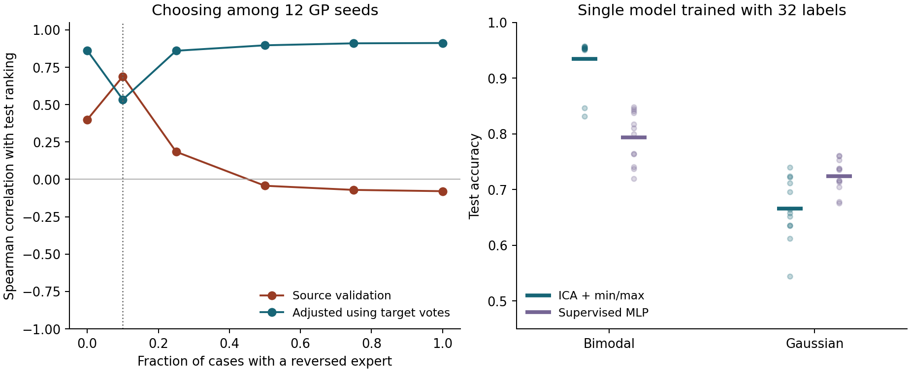

# When do we need an ensemble?

This research branch investigates two possible functions of an ensemble. Its members can expose a change in operating conditions through their disagreements. They can also expose factors that a single predictor could learn to combine. The experiments below isolate those functions in different generators.

## What can one network preserve?

| Goal | Sufficient structure or observed outcome |
|---|---|
| Reproduce every binary top-1 decision | The equal-weight average of two probabilities σ(a) and σ(b) is above one-half exactly when a+b>0. If their logits are affine in common raw features, average their coefficients and deploy one affine threshold. On 54,360 pair–record comparisons from Spambase and UCI HAR, all decisions agreed. Probabilities differed, with RMSE up to 0.091 on the selected pairs. [Proof, counterexamples and source-model controls](binary-pair-decisions/README.md) |
| Reproduce the full probability vector exactly | For a stacker trained on centered log probabilities of affine softmax experts, the classwise normalization terms cancel and the remaining affine maps compose. On handwritten digits the largest discrepancy was 1.23×10⁻¹⁵. A full classifier trained on the original labels still had better Brier loss on every fold. [Exact compilation](compiled-views/README.md) |
| Approximate an arithmetic probability pool with a smaller model | Related sigmoid units can be grouped into a single hidden layer. The within-group logit variance bounds the probability error on each input. On 16 weak-signal banks four merged units had probability RMSE 0.00044, versus 0.01605 keeping four high-weight candidates. For eight distinct directions, four merged units had RMSE 0.104 and the width selector retained all eight. [Width study and error guarantee](width-certificate/README.md) |
| Know when multiclass probabilities or labels are preserved | An affine softmax parameters-only average has a total-variation bound derived from the dispersion of class-relative source logits. It has the same sharp constant for any number of classes. On overlapping HAR views the predicted class always agreed, but the proof guaranteed TV≤0.05 for only 0.16% of cases. [Proof, empirical coverage and public sklearn interface](softmax-certificate/README.md) |
| Learn a raw-input model when provider parameters are unavailable | In a controlled faulty-sensor task, one learned input cap and a linear skip gave 93.36% versus 93.59% Bayes and 92.90% direct linear classification. The gain disappeared when the fault was removed. A separate real HAR study found that a single MLP retained 22 of 33 ensemble repairs and introduced 34 new errors. [Controlled mechanism](bounded-evidence/README.md) · [Real raw-feature test](real-transfer/README.md) |

A competitive single model matters before claiming that any ensemble improvement transferred. On disjoint Spambase views the selected two-member pair reached 89.58% accuracy versus 83.93% for the validation-selected member, but a single log-transformed logistic classifier reached 93.92%. Also check the requested deployment output and actual cost. A model preserving the winner may return different probabilities. On one CPU, verifying a multiclass winner and falling back to the full pool beat a simpler check of individual expert unanimity in only one nonduplicate workload. [Binary comparisons](binary-pair-decisions/README.md) · [Measured inference costs](softmax-routing/README.md)

## Selecting across search seeds

We fitted 12 independent OKAPI trees to the same 384 cases for each dataset. One expert reversed its prediction in 10% of the source cases. We varied that frequency on the test population while keeping the six other experts and the labels fixed within each counterfactual pair. The confirmation used eight new data draws and twelve new search seeds per draw. Brier here is the mean squared error of the positive-class probability.

| Operating condition | Ordinary validation | Selection adjusted to target | Best available in hindsight |
|---|---:|---:|---:|
| 50% reversals, test Brier | 0.17827 | 0.16105 | 0.15973 |
| Excess over best available | 0.01854 | 0.00132 | 0 |

With 256 labeled validation cases the mean Spearman correlation of validation with test was 0.688 at source prevalence and −0.043 at 50% reversals. Even a large source reference fell from 0.994 to −0.027. A longer validation sample estimates the source ordering more accurately. That ordering can change at deployment.

For a tree with condition-specific losses R₀ and R₁, the slope of its risk under a prevalence shift is R₁ − R₀. Trees with similar source scores can have very different slopes. Mean absolute prediction change under a controlled perturbation of the affected expert predicted the rank of those slopes (mean Spearman 0.816). Counting occurrences of that expert gave 0.035. In one illustrative pair, giving the unreliable expert twice the weight changed source Brier by 0.00056 and shifted Brier by 0.051.

The adaptive selector estimates the target mixture from 512 independent, unlabeled target examples and source validation context identifiers using pairwise expert disagreements. It reweights the two source validation losses and deploys one existing tree. It improved over ordinary validation in all eight held-out draws at 50% reversals. Mean paired improvement was 0.0172, with a 95% t interval of 0.0070 to 0.0274. At unchanged prevalence it cost 0.00036. The synthetic shift is a mixture of two known conditions with stable conditional distributions. New failure modes, invisible contexts or changing conditional risks require separate evidence. [Protocol and per-condition results in Polish](seed-selection-pl.md)

How many expert comparisons does the selector actually need? We picked one pair using only the largest observed change in its rate of disagreement between the two source conditions. On each target example this observer emits a single bit. On the original confirmation bank at 50% reversals, excess Brier was 0.00148 using the bit, 0.00132 using all 21 pairwise disagreement rates, and 0.01854 using ordinary validation. A follow-up resampled unlabeled target inputs and an additional source sample with context annotations. It kept the trees, their labeled conditional loss estimates and the test set fixed. Excess Brier was 0.00111 for one pair, 0.00073 for all pairs, and 0.01547 for the unstable expert's mean score. In the balanced simulator, reversing that expert leaves its individual score distribution unchanged in the population, but changes its relationship to other experts. The extra bit is used across a batch to select a tree. It does not perform the example-level classification.

## Learning one circuit from raw inputs

We also removed the source ensemble and concept supervision entirely. In a synthetic model with four randomly mixed independent factors, we fitted independent component analysis (ICA) to 4,096 unlabeled inputs. A small labeled sample selected a signed min/max rule from 1,144 read-once Boolean functions. The resulting classifier takes raw inputs through one affine projection and min/max operations. A lookup table and generic classifiers control for the advantage conferred by the representation or function class alone. Each seed fits anew and tests on independent examples at its own rotation.

| TwoPathways, 32 task labels, 12 rotations | Single ICA circuit | Supervised MLP |
|---|---:|---:|
| Independent bimodal factors | 93.5% | 79.4% |
| Isotropic Gaussian factors of matched covariance | 66.6% | 72.4% |

The bimodal distribution makes directions identifiable up to permutation and sign. With Gaussian factors, every orthogonal rotation has the same unlabeled distribution. Changing only the task to XOR exposes the second assumption. With 128 labels and bimodal factors, the circuit reached 71.1% while a table over the recovered coordinates reached 94.4%. A compact rule helps when both the factors and their composition are learnable under the available supervision. This is a controlled use of established ICA and logic induction. [ICA identifiability and algorithms](https://doi.org/10.1016/S0893-6080(00)00026-5)

A follow-up fixed a model-selection rule before testing on twelve additional rotations. It checks whether two independent halves of the unlabeled sample yield consistent ICA axes. When they do, description length trades the cost of a compact circuit against the cost of a 16-cell truth table. When axes are unstable, it falls back to an RBF classifier. The procedure accepted all twelve bimodal cases, falsely accepted one of twelve Gaussian cases, and selected the table on eleven of twelve bimodal XOR runs with 32 labels. On bimodal TwoPathways it chose the compact circuit on all twelve runs and reached 95.7%. Across the six fixed combinations of distribution and task, the gain over a 75/25 holdout selector at 32 labels was 3.54 points (paired 95% interval 2.07–5.00). At 128 and 512 labels, intervals included zero. The adaptive fallback can deploy a kernel model or a lookup table. The single-network interpretation applies to runs that selected the circuit. The archive contains an example of the fitted raw-input circuit as portable JSON.

## Transferring a property of a fitted ensemble to a single MLP

A separate generator supplied three sensor views. A bounded search over six rules in the FusionBench/OKAPI operator language recovered a symmetric pair of inputs. We used the symmetry to exchange the two raw views during supervised training. We also used the rule's distributivity to train on two repeated-view inputs with a shared label loss. A single MLP runs once at inference. Expert scores, weights and soft targets are absent from its optimizer. View grouping and source-side orientation information are supplied in this experiment.

On eight new seeds with reversed sensor polarity and zero rescue positives in target training, accuracy rose from 82.81% for a flat MLP to 87.95% for an equal-compute three-view swap control and 92.57% for the transferred loss. The wrong min reduction reached 90.81%. The correct reduction improved over the equal-compute swap control by 4.61 percentage points (paired 95% interval 4.18–5.04). Some gain comes from training on duplicated views. The expert ensemble reached 93.59%. A plain MLP trained on the original 1,536 balanced source task labels reached 92.57%.

Across 12 fresh rotations of the rescue view a 57-parameter MLP with this training rule reached 90.64%, against 81.90% for the same architecture trained conventionally. A three-logistic-expert ensemble with only 15 trainable parameters reached 93.53%. This generator favors linear concept detectors. The single student eliminated expert calls but carried more parameters than the strongest simple baseline. An unannounced reversal at deployment cut the 141-parameter aligned model to 72.6%, below 81.8% for the plain model. Symmetry discovery and augmentation both have earlier precedents. [InstaAug](https://proceedings.mlr.press/v202/miao23a.html) · [LieGAN](https://proceedings.mlr.press/v202/yang23n.html)

## Other controls and benchmark additions

- **Search variance and compute.** Four scenarios crossed data seeds with GP seeds. Across eight confirmation data seeds, selecting from four restarts on a held-out set gained 1.39 macro-F1 points over selecting by train score. The advantage over spending all 480 labels on fitting was 0.28 points, with a paired interval of −1.10 to +1.67. Archiving four populations of one long trajectory explained part of the apparent restart advantage. Compact selection reduced 12.09 nodes to 6.13 with mean IID macro-F1 falling from 0.7766 to 0.7652. [Full search protocol and estimates](search-stability.txt)
- **Probability calibration.** A single held-out coefficient blends one GP tree with the mean. Over five synthetic scenarios it improved average IID Brier in four and tied in one with macro-F1 search. For GatedExperts, Brier changed from 0.352 to 0.340, while direct Brier optimization already achieved 0.321. The same calibration worsened Compound under weaker detectors. Choose the search objective before assessing the value of postprocessing.
- **Attribution and acquisition.** Duplicating a max leaves the function intact. Individual bypasses in that representation each found zero changes. Joint bypass restored about 857 repairs and 168 harms per test split. In a separate 20-seed acquisition test with 256 labels, stratification over all four equivalent encodings yielded 77.0% balanced-test accuracy, simple expert vote patterns 79.4%, and random selection 75.5%. A node's local bypass effect depends on how the computation is written. [OKAPI interventions and experiments](https://github.com/damiankucharski/OKAPI/tree/research/ensemble-mechanisms-stability/experiments)
- **Routing as privileged information.** In the reconstructed two-expert design we derived the best hidden-input policy under a specified collateral-error budget. Raising selector accuracy from 0.75 to 0.92 increased ensemble repairs from 142 to 353 per 10,000 cases. At the same 1% collateral budget, optimal recoverable repairs using the student's inputs fell from 47 to 29. This limit concerns the available information in this generator.
- **External predictions.** The new evaluate command accepts independent saved fit and test predictions and reports results without requiring an oracle. On one held-out split of 450 real handwritten digits, macro-F1 was 0.9799 for a logistic stacker, 0.9753 for averaging and 0.9730 for OKAPI. This is a portability check on one dataset and split.
- **Same-seed isolation.** Interleaved optimizers now have separate random streams. The eight-generation single-run sequence on explicitly ordered inputs matched the previous implementation exactly. This engineering change addresses interference between concurrent or interleaved runs. The experiments above measure score differences across distinct, valid search seeds.

[Raw measurements, per-seed estimates and configurations](results.zip) · [Reproduction commands](reproduce.md)
