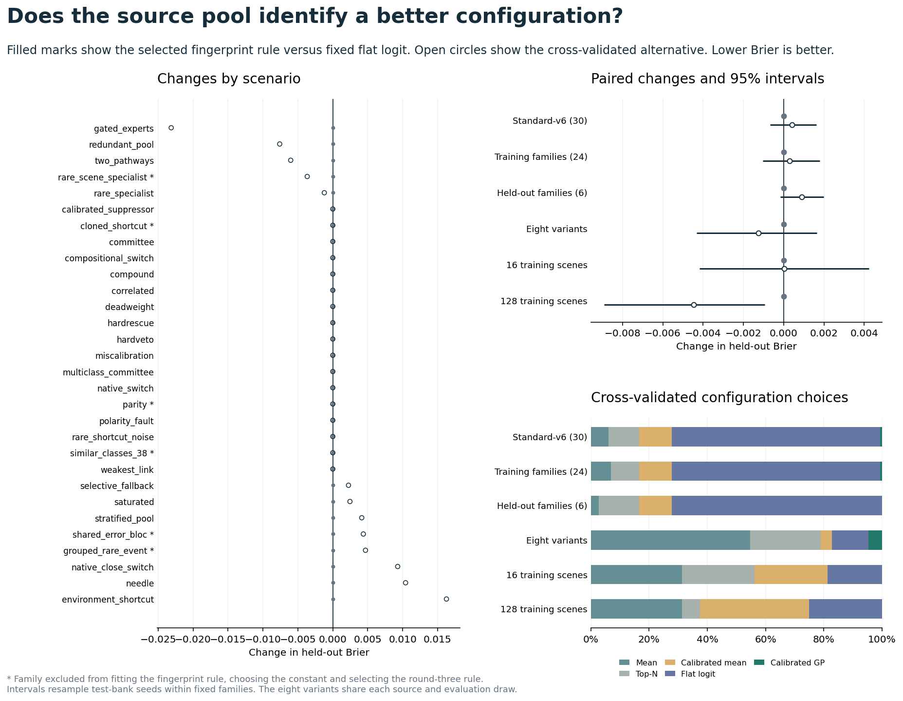

# Can the training predictions tell OKAPI how to fuse them?

Two decisions come up when fusing a new set of models. Do the models differ in quality, do they make the same mistakes, and does one of them rescue the others on particular examples? Given those observations, should we average all the models, keep a subset, or fit a more expressive rule? These three rounds tested the two decisions separately. Every method saw the same training predictions and labels. Test predictions and labels were reserved for scoring.

## Which characteristics were visible?

We generated the same 16 training scenes under eight combinations of unequal model quality, shared error, and specialization on a minority of scenes. For each of eight independent draws we used the other seven to set a threshold for a single measurement, then classified the held-out conditions. Disagreement identified shared errors in 54 of 64 conditions. The spread of individual Brier losses identified unequal quality in 44 of 64. The gap between the best fixed provider and the best provider chosen separately after seeing each label identified local specialization in 32 of 64, equal to chance. This last measurement can reward a lucky prediction on a noisy label. [Matched results and limits](r1-fingerprint.md)

## What did the configuration helper choose?

The candidate set ran from the arithmetic mean and training-ranked Top-N through a temperature-calibrated mean, a single regularized native logit head and a calibrated, mean-seeded GP tree. The head fits its coefficients without gradients. The GP penalizes departure from the mean during search. Two further OKAPI references and probability logistic stacking competed outside that candidate set. The earlier native-pattern reference compares a GP shortlist and native heads using a held-out part of the fusion-fit bank. [Candidate definitions](protocol.md) · [Implementation](../../../fusionbench/methods/auto_configuration.py)

**Round 1.** Offline we taught a shallow decision tree to minimize test Brier on *previously simulated training tasks*. The tree could use eight measurements from each task's source bank. We gave 24 scenario families equal weight and withheld six whole families. Both sides of every permissible first split still favored the regularized logit head. The resulting one-leaf rule always selects that head. This hides real exceptions. On the disappearing-shortcut scenario the arithmetic mean scored 0.48186 against 0.69425 for the head. On gated experts, Top-N scored 0.32502 against 0.35498. [Frozen rule, leave-one-family-out check and examples](configuration.md)

**Round 2.** We compared the frozen rule to choosing on the new task itself. For each of five candidates, three-fold cross-validation produced a prediction for each row using a fit that had never seen that row. All rows from one scene stayed together where scene IDs were available. The rule took the simplest action within one paired standard error of the lowest out-of-fold Brier, then fitted it anew on every source row. On the 24 development families, Brier was 0.27460 for the fixed head and 0.27482 for this adaptive rule. The protocol carried the fixed head forward. The difference of 0.00022 determined which rule to confirm and gives little evidence about their relative performance. [Round 2 decision](selection.json) · [Verified public API replay](results/r2-public-replay.json)

## What held up on fresh draws?

**Round 3.** On 180 fresh standard banks (six per scenario), the selected rule again returned the fixed head on every bank. Its Brier change against the fixed head was exactly zero, both across all 30 scenarios and on the six families excluded from fitting and rule selection. The primary endpoint failed. The best *observed* test action among the five scored 0.25698. That retrospective gap of 0.00934 includes finite-test selection optimism. The stronger historical native-pattern reference scored **0.24208**, better even than that five-action hindsight comparison. Its search space includes evolved subtrees with native logit heads. [All scenarios](results/r3-families.csv) · [Registered endpoints](results/confirmation.json)

| Method | Brier, all 30 ↓ | Macro-F1 ↑ | Mean providers used |
|---|---:|---:|---:|
| Arithmetic mean | 0.37306 | 0.69729 | 9.83 |
| Ranked-prefix Top-N | 0.35287 | 0.70991 | 4.05 |
| Logistic stacking on probabilities | 0.26950 | 0.75909 | 9.83 |
| Regularized logit head, also the selected rule | 0.26632 | 0.75506 | 9.83 |
| Group-aware cross-validated choice | 0.26673 | 0.75658 | 9.02 |
| Ordinary full-data constructive GP | 0.37421 | 0.68941 | 2.16 |
| Calibrated mean-seeded GP with prediction penalty | 0.32036 | 0.71772 | 4.33 |
| Historical native-pattern OKAPI, eight GP finalists | **0.24208** | **0.78630** | 9.14 |

For the logit head minus logistic stacking, the paired Brier difference was −0.00318 (95% interval −0.00425 to −0.00216). The alternative CV rule differed from the fixed head by +0.00041 (−0.00067 to +0.00162). It selected the head 129 times, the calibrated mean 20, Top-N 19, the ordinary mean 11, and the calibrated GP once. Cross-validation evaluated 15 action/fold combinations, averaging 0.218 seconds per bank before the selected all-row refit on this machine. [Paired comparisons](results/r3-contrasts.csv) · [Selection frequencies](results/r3-actions.csv) · [Complexity, timing and binary AP](results/r3-configuration-costs.csv)



### When is simpler fusion warranted?

On the weak-specialization control, where 128 balanced source examples offered little evidence for preferring one provider, CV chose the mean on 14 of 16 banks and Top-N on two. Brier improved from 0.50177 for the fixed head to 0.48376 (change −0.01800, 95% interval −0.02451 to −0.01275). The ordinary mean scored 0.48188. On gated experts, CV chose the winning Top-N on all six draws (0.32549 against the head's 0.34862). On the scarce 16-scene control the CV change was +0.00003 (−0.00418 to +0.00422). On the panel crossing shared errors, model quality and a rare specialist it was −0.00125 (−0.00431 to +0.00164). Sixteen independent seeds contribute to each of these supplementary comparisons on controls. [Controls and family results](results/r3-levels.csv) · [Grouped comparisons](analysis.md)

On the disappearing-shortcut scenario, both configuration rules selected the logit head. Test Brier was 0.66905, against 0.46964 for the ordinary mean, which won on all six draws. Here the generator increases the specialist region from 5% to 50%, removes the source shortcut, and starts flipping provider votes on the target. This single scenario accounts for about 71% of the total five-action hindsight gap to the fixed head on the standard panel. For CV overall, assigning its choices randomly across the 180 banks worsened Brier by 0.02514. Restricting reassignment to different seeds of the same scenario changed it by just 0.00004 (95% interval −0.00036 to +0.00041 for random minus actual). Most of the measured benefit of matching choices to banks can therefore be explained by differences **between scenario families**. [Action reassignment control](results/r3-action-mix.csv)

### A limit that more source data cannot remove

We paired 16 identical training banks and identical test predictions with two possible target laws. In one law a single provider gives the true event probability. In the other law the mean does. Top-N and mean each achieved zero expected excess Brier in its own favorable world and lost 0.09023 in the other. No training-only measurement can tell these particular target laws apart. Completing the square gives an irreducible average excess of 0.02250 in the population and 0.02256 on the sampled test inputs. The frozen head paid 0.05037 and CV paid 0.04668. This control isolates a change of target law. It does not attribute stationary failures to drift. [Derivation](banks.md) · [Checks on all paired forecasts](results/r3-witness-summary.csv)

**Next question.** For the stronger native-pattern OKAPI, does a simple subset earn enough *repeatable* advantage across independent training scenes to justify switching away from its usual search? The two informative contrasts are gated experts, where the subset advantage is visible on the source, and the disappearing shortcut, where every source-fold choice trusted the same unreliable relation. One testable extension would measure stability of the gain under prespecified, plausible changes in how source scenes are weighted. It would need a stationary control, an explicit assumption about admissible reweightings and a fresh confirmation against the native-pattern reference.

The three model-fitting and scoring runs took 46.1, 66.2 and 91.4 seconds on three CPU workers. In order, the 216, 186 and 404 sampled conditions produced 1,728, 2,232 and 4,848 method scores. They include matched variants of the same draw. End-to-end durations between registration, policy lock and selection lock were 191 and 109 seconds for the first two rounds. Round 3 took 200 seconds from selection lock to the checked report. Independent verification reconstructed all three cheap controls on every bank, reran the selection rules from source data, and checked 1,616 routed forecast pairs in round 3. [Round 1 verification](results/verification-r1.json) · [Round 2](results/verification-r2.json) · [Round 3](results/verification-r3.json)

## Using and reproducing the result

With FusionBench and its optional OKAPI dependency installed from this research revision, use the helper directly on a new classification task. The inputs are aligned base-model probabilities, training labels and optional independent scene IDs. Inspect the selected action before interpreting its test score. [API example and dependency](../../site/okapi.md)

```python
from fusionbench.methods.auto_configuration import ConfiguredOKAPI
from okapi.pool_diagnostics import pool_fingerprint

measurements = pool_fingerprint(train_probabilities, train_labels, groups=train_scene_ids)
model = ConfiguredOKAPI(policy="source_cv").fit(
    train_probabilities, train_labels, task="binary", n_classes=2, groups=train_scene_ids
)
print(measurements["disagreement"], model.action_, model.selection_["oof_brier"])
probabilities = model.predict(new_probabilities)
```

The fingerprint also works without scene labels. To apply the frozen rule from this study, pass the value of the `policy` key in [the archived JSON](results/r1-policy.json) to `ConfiguredOKAPI`. The experimental choice targets Brier. Metrics like macro-F1 need their own selection experiments. One optimizer seed was used throughout. The intervals describe variation between fresh simulated data draws on these fixed scenarios.

From a checkout of this branch with its pinned optional dependency, use the following commands in order. The runner checks the committed policy before round 2 and the committed selection before round 3. The raw tables include SHA-256 digests of inputs and forecasts. Timing fields vary by machine.

```sh
export PYTHONPATH=.
export OPENBLAS_NUM_THREADS=1 OMP_NUM_THREADS=1 MKL_NUM_THREADS=1
study=docs/ensemble-study/autoconfig-three
python "$study/run_auto.py" 1 --workers 3
python "$study/summarize_auto.py" 1
python "$study/feature_recovery.py"
python "$study/router_study.py" train
python "$study/run_auto.py" 2 --workers 3
python "$study/summarize_auto.py" 2
python "$study/decide_auto.py" lock
python "$study/run_auto.py" 3 --workers 3
python "$study/summarize_auto.py" 3
python "$study/decide_auto.py" confirm
python "$study/witness_auto.py"
for round in 1 2 3; do
    python "$study/configuration_costs.py" "$round"
    python "$study/verify_auto.py" --round "$round"
done
python "$study/verify_configured.py"
python "$study/plot_auto.py"
```

[Protocol fixed before data generation](https://github.com/damiankucharski/fusionbench/commit/44d72ca149fb0bbc458b9ff0538bad952c4eda38) · [Round 1 policy lock](https://github.com/damiankucharski/fusionbench/commit/046b6e2) · [Round 2 selection lock](https://github.com/damiankucharski/fusionbench/commit/f056878) · [Native OKAPI implementation](https://github.com/damiankucharski/OKAPI/commit/5707500fd5cf8b199ce3d1f201e63af8b1dec0f7)
