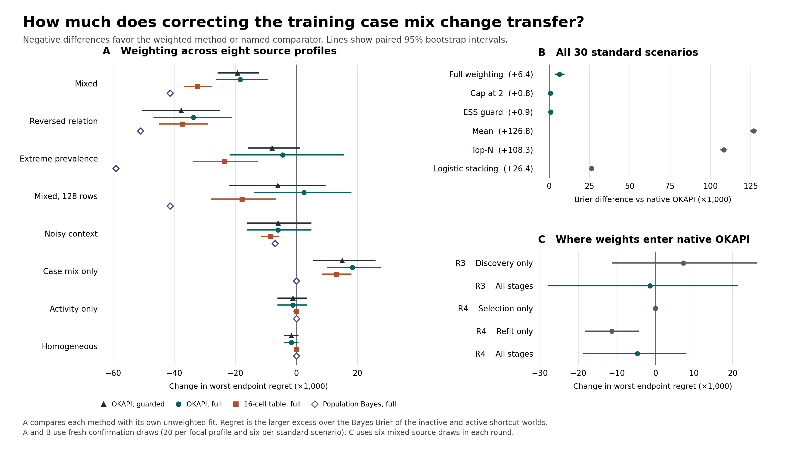

# Changing the fitness of an OKAPI tree when source environments differ

In a two-environment training bank, a shortcut can appear especially reliable on examples a genuine specialist already handles well. A tree trained on pooled rows can learn that association. The next site may have the same kinds of cases and the same providers, yet lack the association. The last experiment found that weakening one provider after training could recover little of the available accuracy. Here we changed the loss used **while evolving, selecting and refitting the tree**. The deployed predictor is still one native tree. [Previous experiment](../provider-use-ten/README.md) · [Protocol and seed schedule](protocol.md)

## What held up on new data

**The locked policy improved the primary transfer metric.** Across 20 fresh mixed-source draws, maximum regret fell from 0.08690 to 0.06762, a reduction of **0.01928** [0.01231, 0.02582]. Reversing which environment held more specialist cases gave a reduction of 0.03770 [0.02499, 0.05046]. However, changing *only* the proportion of specialist cases raised maximum regret by 0.01501 [0.00553, 0.02587]. The mixed and case-mix-only sources had **identical training weights in all 20 matched draws**. The difference between those two results cannot be diagnosed from the distribution of the weights alone. [Locked tests](results/confirmation.json) · [Source-profile comparisons](results/r10-profile-pairs.csv)



### Four preregistered tests

| Test vs ordinary native OKAPI | Paired change [95% interval] | Decision |
|---|---:|---|
| Mixed maximum regret | −0.01928 [−0.02582, −0.01231] | Improvement confirmed |
| Macro Brier across the 30 standard scenarios | +0.00089 [−0.00037, +0.00224] | Within +0.005 margin |
| Case-mix-only source, 80% specialist cases at deployment | +0.01232 [+0.00195, +0.02494] | Exceeds +0.010 margin |
| Mixed source, shortcut absent at deployment | +0.00949 [−0.00051, +0.01941] | Upper bound exceeds +0.010 margin |

Brier on the mixed target with the shortcut active improved by 0.02006; the largest possible regret in the two worlds therefore decreased despite the deterioration at the other endpoint. The independent standard comparison used **30 distinct scenarios with six fresh draws each**. Native was strongest on this aggregate. The standard delta from full unrestricted weighting was +0.00636 [0.00344, 0.00956]. Across sources with measured metadata, the evidence supports a correction when shortcut reliability is coupled with case mix. Its performance on a valid specialist and its cost under a vanished shortcut argue against making this the default. [All method contrasts](results/r10-contrasts.csv) · [Standard family breakdown](standard.md)

| Method | Standard Brier | Mixed max regret | Shortcut absent | Shortcut active | Specialist-rich target¹ |
|---|---|---|---|---|---|
| Regularized native-pattern OKAPI | 0.24912 | 0.08690 | 0.26886 | 0.19478 | 0.14402 |
| Effective-count rule (locked) | 0.25001 | 0.06762 | 0.27835 | 0.17472 | 0.15634 |
| Cap raw weights at 2 | 0.24987 | 0.06762 | 0.27835 | 0.17472 | 0.15634 |
| Full weights | 0.25548 | 0.06847 | 0.28957 | 0.16963 | 0.15839 |
| Logistic stacking | 0.27550 | 0.11727 | 0.34779 | 0.21390 | 0.21660 |
| Ranked-prefix Top-N | 0.35747 | 0.16072 | 0.36825 | 0.26457 | 0.26924 |
| Arithmetic mean | 0.37592 | 0.19572 | 0.40756 | 0.30466 | 0.32108 |

¹ Stable shortcut activity and varying regional prevalence at training. At deployment 80% of the target cases are in the specialist region. The other three focal columns report the mixed training design.

| Source profile | Mean effective fraction after weighting | Native max regret | Locked max regret | Paired difference [95% interval] |
|---|---|---|---|---|
| Both source characteristics vary | 71.7% | 0.08690 | 0.06762 | -0.01928 [-0.02582, -0.01231] |
| Opposite source association | 71.8% | 0.10564 | 0.06794 | -0.03770 [-0.05046, -0.02499] |
| Very little overlap | 82.3% | 0.10784 | 0.09987 | -0.00797 [-0.01586, +0.00117] |
| 128 training rows | 71.7% | 0.11557 | 0.10944 | -0.00612 [-0.02207, +0.00960] |
| 25% context-label errors | 88.4% | 0.08690 | 0.08090 | -0.00600 [-0.01604, +0.00494] |
| Only case mix varies | 71.7% | 0.05465 | 0.06966 | +0.01501 [+0.00553, +0.02587] |
| Only shortcut activity varies | 99.8% | 0.05638 | 0.05518 | -0.00120 [-0.00622, +0.00343] |
| No systematic source change | 99.8% | 0.05890 | 0.05723 | -0.00167 [-0.00416, +0.00066] |


The uncertainty shown above is over fresh training draws within each prespecified design. Source profiles that share a seed are paired. Each focal comparison computes the exact target risk of its fitted tree, which still varies with training data and anonymous provider order.

### What changed in the errors?

At the always-active mixed target, the locked policy reduced the squared error of the **mean forecast** by 0.02178 Brier and increased the across-source variance by 0.00172. With only case proportions changing, on the specialist-rich target the same policy added 0.01232 Brier. Of that deterioration, 0.00894 came from additional variance [0.00351, 0.01389], and 0.00339 from the mean forecast. These are fixed-target decompositions of Brier across 20 draws. They pinpoint a systematic correction in one world and a variance cost in another. [Bias and variance by world](decomposition.md) · [Numerical components](results/r10-decomposition.csv)

As a separate finite-sample control, we learned a probability for each of the 16 observed report patterns from its training labels, applying a half-positive, half-negative prior. All 16 patterns occurred in each of the final focal training banks. On mixed sources, weighting this table reduced maximum regret from 0.08985 to 0.05737. With the same full weights, native OKAPI scored 0.06847; the table's advantage was 0.01111 [0.00324, 0.02089]. On case-mix-only draws the weighted table itself lost 0.01300 [0.00835, 0.01806] against the unweighted table. This shows both a remaining opportunity for native fitting on the discrete benchmark and a cost of weighting even for a method with no tree search. The 16-pattern estimator relies on repeated discrete inputs; it gives no performance guarantee on continuous provider reports. [Paired table controls](results/r10-support-contrasts.csv)


## What changes in a real fit?

For a binary example, a provider reports a probability that the class is positive. In the focal generator four providers report a generalist's vote, a specialist's vote, a cue about the specialist's region, and a sometimes-reliable shortcut's vote. The fitting procedure sees these reports in anonymous order. In the mixed source, 15% of one environment and 85% of the other are specialist cases. The shortcut is uninformative in the first environment and 90% accurate in the second. Averaged over training, half the cases belong to the specialist region. Comparing methods on a single source model means varying only the training objective or stage specified for that comparison.

Full weighting gives each observed environment the same empirical proportions of specialist and other cases. For a row in environment e and observed context c, the weight is P(e)P(c)/P(e,c), estimated from source counts without class labels. With precisely the population proportions above, an underrepresented row gets weight 3.33 and an overrepresented row gets 0.59. All labels are retained. Their population weight concentration corresponds to an effective count of about 261 rows out of 512. Actual uncertainty also depends on the outcomes and on correlations among examples. Clipping each raw weight at 2 before normalization reduces concentration and yields partial balance. The guarded policy chooses between full weights, clipped weights and ordinary weights using an effective fraction threshold of 65%. Any joint cell with fewer than four observations triggers the uniform fallback. This diagnostic quantifies weight concentration; correlated examples can contain less independent information. [Source estimator](https://github.com/damiankucharski/OKAPI/blob/f3350064c3f39d3bf8eaa7dd5c068e0c35849c0a/okapi/case_mix.py)

The full procedure evaluates empirical weighted Brier throughout discovery, validation and refitting. GP still uses its original rounded tournament score. Shortlisting and validation use unrounded losses. The original 70/30 discovery and validation split, eight-program shortlist and regularized head objective remain in place. The weighting changes the data term. The L2 feature-variance scaling uses its ordinary source estimate in every comparison. The GP family retains its winning discovery tree, while the flat and augmented heads have a final all-source fit. No environment or context metadata are required at inference. Only synthetic cases were evaluated, at one GP random seed with fresh data seeds. [Native implementation](../../../fusionbench/methods/native_pattern.py) · [Weighted GP selection](../../../fusionbench/eval/seed_geometry_standard.py)

## How to read the two risks

The targets where the shortcut is absent and always active have oracle full-class Brier values of 0.23217 and 0.10895. For each trained tree we compute its excess over the appropriate optimum in each world, take the larger excess and then average over training draws. Lower **maximum regret** means a better compromise. We also report Brier in each world since this compromise can improve one and hurt the other. The target with 80% specialist cases separately tests the cost to a stable specialist. The standard result averages equally over the 30 fixed standard-v6 families. These families generally have no measured acquisition environments. The stress test there constructs two groups from provider disagreement and two strata from consensus confidence using only training reports.

With the data-generating laws known, full weighting on the mixed source produces exactly the half-active target joint distribution. Its Bayes predictor has maximum regret 0.04194, versus 0.08328 for the predictor optimal on the unweighted mixed source. A predictor expressly minimizing the worst regret across both endpoint laws achieves 0.03568. These are population calculations. Fitting a finite tree introduces sampling and search error, and most real deployments do not supply the target law. [Derivation, including clipping and noisy metadata](population.md)

## The ten rounds

Each round included the complete standard panel and all three inexpensive baselines. Each comparison below uses matched data and optimizer settings within that round. Early focal experiments have six paired draws per profile. Signs for differences refer to weighted minus ordinary native Brier or maximum regret.

| Round | Comparison | Finding |
|---:|---|---|
| 1 | Start with mixed case proportions and shortcut activity | Full weighting reduced maximum regret by 0.03005 [0.02445, 0.03543] and changed the discovery path on 6/6 draws. Standard macro Brier increased by 0.00413. |
| 2 | Shuffle environment assignments, keeping reports and labels | With real IDs, the mixed maximum-regret change was −0.00026 [−0.02822, +0.02565]. With shuffled IDs the change was +0.00423 [+0.00060, +0.00847]. |
| 3 | Reverse which environment contains more specialist cases; compare full and discovery-only weighting | On reversed sources full weighting reduced maximum regret by 0.05026. Full versus discovery-only used identical discovery paths and gained a further 0.02865 [0.00664, 0.04592]. Mixed sources showed a much smaller difference on these draws. |
| 4 | Isolate finalist selection and final parameter fitting | On the six mixed draws, weighting only finalist selection exactly preserved the ordinary predictions. Weighting only the final refit preserved the discovery path but changed all six fitted programs. It improved maximum regret by 0.01132 at a cost of 0.01851 Brier when the shortcut disappeared. |
| 5 | Stress poor overlap (3.5% versus 96.5% specialist cases) | Full weights gave an average effective fraction of 13.2%. Clipping at 2 raised it to 81.6%. The six-draw intervals for all three clipping levels included zero for maximum-regret differences. |
| 6 | Train on 128 rows | On these six small sources every joint cell still met the four-row minimum. The maximum-regret contrast for cap2 was +0.01568 [−0.03206, +0.06288]. Sufficient counts to compute a weight do not guarantee a useful fit. |
| 7 | Corrupt 25% of context metadata, holding labels and provider scores fixed | Full weighting improved maximum regret by 0.00773 on the mixed source and by 0.00168 with a corrupted cue. The paired difference in effects was +0.00605 [+0.00054, +0.01449]. |
| 8 | Shuffle the weight vector, preserving its effective count | In the mixed design full weighting changed maximum regret by −0.00530, while shuffling those same weights raised it by 0.01168 [+0.00353, +0.01946]. |
| 9 | Lock one rule without seeing confirmation draws | Guarded and cap2 tied on the mixed source at 0.06944 and both met the selection margins. Full weighting exceeded the standard +0.005 margin at +0.00653. The registered tie order selected guarded. |
| 10 | Independent confirmation with eight controlled training profiles and all 30 standard scenarios | The results and all four frozen tests appear above. |

The focal target priors and the scenario identity were available to the evaluation code alone. Capped weights are clipped *before* final normalization, so individual final weights may exceed the numerical cap. The guarded rule chooses a correction solely from concentration. It does not test whether the relationship between provider errors and classes really changed across environments. [Stage contrasts](results/r04-stage-pairs.csv) · [Weight diagnostics](results/r10-weights.csv) · [Round-nine lock](https://github.com/damiankucharski/fusionbench/commit/2f1e7b50524102c4f14224ab9c8ac2e88ae36f87)


## The next question

The environment/context counts can indicate whether a correction can be estimated precisely. They cannot indicate whether a correction is warranted: the mixed and case-mix-only draws in this study have identical counts and opposite effects. A source-only next experiment could use the earlier context-adjusted diagnostic for *changes in provider reliability within comparable cases*, and enable weighted refitting or search only when that evidence reproduces across training environments. It would need matched null cases, equal weight vectors, unreliable context labels and the complete standard panel. Reusing all labels in both screening and tree selection can itself create an optimizer's curse; the same train-only rule must be locked before confirmation. There are no real STARCOP or MedMNIST results in this series.

## Reproduction

Install the pinned optional dependency from the FusionBench research checkout with `pip install '.[okapi]'`. The native estimator lives in the OKAPI research branch. The fit runner uses at most four CPU workers and deduplicates identical weight/stage fits within a bank. Scores, source traces, validation choices, discovery path fingerprints, selected program fingerprints and prediction hashes are retained. A program fingerprint includes its operator parameters. A changed discovery path means that the *ordered set of distinct programs visited* changed. Some selected program changes can leave measured predictions unchanged.

```sh
export PYTHONPATH=. BACKEND=numpy OKAPI_LOG_LEVEL=ERROR
export OPENBLAS_NUM_THREADS=1 OMP_NUM_THREADS=1 MKL_NUM_THREADS=1
study=docs/ensemble-study/case-mix-ten
python "$study/population.py"
for r in 1 2 3 4 5 6 7 8 9 10; do
    python "$study/run.py" "$r" --workers 4
    python "$study/support_control.py" "$r"
    python "$study/analyze.py" "$r"
    python "$study/verify.py" "$r"
done
python "$study/decompose.py"
python "$study/plot_results.py"
```

Round ten verifies the committed ninth-round selection and raw score hash before training. The standard-panel intervals resample seeds within each fixed scenario. The focal intervals resample paired source draws, reusing each fitted model across four analytically scored test distributions. Both use 10,000 bootstrap replicates. The effective counts reported for actual grouped scenes aggregate the source weights by scene before measuring their concentration. Such counts describe how unevenly the scene totals are weighted.


The ten fitting and scoring jobs took **515.4 seconds** in total with four CPU workers, including 112.6 seconds for the final round. The interval from protocol commit to the last raw scores was 10 min 11 s. There were 1,072 training banks (750 standard, 322 focal), 2,038 source/target conditions, 3,124 native fits including stage and weighting variants, and 15,010 recorded primary method scores, apart from the frequency-table controls. Independent verification checked 792 paired intervals, 240 regenerated weight vectors and all 4,480 focal method/target risk calculations in confirmation. FusionBench's suite passed 960 tests with 11 skipped, the completed staged-weight test file passed 13 tests, and OKAPI's suite passed 925 tests with one skipped. Strict MkDocs generation, wheel construction and the documented fit example succeeded. [Confirmation audit](results/r10-verification.json) · [Statistical definitions](analysis.md)
