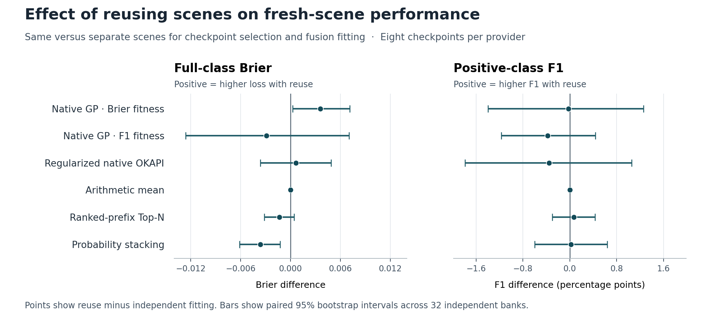

# Does choosing checkpoints on the fusion-training scenes hurt transfer?

It did for the prespecified native GP trained on Brier. Reusing the scenes made its fit loss look **0.00987 better** and its loss on fresh scenes **0.00360 worse**. The two-sided paired 95% interval for the fresh-scene difference was **+0.00027 to +0.00711**. The result does not generalize across fusion procedures: regularized native OKAPI had an inconclusive difference and probability stacking improved under reuse. Arithmetic averaging achieved the lowest fresh-scene loss in both arms. [Frozen protocol](protocol.md) · [Raw scores](results/scores.csv) · [Paired intervals](results/summary.csv)

## What the two runs share

Each of 32 banks supplies eight providers with eight correlated synthetic checkpoints each. Every checkpoint has the same individual population competence. Every fixed vector of selected slots also has the same joint population law on fresh data. Choose a checkpoint for each provider by pooled positive-class F1 on block A, then freeze those exact provider columns. Fit one fusion model on A and another on B. Swap the roles of the blocks and repeat. Fit and checkpoint selection each see 24 independent scenes with eight observations per scene. A reused run draws on 24 distinct development scenes, a disjoint run on 48. Both models see the same 256 independent audit scenes for a given choice of checkpoints. The audit has the same distribution as the source.

The outcomes below average the two swaps within a bank, then weight banks equally. Intervals resample the 32 banks together with their matched arms. The one-checkpoint control cancels exactly in each bank after swapping. Averaging also cancels exactly on audit at eight checkpoints because the mean of a frozen set of columns requires no fitting. [Generator](../../../fusionbench/scenarios/checkpoint_bank.py) · [Checkpoint choices](results/checkpoints.csv) · [Bank fingerprints](results/run.json)

## Results on fresh scenes

Full-class Brier loss is lower for better predictions. A positive difference means that using the same scenes for both stages hurt transfer.

| Fusion method | Reused scenes | Disjoint scenes | Reuse minus disjoint (95% interval) |
| --- | ---: | ---: | ---: |
| Native GP trained on Brier (primary) | 0.27137 | 0.26778 | +0.00360 [+0.00027, +0.00711] |
| Native GP trained on F1 | 0.29798 | 0.30087 | −0.00289 [−0.01262, +0.00705] |
| Regularized native OKAPI | 0.26908 | 0.26842 | +0.00066 [−0.00363, +0.00486] |
| Arithmetic mean | 0.24845 | 0.24845 | 0 |
| Ranked-prefix Top-N | 0.25536 | 0.25668 | −0.00133 [−0.00314, +0.00042] |
| Probability logistic stacking | 0.25673 | 0.26036 | −0.00363 [−0.00612, −0.00126] |



At the **provider level**, selecting from eight checkpoints lifted F1 on the scenes used for selection to 0.59231 versus 0.52911 on the opposite block, a 6.32 percentage point difference (95% interval 5.85–6.82). Compared with always taking the first slot, the selected providers gained only 0.08 points of F1 on fresh scenes (interval −0.10 to +0.25). At the **fusion level**, the Brier-trained GP's fit-to-audit gap increased from 0.03497 to 0.04844. Reuse worsened fresh-scene Brier in 20 of the 32 paired bank means. The counterpart trained for F1 lost 0.38 percentage points of fresh-scene F1 under reuse (interval −1.17 to +0.44). Fresh-scene F1 effects were inconclusive for every trainable procedure. These secondary comparisons are descriptive. [All metrics and uncertainty](results/summary.csv) · [Bank-level contrasts](results/bank-contrasts.csv)

## Did a better tree ever exist in the search?

For the Brier-trained GP we rescored all distinct visited programs on the audit after the search had finished. The best audit loss recorded among visited programs was nearly identical between arms. The gap between the deployed tree and the best remaining survivor increased. Losing useful candidates before the last generation was also possible, although the arm difference for that part was uncertain.

| Diagnostic on the same audit scenes | Reused scenes | Disjoint scenes | Paired difference (95% interval) |
| --- | ---: | ---: | ---: |
| Best loss among all visited trees | 0.26045 | 0.26040 | +0.00005 [−0.00206, +0.00216] |
| Gap from best visited to best final survivor | 0.00718 | 0.00575 | +0.00143 [−0.00052, +0.00352] |
| Gap from best final survivor to deployed tree | 0.00374 | 0.00163 | +0.00212 [+0.00069, +0.00349] |

The rows add up to the loss of the deployed tree before rounding. Hindsight minima favor larger archives through selection on a finite audit and cannot be deployed as measured. Even the best visited trees averaged about 0.012 more Brier loss than the simple mean. Thus improving the last ranking alone would still leave a substantial deficit in this search. The mean's advantage is plausible in a law where providers are equally competent with independent errors conditional on the shared signal. The experiment does not establish that the mean equals the Bayes posterior. [Generation records](results/trajectories.csv.gz)

## Interpretation and next test

The two GP probes use actual native variation and different predictive objectives. The separately reported regularized method uses an inner split by row (134 discovery and 58 validation) and may split a development scene across these subsets. Its external audit remains scene-disjoint. The two native methods answer different questions. The 32 independent banks use one search seed per bank. The intervals describe uncertainty under this generator with that assignment and do not separate search-seed from data-seed variance.

The simulator models selection among equally competent checkpoints on correlated observations. Real training can produce genuinely better epochs, and different providers can specialize on different scenes. The test establishes one route to optimistic validation without any distribution shift. A causal estimate for STARCOP would require the real checkpoint predictions, scene grouping and evaluation protocol. The setup uses one predictive objective plus tree size; the dissertation also studied other objectives. Its original STARCOP setup and final-front analysis give the motivation. [Dissertation, checkpoint selection](https://bip.polsl.pl/wp-content/uploads/sites/4/2026/11/Damian-Kucharski_rozprawa-doktorska.pdf#page=109) · [Final-front comparison](https://bip.polsl.pl/wp-content/uploads/sites/4/2026/11/Damian-Kucharski_rozprawa-doktorska.pdf#page=121)

A next controlled comparison would supply the native arithmetic mean at initialization under the same search budget, then measure whether it survives and is deployed. Pair the equal-competence law with a positive control where one provider or one checkpoint is genuinely more informative. This would test whether a method can preserve a good simple solution while still leaving it when complexity is justified. [Earlier seeded-mean control on another law](../validation-curse/grouped/README.md)

## Reproduce and verify

Use this FusionBench research checkout and the OKAPI dependency pinned in its optional extra (commit **1d7ad2d**). From the FusionBench repository root:

```sh
uv sync --extra okapi
export BACKEND=numpy OKAPI_LOG_LEVEL=ERROR LOGURU_LEVEL=ERROR
export OPENBLAS_NUM_THREADS=1 OMP_NUM_THREADS=1 MKL_NUM_THREADS=1 NUMEXPR_NUM_THREADS=1
study=docs/ensemble-study/checkpoint-reuse
.venv/bin/python "$study/run.py" --workers 3
.venv/bin/python "$study/analyze.py"
.venv/bin/python "$study/plot.py"
.venv/bin/python "$study/verify.py"
.venv/bin/python "$study/standard_panel.py" --workers 2
```

The primary run took 53.54 seconds wall time with three CPU workers, each limited to one numerical thread. It generated 1,536 method-cell scores, 1,024 provider checkpoint records and 8,704 generation records. Repeated cells with identical fit inputs, selected slots and seed were reused within bank. A separate one-worker check reran a complete bank, verified 4,584 numeric fields to a maximum absolute difference of 5.56 × 10⁻¹⁷, and inverted the audit labels for two GP runs. The chosen structures, predictions and search trajectories stayed identical. The independent implementation and checks are in [verify.py](verify.py) and [verification.json](results/verification.json).

The separate compatibility run took 9.41 seconds and reproduced all 96 archived test Brier scores exactly on the 24 standard-v3 scenarios at seed 1729. That is a replay of the fixed-provider suite. The new result above is from the independent staged protocol. [All 24 scenarios](results/standard-panel.csv) · [Reference methods and elapsed time](results/standard-panel-timing.json)
