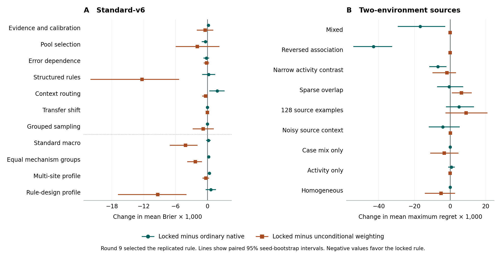

# When should OKAPI change the weight of training examples?

A radiology or remote-sensing model can look worse at a second site simply because that site sees harder cases. A different possibility is that its predictions get worse on the *same kind* of case. In these simulations we varied both properties independently. During training, OKAPI could give underrepresented combinations of site and case type more influence, then deploy one evolved tree. We asked whether evidence that a provider's reliability changes **within a case type** helps decide when to apply those weights. [Protocol](protocol.md) · [Findings across four studies](consolidation.md)

**The screen identified the changing shortcut in all 24 mixed sources and stayed off in all 24 matched sources in which only the proportions of cases changed.** On the mixed design the weighted tree reduced the larger of its two endpoint regrets from 0.08986 to 0.07312. It matched unconditional weighting on all 24 because the trigger always fired. The gain therefore comes from weighting. The contribution of the trigger is the decision to keep the ordinary tree on the matched control. When the shortcut disappeared completely at deployment, the experiment could not exclude a cost greater than our +0.010 Brier margin. We retain conditional weighting as an opt-in experiment. [Four prespecified tests](results/confirmation.json)

## Independent confirmation

Round 9 selected **Replicated full** using 120 standard source/test pairs and twelve source draws in each of three focal designs. Round 10 used 240 fresh standard pairs (eight per scenario) and 24 fresh sources in each of nine focal designs. For each focal source, we computed the expected Brier exactly in four possible deployments using the same fitted forecasts. The primary metric was the larger **excess over the best possible forecast in each of two worlds**, one with the shortcut absent and one with it active. This is computed separately for every source before averaging. Lower values are better throughout. [Committed selection](selection.json) · [Confirmation](results/confirmation.json)

| Prespecified comparison | Ordinary native | Replicated full | Paired change [95% interval] | Passed |
| --- | --- | --- | --- | --- |
| Mixed source, maximum regret | 0.08986 | 0.07312 | -0.01674 [-0.02932, -0.00266] | Yes |
| Overall standard Brier | 0.24471 | 0.24491 | +0.00020 [-0.00021, +0.00061] | Yes |
| Case mix only, specialist-rich target | 0.14961 | 0.14961 | +0.00000 [+0.00000, +0.00000] | Yes |
| Mixed source, shortcut absent | 0.27033 | 0.27904 | +0.00871 [-0.00486, +0.02172] | No |

The primary test required an upper paired 95% limit below zero. The safety margins on the three following rows were +0.005, +0.010 and +0.010. Test labels never entered the gate, tree fit or round 9 choice. The diagnostic did use available **source** labels, including rows later used in OKAPI's internal finalist selection. That finalist subset therefore did not validate the gate independently. Intervals cover fresh generator draws for these fixed scenarios and a single GP and split seed. The group and application comparisons below are secondary point estimates with pointwise intervals in the downloadable table. [All paired contrasts](results/r10-contrasts.csv)

## Standard suite by mechanism and intended use

| Scoring panel | Scenarios | Ordinary native | Replicated full | Logistic stacking | Top-N | Mean |
| --- | --- | --- | --- | --- | --- | --- |
| All 30 scenarios | 30 | 0.24471 | 0.24491 | 0.27005 | 0.35494 | 0.37445 |
| Equal weight per group | 30 | 0.26953 | 0.26978 | 0.29046 | 0.35775 | 0.37191 |
| Multi-site profile | 9 | 0.42160 | 0.42197 | 0.43525 | 0.48265 | 0.44084 |
| Rule-design profile | 12 | 0.21312 | 0.21377 | 0.25996 | 0.38636 | 0.41323 |
| Evidence and calibration | 3 | 0.22852 | 0.22870 | 0.25817 | 0.37945 | 0.37656 |
| Pool selection | 4 | 0.27775 | 0.27740 | 0.28908 | 0.31292 | 0.42355 |
| Error dependence | 5 | 0.12474 | 0.12454 | 0.12874 | 0.18812 | 0.21447 |
| Structured fusion rules | 9 | 0.19231 | 0.19256 | 0.24255 | 0.40768 | 0.42849 |
| Context routing | 3 | 0.27554 | 0.27737 | 0.31220 | 0.32239 | 0.36742 |
| Transfer shift | 3 | 0.65067 | 0.65067 | 0.66031 | 0.75028 | 0.64747 |
| Grouped sampling | 3 | 0.13720 | 0.13720 | 0.14220 | 0.14344 | 0.14541 |

In the transfer group the arithmetic mean scored 0.64747 and both OKAPI configurations scored 0.65067. The latter-minus-mean paired difference was +0.00320 [−0.01504, +0.01989]. Omitting `rare_shortcut_noise` reverses their point ranking; omitting `gated_experts` makes LR the leader in the context-routing group. These omissions are descriptive. Ordinary native had the lowest point score at every blend between the two prespecified application profiles, with small margins. Group data therefore tell both where a method wins and how much that conclusion depends on the membership. Brier levels also depend on the scenario's class distribution and intrinsic uncertainty, so compare methods within a group. [Leave-one-scenario-out analysis](profile-sensitivity.md) · [Shared-seed sensitivity](seed-blocks.md)

The 30-scenario macro preserves the historical comparison. Its nine structured-rule scenarios receive 30% of the total weight, whereas each three-scenario group receives 10%. Under equal group weighting each group receives one seventh. **Multi-site** puts 50% on transfer, 30% on sampling from groups and 20% on choosing a model by context. **Rule design** puts 75% on structured rules and 25% on context routing. All methods see the same examples under every aggregation. These examples specify priorities rather than measured frequencies in any deployment. Publish the weights with the result. [Complete membership, rationale and public Python API](../../site/mechanism-groups.md) · [All 30 family scores](results/r10-families.csv) · [Sensitivity to profile choice](profile-sensitivity.md)

The purpose tags give another view of the same scores. On 14 capability probes, the conditional tree beat probability LR by 0.04687 Brier [0.04392, 0.04976]. On 18 operational stress scenarios the advantage was 0.00604 [0.00416, 0.00783]. Some scenarios carry both tags. The nearly eightfold difference shows why an overall advantage on this catalogue should be decomposed before it is used to motivate a real deployment. These panels also differ in mechanisms and scale, so the comparison does not establish a causal effect of being “realistic.” [Tag definitions](../../site/mechanism-groups.md) · [Comparison table](results/r10-contrasts.csv)



## When the intervention changed the forecast

| Training source | Gate active / 24¹ | Ordinary native | Replicated full | Unconditional full | Change vs native [95% interval] |
| --- | --- | --- | --- | --- | --- |
| Both mechanisms vary | 24/24 | 0.08986 | 0.07312 | 0.07312 | -0.01674 [-0.02932, -0.00266] |
| Only case mix varies | 0/24 | 0.06128 | 0.06128 | 0.06450 | +0.00000 [+0.00000, +0.00000] |
| Only shortcut activity varies | 24/24 | 0.05210 | 0.05284 | 0.05284 | +0.00074 [-0.00110, +0.00272] |
| Reversed association | 24/24 | 0.10794 | 0.06499 | 0.06499 | -0.04295 [-0.05432, -0.03243] |
| 128 source rows | 8/24 | 0.10991 | 0.11492 | 0.10591 | +0.00501 [-0.00231, +0.01336] |
| Sparse overlap | 12/24 | 0.10889 | 0.10837 | 0.10191 | -0.00052 [-0.00724, +0.00731] |
| Narrow activity contrast | 15/24 | 0.06912 | 0.06223 | 0.06402 | -0.00689 [-0.01172, -0.00201] |
| 25% corrupted context IDs | 23/24 | 0.08986 | 0.08580 | 0.08557 | -0.00406 [-0.01196, +0.00546] |
| Identical environment laws | 0/24 | 0.06443 | 0.06443 | 0.06945 | +0.00000 [+0.00000, +0.00000] |

¹ Counts use the locked method's trigger, or the single-screen trigger if the lock selected ordinary native. A positive screen can still yield ordinary training weights when source support is inadequate. These are maximum regrets for the corresponding nine source designs. Levels on individual target laws, including the intermediate shortcut and specialist-rich targets, are in the [full score table](results/r10-levels.csv). The [dose-matched comparison](dose_control.md) tests whether screening or simply reducing the strength of the intervention explains the outcome.

On the standard panel the replicated trigger fired in 45/240 source banks and produced nonuniform weights in 41/240. It fired in 4/24 standard transfer banks and changed the weights in none. In the three grouped-sampling scenarios it fired in 0/24. Here the diagnostic has only 64 scene-level representatives for 512 training observations, and the required counts for comparing like contexts were insufficient. This is a limit on using the method to defend against selection overfitting when the number of independent scenes is small. Focal results with measured environment and case identifiers also differ from standard environments defined by a proxy from provider disagreement. The next targeted question is whether source diagnostics can quantify the amount of independent support for a within-context change before a fusion intervention is proposed. [Gate counts](results/r10-gates.csv) · [Decision effects](results/r10-decision-effects.csv)

## Ten rounds and their controls

| Round | Intervention | Focus shown | Rule shown | Activated | 30-scenario Brier | Focal Δ max regret vs native |
| --- | --- | --- | --- | --- | --- | --- |
| 1 | Matched change in case mix alone | mixed | Conditional full | 6/6 | 0.24713 | -0.01011 |
| 2 | Ignore context, change activity alone | varied | Conditional full | 6/6 | 0.24101 | +0.00184 |
| 3 | Shuffle environment IDs inside context | reversed | Conditional full | 6/6 | 0.24753 | -0.03953 |
| 4 | Reduce training count to 128 | small128 | Conditional full | 4/6 | 0.25259 | -0.00392 |
| 5 | Reduce overlap between source sites | extreme | Conditional full | 2/6 | 0.24571 | -0.00170 |
| 6 | Reduce the reliability difference | narrow | Conditional full | 4/6 | 0.24455 | -0.00627 |
| 7 | Corrupt a quarter of context IDs | noisy_context | Conditional full | 6/6 | 0.24555 | +0.00324 |
| 8 | Compare with a random trigger | homogeneous | Conditional full | 0/6 | 0.24730 | +0.00000 |
| 9 | Choose the locked rule | reversed | Replicated full | 12/12 | 0.24700 | -0.04800 |
| 10 | Fresh confirmation | mixed | Replicated full | 24/24 | 0.24491 | -0.01674 |

The exploratory rows show the same single-screen full-strength rule, allowing its behavior to be followed as source conditions change. The final two rows show the rule chosen at the lock. R2 also fit a raw trigger based on marginal provider loss. It flagged the true specialist in all six case-mix-only sources, while the context-adjusted trigger stayed off on all six. In R3, shuffling the training environment identifiers *within* each kind of case eliminated all six mixed-source activations while preserving the contingency table and the weights applied on the original examples. In R8 the random-trigger control used a fair coin independent of labels. It did not match the frequency of the measured trigger. Each round used all 30 standard scenarios and the same three cheap references. [Per-round CSVs, gate decisions and timing](results/) · [Table guide](reading-results.md)

## Consolidation decision

Keep the public mechanism groups, scenario-level scores, explicit application weights and paired source fixtures. Keep conditional weighting available to researchers who have trustworthy source context and environment information. Ordinary regularized native OKAPI remains the reference. The locked rule passed its primary comparison and two of three safeguards. In the matched mixed sources, maximum regret improved in 21 of 24 draws, while the vanished-shortcut endpoint worsened in 17 of 24. The source diagnostic alone cannot tell how reliable that shortcut will be in the target. Under sparse overlap, a dose-matched control also finds that abstention can forgo a beneficial weighted fit. The study supports consolidation of the benchmark and an optional training control. It does not warrant general deployment of the trigger. [Evidence across four studies](consolidation.md) · [Dose comparison](dose_control.md)

## Reproduction

From the FusionBench root, use the pinned OKAPI dependency from the research branch. With both checkouts available, set `PYTHONPATH=.:/path/to/OKAPI`, `BACKEND=numpy`, `OKAPI_LOG_LEVEL=ERROR` and set `OPENBLAS_NUM_THREADS`, `MKL_NUM_THREADS` and `OMP_NUM_THREADS` to 1. The native reference uses the regularized native-pattern tree, eight eligible GP finalists and fixed split and GP seeds. The half-strength policy interpolates the **training weights** halfway to uniform weights. No additional predictor is needed at inference. [Native code and tests](https://github.com/damiankucharski/OKAPI/commit/e455a1975f995641663007b2f3ed4e64ae7d2b54)

```sh
study=docs/ensemble-study/conditional-ten
for r in 1 2 3 4 5 6 7 8 9 10; do
    python "$study/run.py" "$r"
    python "$study/analyze.py" "$r"
    python "$study/verify.py" "$r"
done
python "$study/plot_results.py"
python "$study/profile_sensitivity.py"
python "$study/seed_blocks.py"
python "$study/dose_control.py"
```

The ten main fit-and-score jobs took 466.6 seconds in total using four CPU workers, with individual jobs ranging from 26.8 to 138.5 seconds. They evaluated 1,230 training-bank instances across the fixed designs and 2,400 paired source/target conditions, producing 19,596 method scores from 2,922 distinct within-bank native fitting calls plus the cheap references. Matched profile variants reuse random draws intentionally. These counts do not denote distinct benchmark families. Verification, diagnostic analysis and the secondary dose replay are outside these fit times. [Independent checks](verify.py)

From the first fitting job through independent verification of R10, 519 seconds elapsed. Some analysis and replay ran concurrently with the following round. [Recorded times per round](results/recorded-times.csv)
