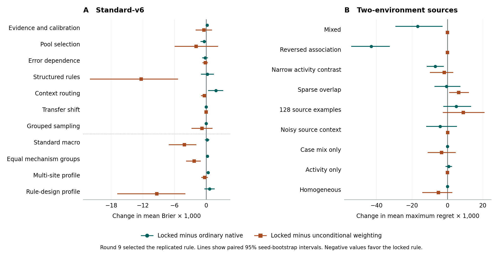

# What transfers from these experiments into FusionBench?

Two training sites can see different proportions of easy and difficult cases. That alone changes a model's average error at each site. A second possibility is that a model actually becomes less reliable within the same kind of case. FusionBench lets us vary those two effects separately, then combine them while keeping source examples, target laws and baselines paired. Ordinary native OKAPI, mean, ranked-prefix Top-N and logistic stacking remain useful reference points across these interventions.

## Evidence across four studies

| Study | What the controlled comparison established | Where the intervention reached its limit |
| --- | --- | --- |
| Environment screening | Adjusting for the observed case mix helped identify a provider using a changing shortcut. Removing the flagged provider reduced mean worst-endpoint Brier by 0.02928 on the mixed source. | With standard-suite environments defined by provider disagreement, the filter discarded the useful gate in all eight `gated_experts` trials. Standard macro Brier rose by 0.01478. [Study and confirmation](../environment-ten/README.md) |
| Provider utility | Shuffling the known selector reduced its measured routing gain by 0.28041 Brier. A rule using that evidence preserved native forecasts on every fresh standard `gated_experts` draw. | The same rule often protected the shortcut because it helped on the source. Its primary mixed-source maximum regret rose from 0.08341 to 0.08435. [Study and confirmation](../provider-use-ten/README.md) |
| Case-mix weighting | Changing the Brier objective inside native search improved the locked method's mixed-source maximum regret from 0.08690 to 0.06762. One native tree still made each forecast. | The weights were identical across 20 matched pairs of mixed and case-mix-only sources. In the latter, weighting increased maximum regret by 0.01501. Counting the effective number of weighted examples could not distinguish the two source mechanisms. [Study and confirmation](../case-mix-ten/README.md) |
| Conditional case-mix weighting | Requiring two halves of the source to confirm a context-adjusted discrepancy distinguished 24/24 mixed sources from 0/24 case-mix-only sources. The locked rule reduced mixed maximum regret by 0.01674 [0.00266, 0.02932]. It reproduced native forecasts in the case-mix-only control, including the specialist-rich target. | On the same mixed sources with an inactive target shortcut, Brier rose by 0.00871 [−0.00486, +0.02172]. The upper endpoint exceeded the +0.010 safeguard. With 128 source rows the screen activated on only 8/24 draws and the maximum-regret change versus native was +0.00501 [−0.00231, +0.01336]. [Frozen choice](selection.json) · [Confirmation](results/confirmation.json) · [Activation counts](results/r10-gates.csv) |

Worst-endpoint *risk* is the larger absolute Brier of one fit in two target worlds. Worst-endpoint *regret* first subtracts the Bayes risk of each world. Those objectives can prefer different forecasts on exactly the same law. The studies above used fresh draws and their own registered criteria. Their numbers describe within-study paired comparisons. [Exact example of the two objectives](../provider-use-ten/oracle.md)

The conditional rule answered a specific question about the **source**. When the data supported a repeatable loss change within the observed contexts, applying weights was often useful. At the narrower activity contrast, 15/24 sources triggered and the locked method's maximum regret improved by 0.00689 [0.00201, 0.01172] versus native. With sparse overlap, requiring replication gave up some of unconditional weighting's gain, raising maximum regret by 0.00645 [0.00096, 0.01214] versus the unconditional rule. Neither decision determines future target shortcut activity. [Paired source risks](results/r10-contrasts.csv)

## Which interfaces have a case for reuse?

Generating matched source environments, preserving provider order across splits, scoring forecasts on exact target laws and summarizing predefined groups are benchmark operations with checkable answers. A new fusion algorithm can use the same fixtures without access to their hidden roles. The standard panel also keeps problems that the focal fixture omits, including selector dependence and calibrated suppression. Those problems exposed losses hidden by the focal average. [Environment generator](../../../fusionbench/scenarios/source_environments.py) · [Mechanism groups and scoring profiles](../../site/mechanism-groups.md)

Provider diagnostics and staged sample weights are reusable **opt-in experimental controls**. A researcher can ask whether weighting during discovery, held-out selection or full-data head refitting changes the deployed tree. A researcher can also intervene on one provider and score how much the prediction moves. Each control specifies an operation that can be reproduced and compared. Deciding *when* to use that operation is an empirical policy choice. In particular, a change in a provider's standalone error can coexist with a useful routing role, and an effective-count guard cannot detect a change in the target label law. [OKAPI integration](../../site/okapi.md) · [Matched case-mix controls](../case-mix-ten/README.md)

The replicated rule earns a place alongside those controls. It can reproduce a contrast between two sources with the same case counts and different provider behavior. Its failed target safeguard and the 128-row result leave a general default unsupported. The standard suite also uses disagreement-based proxy environments, whereas the focal scenario supplies genuine site IDs. Testing a real cohort would require identifying the source environments and grouping independently sampled units before inspecting target labels. [Protocol and information boundary](protocol.md)

## Interpreting the benchmark aggregate

Keep the standard-v6 macro score as a stable comparison across releases and papers. Every one of its 30 scenarios contributes equally. Report the prespecified mechanism groups alongside it so a reader can locate which ability changed. The `multi_site` profile, for example, puts half the weight on transfer shift, 30% on grouped sampling and 20% on context routing. A team building rule-based fusions might care more about `rule_design`, which gives structured rules 75% and context routing 25%. Within each group, included scenarios receive equal weight. [Profile definitions](../../site/mechanism-groups.md)

These weights express an evaluator's priorities. Estimating how often these mechanisms actually arise on a satellite sensor or medical imaging dataset requires observations from that population. Freeze the scenario version, data-generating parameters, selected profile and family weights before comparing methods. A later application can publish its own prespecified score alongside the original result. It does not change the ranking criterion of the earlier study.

| R10 scoring profile | Native | Replicated | Unconditional | Mean | Top-N | Logistic stacking |
| --- | ---: | ---: | ---: | ---: | ---: | ---: |
| Standard macro | 0.24471 | 0.24491 | 0.24903 | 0.37445 | 0.35494 | 0.27005 |
| Equal mechanism groups | 0.26953 | 0.26978 | 0.27205 | 0.37191 | 0.35775 | 0.29046 |
| Multi-site | 0.42160 | 0.42197 | 0.42227 | 0.44084 | 0.48265 | 0.43525 |
| Rule-design | 0.21312 | 0.21377 | 0.22310 | 0.41323 | 0.38636 | 0.25996 |

Versus unconditional weighting, the largest mechanism-specific gain was on structured rules, −0.01234 Brier [−0.02202, −0.00530]. Giving such problems more weight in the rule-design profile yielded a gain of 0.00933 [0.00394, 0.01688]. The multi-site profile gave a smaller change of −0.00030 [−0.00092, +0.00031]. On the three registered transfer-shift scenarios, even the arithmetic mean had a lower observed score than native, 0.64747 versus 0.65067, with a paired difference of −0.00320 [−0.01989, +0.01504]. These findings show why a broad macro and a targeted panel answer different questions. [Absolute scores](results/r10-levels.csv) · [Paired differences](results/r10-contrasts.csv)

The plot script separately computed each scenario's mean from its eight raw seed scores, applied the public scenario weights, and compared the results with the reported tables. All 112 absolute mean risks agreed within $1.2\times10^{-16}$ across eight methods and 14 aggregations, including overlapping purpose tags. The eligible application profiles were declared before the round-9 selection and were secondary throughout. [Aggregation audit](results/r10-taxonomy-audit.json) · [Figure and audit code](plot_results.py) · [Vector figure](results/r10-conditional.pdf)
