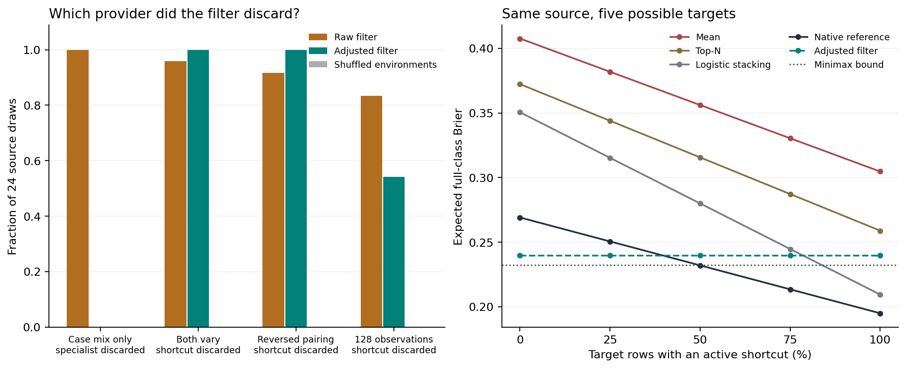

# Can training environments separate a shortcut from real expertise?

A model can lose accuracy between hospitals, sensors or time periods for two different reasons. Its prediction may depend on a relation that changes. Alternatively, the new source may simply contain fewer of the cases that model handles well. These mechanisms call for different fusion decisions. We isolated them in a synthetic experiment with observed source environments and tested what happens when OKAPI removes one provider before fitting.

In the final 24 independent draws, conditioning on the observed region protected the specialist every time and identified the changing provider every time in the mixed design. Removing that provider reduced worst-endpoint Brier by 0.02928. The same action lost 0.04483 Brier when the shortcut remained active throughout deployment. Across the 30 standard scenarios, inferring environments from model disagreement and filtering raised Brier by 0.01478. These findings support using the screen as an optional diagnostic with measured source conditions. The native reference remains the strongest of the evaluated rules on the standard aggregate. [Confirmation criteria](results/confirmation.json) · [Figure](results/environment-ten.pdf)

## What the benchmark controls

Four ready-made source profiles cross two switches. In one switch, the shortcut is informative for all the rows of one source environment and none of the other. In the other switch, a genuine specialist's region occupies 15% of one environment and 85% of the other. In the absence of either switch, both corresponding rates are 50%. All four profiles therefore supply the same number of labeled examples and the same average exposure. Anonymous provider order changes by seed. Every model reports the same two probability values (.2 and .8), so confidence alone cannot reveal the role. A separate observed binary cue identifies the specialist's region. [Four source presets and example](../../site/scenarios.md#multiple-labelled-source-environments) · [Generator](../../../fusionbench/scenarios/source_environments.py)

Each fitted model faces several possible target populations. They have exactly the same 16 possible input patterns but differ in the frequencies of those patterns and the class probability attached to each. We integrate test loss over their exact distributions. Unless specified otherwise, half the target cases come from the specialist's region. We also run all 30 standard-v6 scenarios from the previous study, fitting and scoring each from its regular sampled data. The standard suite does not provide the two controlled source environments of the focal experiment. For its regression check, we explicitly partition source examples by whether their provider disagreement exceeds the median. Consensus confidence supplies a second, observable stratum. This tests the cost of trying to infer environments from the predictions.

## What OKAPI changes

For each provider, the raw screen compares its full-class Brier between source environments. The adjusted screen first averages its Brier over the same context proportions in both environments. In either case the score is an absolute difference less a penalty for its sampling uncertainty. A sufficiently large, unique score excludes at most one provider. The native procedure trains on the full source with the remaining inputs. An abstaining filter reuses the unchanged native reference. The reference is regularized native-pattern OKAPI, including evolved subtrees, native logit heads and an eight-program GP shortlist. This is an opt-in source diagnostic and decision rule. Environment IDs, contextual strata and test outcomes are unnecessary at inference. [Native screen](https://github.com/damiankucharski/OKAPI/blob/25947c4a695c64c85922d18ac605b8eb2a61d4d7/okapi/environment_stability.py) · [Adapter](../../../fusionbench/methods/environment_screen.py) · [Frozen protocol](protocol.md)

### Why the adjustment can work

For the focal generator, a provider giving confidence 0.8 to its predicted class incurs full-class Brier 0.08 when correct and 1.28 otherwise. Its expected loss at accuracy $A$ is therefore $1.28-1.2A$. If $a$ is the fraction of rows with an active shortcut, the shortcut's accuracy is $0.5+0.4a$. If $p$ is regional prevalence, the specialist's accuracy is $0.5+0.45p$. In the mixed design the population between-environment Brier differences are consequently 0.48 for the shortcut and 0.378 for the specialist. Both look unstable to the raw screen. Comparing at a common $p$ removes the specialist's difference while leaving variation in $a$ detectable. This identification uses measured context and overlapping cases in both environments. [Implementation of the underlying law](../../../fusionbench/scenarios/rare_shortcut_noise.py)

### What a worst-case gain means in this generator

At zero shortcut activity the shortcut vote is independent of the outcome and of the other reports. The exact Bayes forecast based on the remaining three inputs therefore attains the full-information optimum at that endpoint, **0.23217** Brier. The joint distribution of the three inputs and label stays the same as shortcut activity increases. This forecast consequently has risk 0.23217 at every activity level. Since every rule incurs at least 0.23217 risk at the zero endpoint, this is the exact minimax value over the two endpoints at 50% region prevalence.

There is a price for that guarantee. When the shortcut is always active, the Bayes risk using all four reports is **0.10895**. Even a perfect fusion rule without the shortcut then loses **0.12322** Brier relative to the optimum available in that target. Removing the specialist instead would cost 0.14283 at zero shortcut activity. These are population information costs in the known synthetic law. The experiment below estimates the additional effect of finite training data and OKAPI's search. Also, a target with 50% active shortcuts need not reproduce the mixed source joint distribution: at the mixed source, shortcut activity and specialist prevalence change together. [Exact finite-support calculation](oracle_env.py) · [Oracle table](results/r01-oracle.csv)


## Independent confirmation

The full standard suite contains **30 distinct scenarios**. The final round used eight fresh draws per scenario for 240 paired standard comparisons. Separately, the controlled experiment used 24 fresh source draws per profile, reusing each trained predictor in six synthetic target populations. All entries below are mean full-class Brier, for which lower is better. The column for 80% specialist cases uses a source in which only the proportion of cases handled by the specialist varied. The last two columns use the source where both mechanisms varied. [All methods, scores, macro-F1 and provider counts](results/r10-levels.csv)

| Fusion method | Standard 30 | 80% specialist cases | Shortcut inactive | Shortcut always active |
|---|---:|---:|---:|---:|
| Regularized native-pattern OKAPI | **0.24668** | **0.14007** | 0.26907 | **0.19495** |
| OKAPI with adjusted screening | 0.26146 | **0.14007** | **0.23979** | 0.23979 |
| OKAPI with raw screening | 0.26084 | 0.33149 | 0.24961 | 0.24092 |
| Logistic stacking | 0.27168 | 0.21453 | 0.35051 | 0.20942 |
| Ranked-prefix Top-N | 0.35577 | 0.26823 | 0.37228 | 0.25888 |
| Arithmetic mean | 0.37570 | 0.32108 | 0.40756 | 0.30466 |



**What the source reveals.** When only the mix of cases changed, raw screening removed the specialist in 24/24 runs. Adjusting for observed region preserved it in 24/24. The lost specialist cost the raw method 0.19141 Brier [0.18872, 0.19380] on a target with 80% specialist cases. When both source properties varied, adjustment removed the true shortcut provider in 24/24 runs. It also did so in 24/24 runs with the source association reversed, and in 13/24 with smaller differences between environments or only 128 source rows. Shuffling environment identifiers on the same training rows produced zero removals in every confirmation profile. [Exclusion counts](results/r10-drops.csv) · [Matched effects](results/r10-contrasts.csv)

**What the source leaves open.** On the mixed source, adjusted screening lowered worst-endpoint risk from 0.26907 to 0.23979. The paired difference was −0.02928 [−0.03883, −0.02063]. Reversing the association between regional prevalence and shortcut activity gave a larger benefit of −0.09598 [−0.10958, −0.08403]. In the mixed design with a fully active target shortcut, native gained 0.04483 [0.03788, 0.05136] from retaining that input. Across the mixed source draws the two risk curves intersect at **39.5% target activity** [30.0%, 49.7%]. This describes where their mean losses coincide under this exact test law. The frequency on the deployment population is unknown at fit time. [Crossover for each design](results/r10-endpoint-tradeoff.csv)

**What failed on standard-v6.** The adjusted screen excluded a provider on 117/240 draws when environment labels came from model disagreement. Mean Brier increased by 0.01478 [0.00616, 0.02436]. Seven family means improved, eleven tied and twelve worsened. Two families accounted for 77.1% of the net deterioration. On `calibrated_suppressor`, Brier rose from 0.17178 to 0.39864, and on `gated_experts` it rose from 0.20036 to 0.31544. In all eight draws of each family, the adjusted rule removed provider zero. In `calibrated_suppressor` this is the stronger of two calibrated log-odds sources. In `gated_experts` this is the selector that tells the fusion which regional expert to trust. Its usefulness enters through an interaction with the other two providers. The largest gain was on `compositional_switch`, from 0.25350 to 0.21856. A partition built from model disagreement can isolate precisely the rows on which a useful model behaves differently. Screening with these proxies exceeded the preregistered tolerance of +0.005, as did screening in the always-active target. Only the primary worst-endpoint criterion and the specialist-preservation criterion passed. [All 30 family means](results/r10-families.csv) · [Individual decisions](results/r10.csv) · [Gated expert generator](../../../fusionbench/scenarios/mixture.py) · [Suppressor generator](../../../fusionbench/scenarios/correlated.py) · [Locked checks](results/confirmation.json)

## Ten rounds in order

Each row highlights the control introduced in that round. The last column is the selected row's paired Brier difference from native, with a 95% bootstrap interval. Worst endpoint means the larger of the 0% and 100% risks for **each fit**, averaged only after taking that maximum. R3 uses the 80% specialist target. All ten rounds also included the standard suite and the three inexpensive references. [Round design and seed schedule](protocol.md) · [Definitions for every results table](analysis.md)

| Round | Source design | Rule | Test | Shortcut removed | Specialist removed | Brier change vs native [95% interval] |
|---:|---|---|---|---:|---:|---:|
| 1 | varied | adjusted | worst endpoint | 8/8 | 0/8 | -0.04749 [-0.06841, -0.03111] |
| 2 | varied | sham | worst endpoint | 0/8 | 0/8 | +0.00000 [+0.00000, +0.00000] |
| 3 | case_mix | raw | 80% specialist | 0/8 | 8/8 | +0.18474 [+0.17966, +0.19024] |
| 4 | mixed | adjusted | worst endpoint | 8/8 | 0/8 | -0.02191 [-0.03405, -0.01067] |
| 5 | four_env | adjusted | worst endpoint | 8/8 | 0/8 | -0.02552 [-0.03723, -0.01471] |
| 6 | narrow | adjusted | worst endpoint | 4/8 | 0/8 | -0.01755 [-0.02999, -0.00438] |
| 7 | small128 | adjusted | worst endpoint | 4/8 | 0/8 | -0.05077 [-0.09634, -0.01081] |
| 8 | noisy_context | adjusted | worst endpoint | 8/8 | 0/8 | -0.03648 [-0.06395, -0.01323] |
| 9 | mixed | adjusted | worst endpoint | 12/12 | 0/12 | -0.03251 [-0.04439, -0.02269] |
| 10 | mixed | adjusted | worst endpoint | 24/24 | 0/24 | -0.02928 [-0.03883, -0.02063] |

R2 kept the data fixed and shuffled environment labels. The adjusted rule with genuine labels detected the shortcut in 8/8 draws on the varied source. R5 repartitioned the same 512 cases from two environments into four. Both partitions led to the same exclusions and losses on those draws. R6 narrowed the difference in shortcut activity, and R7 reduced the number of cases, lowering the frequency of correct exclusions. In R8, restoring the providers' original score magnitudes and, separately, corrupting the *side-channel* context label with 25% flip probability each preserved 8/8 detections on the mixed source. The provider reports still contained the original region cue in the latter control. In R9 both adjusted rules tied at 0.239823 on mixed worst-endpoint risk and raw scored 0.259514. The preregistered tie order selected the ordinary adjusted rule before any R10 fit. [Selection commit](https://github.com/damiankucharski/fusionbench/commit/e50f4aef8cdd359d3e4a4297aafd91d190831ca7)

## Implications for the next experiment

A useful next comparison would first measure how a flagged provider changes the fusion of the other models. A control against the known selector in `gated_experts` can expose a diagnostic that uses only standalone predictive accuracy. The intervention would then vary how strongly an OKAPI tree may depend on a flagged input, retaining the other native operators and keeping the default intact when reliable source metadata are unavailable. One possible objective is maximum *regret*: for each plausible target, measure how far a prediction rule falls behind the best rule available in that target, then take the largest gap. Worst absolute Brier in this generator rewards a method that discards a useful signal permanently. A regret comparison would quantify the price of that choice in both endpoints and test whether a bounded contribution offers a better compromise. The current evidence comes from synthetic populations and a single evolution seed. Transfer to real acquisition environments remains open.

## Reproduction

From the FusionBench research checkout install the pinned optional dependency with `pip install '.[okapi]'`. Each row of the score table has source and test prediction hashes and the number of deployed providers. The source-only trace records estimated environment means, uncertainty and exclusion decisions. One native fit per distinct exclusion is shared by all rules choosing that exclusion. A world with a new mix of test examples reuses the same trained predictor.

```sh
export PYTHONPATH=.
export OKAPI_LOG_LEVEL=ERROR BACKEND=numpy
export OMP_NUM_THREADS=1 OPENBLAS_NUM_THREADS=1 MKL_NUM_THREADS=1
study=docs/ensemble-study/environment-ten
for r in 1 2 3 4 5 6 7 8 9 10; do
    python "$study/run_env.py" "$r" --workers 4
    python "$study/summarize.py" "$r"
    python "$study/verify.py" "$r"
done
python "$study/oracle_env.py" 10
python "$study/endpoint_tradeoff.py"
python "$study/plot_env.py"
```

The final checkout contains the committed round-nine selection required for round ten. Each interval uses 10,000 paired bootstrap draws over source seeds. The standard panel resamples seeds within each fixed family. Focal targets are exact conditional on the generator, but the fitted procedures still vary across source draws. The GP seed was held fixed.


Across ten rounds there were 1,352 generated training datasets counted once per source design and seed (840 standard, 512 focal), 2,992 source–target conditions and 2,554 native fits including retained-provider variants. Fitting and scoring took 394.4 seconds in total with four CPU workers. From preregistration to final raw scores took 8 min 50 s. The independent audit reconstructed 5,316 source decisions, refitted 162 inexpensive references, and recomputed 1,628 paired intervals. The deployed adapter independently reproduced source decisions and predictions on six representative source draws. FusionBench's full test suite passed 933 tests (11 skipped) and OKAPI's passed 850 (one skipped). [Final verification](results/r10-verification.json) · [Deployed adapter replay](results/r09-adapter-replay.json)
