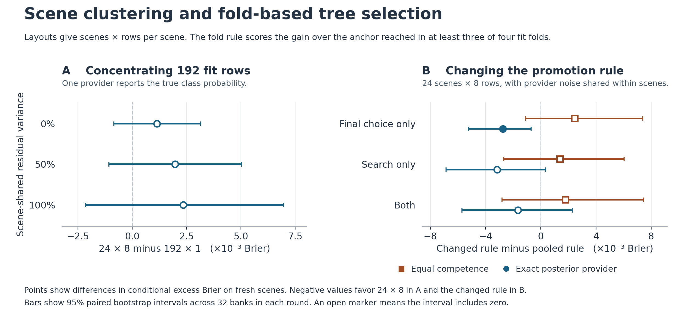

# Can agreement across groups of scenes improve native OKAPI selection?

The initial fit winner was already the perfect provider in **31 of 32** difficult controlled runs. Ordinary native GP chose its exact prediction at deployment seven times; requiring improvements across folds during both evolution and final selection raised that to 16. Average excess loss improved by 0.00165, with a paired 95% interval for the change of **−0.00570 to +0.00228**. This primary result leaves the direction of the quality effect unresolved. The simple initial winner alone scored better than either evolved policy under this deliberately planted condition. [Deployed scores](results/scores.csv) · [Preregistered comparisons](protocol.md)

## The intervention

Find an initial reference tree using pooled fit Brier among the actual founder population: single providers and their all-provider mean. Keep a copy of this anchor. Split the independent fit groups into four parts, assigning every observation from a scene to the same fold. On ordinary suite data, each row is a separate group.

For each proposed tree compute its mean improvement in Brier over the anchor separately in each fold. Sort the four improvements. The second smallest is the gain achieved in at least three folds. Use that number in the native search fitness, retaining the same mutation operators, size objective and generation budget. At deployment a tree uses only its own provider inputs. Scoring during training can refer to an anchor with additional providers. The procedure works with per-observation losses. Pooled F1 would require a different definition. [Criterion in OKAPI](https://github.com/damiankucharski/OKAPI/blob/e9e0da8fa3a43746aca9212ec2fb99d3b09614a3/okapi/fold_gain.py)

The folds serve as repeated views of the same fit data. All candidates see the same labels and the anchor is chosen using those labels. Even for a fixed candidate with four independent fair signs, it beats an equally good anchor in at least three folds with probability **5/16**. A tree can win on the fold score while making the *pooled* loss worse if one fold contains a large loss. [Derivation and numerical check](score-interpretation.md)

## What the comparisons separate

Each bank generated two actual 16-generation GP paths with matched founders and seed. The first scored candidates by ordinary pooled Brier during breeding, the second by the fold criterion. At the end of each path we applied both deployment rules to the same final survivors plus the initial anchor. This yields four paired policies. We also report the ordinary GP without a protected terminal anchor, the initial anchor alone and four reference methods. Audit data were kept outside the search and deployment decision. Under the synthetic signal law, one provider outputs the true event probability. Under the equal law all eight providers are noisy views of the same latent signal. Excess Brier compares a prediction with the true event probability, integrating out audit label noise. [Prespecified protocol](protocol.md)

## Accuracy, frequency and cost of replacement

The primary condition had eight providers, one known perfect to the evaluator, 24 scenes with eight fit rows each, and a fully scene-shared provider residual. This table uses fresh conditional excess Brier. The count records a deployed prediction equal to the true provider on every fit and audit row. Some distinct trees implement the same prediction.

| Search and final choice | Excess Brier ↓ | Exact prediction, out of 32 |
| --- | ---: | ---: |
| Initial best singleton or mean alone | 0.00062 | 31 |
| Ordinary pooled search, pooled final choice | 0.00908 | 7 |
| Pooled search, fold final choice | 0.00633 | 16 |
| Fold search, pooled final choice | 0.00592 | 17 |
| Fold search, fold final choice | 0.00743 | 16 |
| Simple mean | 0.01960 | 0 |
| Ranked-prefix Top-N | 0.00709 | 21 |
| Probability logistic stacking | 0.02299 | 0 |
| Regularized native-pattern OKAPI | 0.02772 | 2 |

Among the 25 ordinary GP misses, average excess was 0.01162. The full fold policy made 16 misses averaging 0.01486. Counting correct selections alone therefore overstates the evidence for better probabilities. The full policy used 2.31 distinct providers per deployed tree on average, versus 2.88 with ordinary selection. Both can represent a singleton. Holding the ordinary search path fixed and changing the final vote reduced excess by 0.00275 (paired 95% interval for the reduction 0.00069–0.00525), a secondary contrast. On the fold-trained path the same terminal change increased average excess by 0.00151 (change interval −0.00027 to +0.00348). Combining the two modifications offered no reproducible advantage here over either alone. [Levels](results/levels.csv) · [Paired contrasts](results/contrasts.csv)

The experimental score has a specific failure mode. In **7 of the 32** primary fits, the full policy selected a tree with positive gain in at least three folds but a *worse pooled fit Brier* than the available anchor. All seven also had worse conditional Brier on audit than the anchor. This exploratory count uses recorded fit scores and frozen decisions, with audit labels excluded from selection. The counted events explain only part of the error. [Decision counts](results/anchor-decisions.csv)

In the equal-competence law at the same severe setting, full fold selection changed excess by +0.00178 (−0.00281 to +0.00745), with simple averaging strongest among the included methods. With 192 eight-row scenes and a perfect provider, its change was −0.00026 (−0.00065 to +0.00010). Top-N had zero excess on all 32 larger fits. Each interval pairs banks across policies. They do not isolate search-seed variance or establish transfer on real images.



## Standard-v4 regression panel

We fitted all policies on 512 examples and evaluated them on 512 new examples in each of the 25 standard-v4 scenarios, twice per scenario. Both fit draws and search seeds were matched across methods. Ordinary pooled deployment and adding the anchor to that decision agreed on all 50 banks.

| Method | Mean test Brier |
| --- | ---: |
| Native GP, pooled search and pooled choice | 0.33395 |
| Native GP, fold search and fold choice | 0.32870 |
| Simple mean | 0.39368 |
| Ranked-prefix Top-N | 0.35491 |
| Probability logistic stacking | 0.26162 |
| Regularized native-pattern OKAPI | 0.23297 |

The proposed policy's mean change was **−0.00525** (95% interval −0.01112 to +0.00048), with improvement in eight families, regression in 14 and ties in three. The largest improvement was on `weakest_link` (−0.37610); both data seeds improved. Regressions included `hardrescue` (+0.08783), `hardveto` (+0.06789) and `cloned_shortcut` (+0.05306). An exploratory leave-one-family-out calculation puts the mean change in the other 24 families at **+0.01021**. Keeping pooled deployment and changing only breeding reduced loss by 0.00634 (interval 0.00083–0.01193). On that same fold-trained path, switching the terminal choice to the fold rule increased loss by 0.00109 (interval 0.00011–0.00205). Suite intervals condition on these fixed families and two seeds per family. [Means](results/panel-means.csv) · [Family-level contrasts](results/panel-family-contrasts.csv) · [Paired intervals](results/panel-contrasts.csv)

## Next test

A direct follow-up would use the same frozen candidate population and require a proposed replacement to improve **both** pooled fit loss and the fold score. It could also fail when one large negative fold is unrepresentative or when the anchor is poor. Test that rule first on new banks, including one law where the initial pool lacks the right rule, and evaluate regressions across all 25 families. A two-stage comparison would separate removing the observed unfavorable replacements from changing which trees are bred. The criterion from this round remains opt-in.

## Reproduce

Check out this FusionBench research revision and install its optional dependencies. Round two also uses the opt-in OKAPI utility from e9e0da8, which can be imported from a separate pinned checkout. From the FusionBench root:

```sh
uv sync --extra okapi
git clone https://github.com/damiankucharski/OKAPI.git ../okapi-fold-study
git -C ../okapi-fold-study checkout --detach e9e0da8fa3a43746aca9212ec2fb99d3b09614a3
export PYTHONPATH="$PWD:$PWD/../okapi-fold-study"
export BACKEND=numpy OKAPI_LOG_LEVEL=ERROR LOGURU_LEVEL=ERROR
export OPENBLAS_NUM_THREADS=1 OMP_NUM_THREADS=1 MKL_NUM_THREADS=1 NUMEXPR_NUM_THREADS=1
study=docs/ensemble-study/fold-promotion
.venv/bin/python "$study/run.py" --workers 2
.venv/bin/python "$study/analyze.py"
.venv/bin/python "$study/panel.py" --workers 2
.venv/bin/python "$study/plot.py"
.venv/bin/python "$study/verify.py"
```

The figure uses the archived round-one contrasts; its training data can also be regenerated from the sibling study. [Round-one results and commands](../scene-dependence/README.md)

Round two took 85.17 s for the 384 controlled native searches and 25.25 s for the 100 suite searches, each with two single-threaded CPU workers. The controlled GP paths made 51,319 fold-path and 51,395 pooled-path training objective evaluations. One independent audit recomputed the primary bank contrast, the suite contrast, matched fold/anchor identities, and every candidate's fold gains and final selection for two refitted paths from one fresh bank. Replacing the audit labels and posterior preserved the fitted search paths and all six reported native decisions. [Timing and fingerprints](results/run.json) · [Independent checks](results/verification.json)
