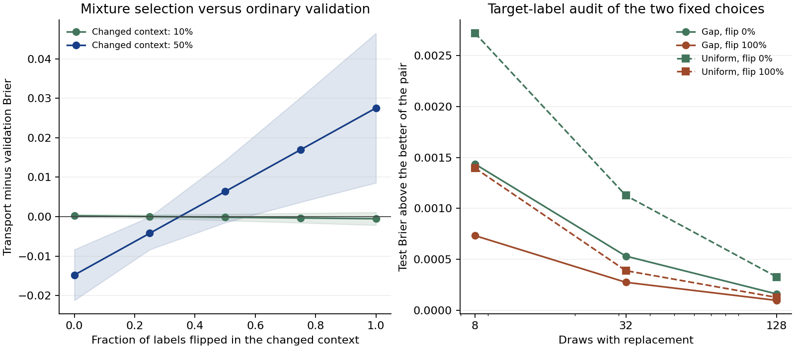

# When the mixture chooses the wrong frozen tree

With a changed-context prevalence of 50%, transporting source validation losses improved positive-class Brier by **0.01479** over ordinary validation when the context-specific labeling rule was stable. After reversing labels in that context, the same choice **cost 0.02754**. The two worlds had exactly the same probabilities from all seven experts on every unlabelled monitoring and audit record. The change in the paired Brier difference was **+0.04233 [0.01879, 0.06586]** across 16 independent source banks. Of 128 paired comparisons, 83 chose different programs and 71 actually reversed their ranking. [Frozen protocol](protocol.md) · [Per-bank estimates and intervals](selection-intervals.csv)

The earlier one-bit observer estimated the frequency of a known failure and reweighted validation losses. We gave it 512 independent unlabeled target records and 256 labeled source-validation records with known contexts. It estimated a mean prevalence of 0.4804 when the truth was 0.50. Giving it the correct 0.50 barely changed its Brier at either endpoint. Changing labels changes the conditional risk used for ranking, even when prevalence is known. At the original 10% prevalence the full-reversal effect on the transported-minus-validation gap was −0.00073 [−0.00245, +0.00098]. [Original observer](https://github.com/damiankucharski/fusionbench/blob/1dfb93e/fusionbench/eval/observer.py) · [Stored tree choices, estimated prevalences and risks](selections.csv.gz)

## A ranking boundary with identical observable inputs

Train 12 actual OKAPI runs on the same 384 source examples in each of 16 banks and freeze their final native trees. Each tree and each baseline sees the same seven provider probabilities. In the changed context a previously strong expert returns its probability complement. Its prevalence rises from 10% to 50%. Independently reverse a fraction λ of the target labels in that context. For each bank integrate over both contexts and λ on a separate paired test sample of 16,384 base records. Within a bank, average eight independent validation/monitor draws first. The paired intervals use the resulting 16 bank means. The fit champion pools in this synthetic study used 59,423 scored programs across 192 GP runs. [Programs, objective counts and times](candidates.csv.gz) · [Fit and independent source validation](source.csv.gz)

| Predictor at 50% changed context | Stable labels | 25% reversed | 50% reversed | 75% reversed | All reversed |
|---|---:|---:|---:|---:|---:|
| Mixture-selected tree | 0.16631 | 0.17177 | 0.17723 | 0.18269 | 0.18815 |
| Ordinary validation-selected tree | 0.18110 | 0.17597 | 0.17085 | 0.16573 | 0.16061 |
| Exact known prevalence with source context losses | 0.16648 | 0.17187 | 0.17726 | 0.18266 | 0.18805 |
| Outcome-informed minimum among the 12 frozen trees | 0.16514 | 0.16845 | 0.16028 | 0.13994 | 0.11602 |
| Arithmetic mean | **0.14253** | **0.16901** | 0.19549 | 0.22197 | 0.24845 |
| Ranked-prefix Top-N | 0.18024 | 0.17181 | **0.16339** | **0.15497** | **0.14655** |
| Regularized logistic stack | 0.14441 | 0.17311 | 0.20182 | 0.23052 | 0.25923 |

Lower Brier is better. The bold cells compare the five deployable methods, excluding the evaluation-only references. Top-N ranks all seven providers on source fit Brier and tests every prefix once; the chosen prefix is then frozen. Brier of the better tree can differ substantially from Brier of the best member of the full archive. The three simple comparators also show how much a restriction to two candidate trees can cost. [Baselines on all target laws](baselines.csv) · [Complete held-out archive risks](risks.csv.gz)

For fixed predictions f and g and binary label Y, reversing the label changes their Brier difference by 2(f−g)(2Y−1). At prevalence p the slope of the average contrast in λ is **2p E[(f−g)(2Y−1) | changed context]**. The average risk lines cross at λ=0.349 when prevalence is 50%. This threshold is specific to the two frozen selection policies and this simulator. The unlabelled monitor makes identical decisions in all five worlds. [Independent verification](independent-verification.json)

## Comparing the two choices with new labels

The audit has a separate 512-row target pool. Compute both frozen probabilities f and g on every row. Define d=f−g and b=d(f+g−1). The exact pool loss difference is mean(b)+mean(d(1−2Y)). Only the second term needs labels. Sampling a row with probability proportional to |d| and weighting its residual turns each draw into ±mean|d|. With replacement, this estimator reduces variance versus centered uniform sampling by **Var_rows(|d|)/k** at k draws for any fixed label vector. This variance result holds for the stated centering. The finite-draw probability of making a good decision on an independent population requires measurement. [Estimator and deterministic bounds](../../../fusionbench/eval/paired_brier.py) · [Independent derivation and adverse example for alternative centerings](https://github.com/damiankucharski/OKAPI/blob/3f64a16/experiments/paired_label_audit/README.md)

| 32 draws at 50% changed context | Stable, gap sampling | Stable, uniform | All reversed, gap sampling | All reversed, uniform |
|---|---:|---:|---:|---:|
| Brier above the better of the two choices on independent test | 0.00053 | 0.00113 | 0.00027 | 0.00039 |
| Selected sign disagreed with the fully labeled audit pool | 7.13% | 10.21% | 4.48% | 5.93% |
| Mean distinct labels actually read | 19.54 | 20.14 | 19.54 | 20.14 |

The paired independent-test improvements were 0.000596 [0.000250, 0.000942] under stable labels and 0.000114 [0.000010, 0.000218] under complete reversal. Both designs used 32 draws and kept duplicate draws at their original weights, caching each acquired label. When the pair agreed everywhere, the charged cost was zero. The implemented uniform design read the label at every unique drawn index in a nontrivial pair. Skipping rows where the two probabilities agree locally would reduce its mean cost to 18.89 while preserving its numerical estimate. The comparison establishes an advantage at a matched number of draws; exact label costs depend on caching and treatment of local ties. [Bank-paired differences](audit-paired.csv) · [Every sampling plan and draw](archive.md)

At 32 draws, fixed-draw 95% Clopper–Pearson intervals for the gap estimator excluded zero in 29.7% of stable-label trials and 45.0% under full reversal. They covered the fully labeled audit-pool difference in 97.9% and 98.1% respectively. A separate deterministic check reads the largest absolute gaps first and leaves every unseen binary label unrestricted. At 32 distinct labels, it established a strictly positive or negative margin in 0/128 stable and 2/128 fully reversed pairs. A tied pair is decided without any labels. These guarantees concern the fixed audit pool. [Costs, certificates and independent test losses](audit-intervals.csv)

## Verification, precedence and scope

An independent interpreter reconstructed all 192 frozen trees, 2,400 evaluated risks and 1,280 choices. Four ordinary native runs were repeated from their original seeds. The audit also checked 491,520 sampled estimates, 245,760 confidence intervals and the finite-pool risk reconstruction. On one pair, an algebraically equivalent scalar rearrangement of the historical prevalence projection introduced one unit of last-place rounding and changed a tie among trees with predictions within 1.12×10⁻¹⁶; using the historical arithmetic order recovered the originally selected program. All strict rank reversals persisted above a 10⁻¹² Brier threshold. [Independent audit](independent-verification.json) · [Verifier](verify_pair_ranking.py) · [Reproduction and archive formats](archive.md)

Sawade, Landwehr and Scheffer already gave sampling proportional to the absolute prediction difference as a limiting case for squared-loss regression with wide Gaussian predictive distributions. Hansen and Hurwitz developed unequal-probability finite-population estimation with replacement. Kossen et al. investigated active test data acquisition and bias correction. Here centering the binary-label Brier contrast establishes an exact finite-pool variance comparison. The experiment applies it to ranking actual frozen ensemble programs across label laws with identical observable predictions. Earlier studies in this repository addressed alarms for unobserved shifts and observationally indistinguishable references. [Sawade et al., §3.2 after Eq. 14](https://proceedings.neurips.cc/paper_files/paper/2012/file/92fb0c6d1758261f10d052e6e2c1123c-Paper.pdf) · [Hansen and Hurwitz](https://doi.org/10.1214/aoms/1177731356) · [Kossen et al.](https://proceedings.mlr.press/v139/kossen21a.html) · [Reference-copy study](../reference-copy/README.md) · [Sentinel audit](../sentinel-audit/README.md) · [Literature index](../literature/README.md) · [Dated review](../literature/2026-11-21.md)
