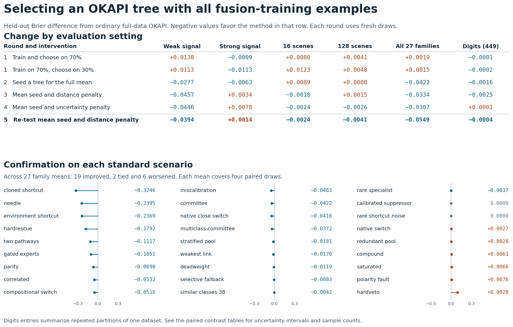

# When every fusion example participates in evolution and selection

On matched rare-event scenes, adding a native mean tree and discouraging departures from its predictions improved macro-F1 and average precision. The primary Brier improvement remained uncertain, and arithmetic averaging retained the lowest loss.

We returned to constructive OKAPI. Each base provider contributes an initial one-node tree. Evolution scores trees on the full source set, and the algorithm returns the highest-fitness tree from its final Pareto front using those same data. With 128 examples this gives the baseline all 128 for every generation and final choice. The earlier eight-tree procedure uses an internal 70/30 split and two additional logit heads. We included it here as a historical reference. [Full-data baseline](engine.py) · [Earlier split-based experiment](../stability-five/README.md)

## What did withholding examples cost?

In the rare-event scenario, the 128 training observations came from 16 scenes. To form a holdout we reserved five *whole scenes*. The results on separate test scenes were:

| Round 1 policy | Test Brier ↓ | Macro-F1 ↑ | Average precision ↑ |
| --- | ---: | ---: | ---: |
| Evolve and choose on all 16 scenes | .14748 | .65004 | .44753 |
| Evolve and choose on 11 scenes | .15550 | .65675 | .43031 |
| Same 11-scene evolution, choose among its finalists on the other five | .15974 | .66386 | .42197 |
| Simple average of the eight providers | .13908 | .70447 | .54217 |

Against full-data evolution the combined split raised Brier by .01226 (95% paired interval .00270 to .02157). Ten of 12 draws worsened. The extra cost of terminal reranking on the same reduced fit was .00424, with an interval spanning zero. The holdout contained fewer than four positives on average. With stronger specialization the point estimate favored having a holdout; over all 27 standard scenarios the difference was +.00146 (−.00228 to +.00521). The observed split cost is therefore specific to the amount of information, the rule and the metric. [Round 1 and all controls](r1-report.md)

## Three ways to retain every example

* **Start with a useful tree.** Add an exact arithmetic-mean tree to the population. A duplicate single-provider seed controls for the extra slot. The genuine mean seed improved the standard panel by .05417 Brier against the duplicate, but in the 16-scene task it increased Brier by .00794. On weak specialization the genuine seed beat the duplicate on all 12 draws even though neither arm returned the exact mean on any draw. The starting tree can affect the trajectory after it is no longer the returned solution.
* **Reduce the reward for departing from the mean.** Give the mean-seeded population a penalty during evolution for its squared probability distance from the provider mean. With full-class Brier, completing the square shows that the ranking is equivalent to fitting an adjusted target. At 128 rows this is 80% one-hot label and 20% provider-mean probabilities. Every training label contributes, and the deployed program uses only the providers in its tree. This combined policy improved weak-specialization Brier by .04572 against ordinary OKAPI in round 3. Isolating the penalty with the same initialization and score scale gave a smaller gain of .00304. [Native objective and tests](https://github.com/damiankucharski/OKAPI/commit/0eeee46d526972304d29ea6eb16357c9c105355f)
* **Reduce the reward for uncertain gains.** Deduct 1.645 standard errors from each tree's average training gain over the mean. Use a scene as the independent unit when scene identifiers are available. Against the otherwise identical zero-margin control it helped both the weak and 16-scene tasks, but cost .00385 Brier over the suite and .01214 on strong specialization. This empirical penalty can reject useful departures from averaging.

A previously fixed rule screened for regressions on strong specialization, the 27-family panel and digits. It sent the second policy to confirmation. Its two-target score differed from the third policy's by only .00029 on different draws. Distinguishing those two methods requires a direct paired comparison. [Matched ablations](ablation-report.md) · [Selection frozen before round 5](selection.json)

## Confirmation on fresh banks

**The combined policy met the weak-specialization target and missed the joint target.** With 32 fresh draws of 16 scenes, the estimated Brier improvement was .00235 (95% interval for the change −.00580 to +.00089). Sixteen draws improved, fifteen worsened and one tied. The fit-to-test Brier gap narrowed from .03045 to .02284. Part of that reduction came from a .00527 increase in fit Brier. The gap alone would overstate the test benefit. The two prespecified targets, weak specialization and 16 scenes, each had to show a reduction for confirmation.

| Round and primary comparison vs ordinary full-data GP | Weak specialty | 16 scenes | 128 scenes | 27-family macro | Digits, 449 |
| --- | ---: | ---: | ---: | ---: | ---: |
| 1. Train with 70%, select with 30% | +.01131 | +.01226 | +.00479 | +.00146 | −.00021 |
| 2. Add the mean tree at initialization | −.02768 | +.00891 | +.00080 | −.04223 | −.00165 |
| 3. Add the mean tree and penalize forecast distance | −.04572 | −.00181 | +.00148 | −.03337 | −.00253 |
| 4. Add the mean tree and penalize uncertain gains | −.04456 | −.00241 | −.00261 | −.03070 | +.00011 |
| 5. Confirm the policy from round 3 | −.03944 | −.00235 | −.00405 | −.05492 | −.00038 |

**Probability accuracy, classification and ranking tell different stories.** On 16 scenes the fitted program's macro-F1 rose from .64562 to .68652 (change +.04089, .03004 to .05190), and average precision rose from .43745 to .48989 (+.05244, .03864 to .06676). The arithmetic mean achieved .70315 and .53551 respectively. It also won on Brier in 31 of the 32 draws. An average final tree used 4.59 of eight providers and none matched the mean's entire test forecast. On 128 independent source scenes the Brier change against full-data GP was −.00405 (−.00826 to −.00060). Comparing the two changes directly on their shared test scenes gave +.00170 (−.00276 to +.00673) for 16 minus 128. These data do not establish a difference in the treatment effect between the scene counts. [Seed-paired scene comparison](results/round5-scene-interaction.csv)

**Could noisy test labels hide a 16-scene benefit?** In a post hoc diagnostic we reproduced all 192 saved test forecasts for the three relevant methods on both scene settings and replaced each binary test outcome with its known probability in the *evaluation* of Brier. The conditional expected 16-scene difference was −.00175 (−.00481 to +.00111) on the very same test inputs. Integrating out this source of noise still left the effect uncertain. The original observed-label result determines confirmation. [Conditional risk replay](scene-posterior.md)

**Where the method transfers.** On weak specialization the reduction was .03944 (.02898 to .04995); 31 of 32 draws improved. Arithmetic averaging still had lower average Brier by .00660. With strong specialization, Brier changed by +.00144 (−.00244 to +.00472). Nineteen scenario means improved across the fixed suite, two tied and six worsened. The largest gains were cloned_shortcut (−.32458), needle (−.23948) and environment_shortcut (−.23693). The largest regression was hardveto (+.09276), a practical reason to keep per-scenario reporting. Training on only 100 digit images raised Brier by .00101 relative to ordinary GP. [All paired comparisons](results/round5-contrasts.csv) · [All fixed scenarios](results/round5-families.csv) · [Prespecified decision](results/confirmation.json)

### Absolute test Brier in round 5

| Setting | Ordinary full-data GP | Mean-seeded GP with penalty | Arithmetic mean | Ranked Top-N | Logistic stacking | Historical split-based pattern model |
| --- | ---: | ---: | ---: | ---: | ---: | ---: |
| Equal competence | .54396 | .49275 | .48187 | .49847 | .51760 | .51863 |
| Weak specialization | .52792 | .48848 | .48188 | .49447 | .50374 | .50429 |
| Strong specialization | .42158 | .42302 | .48188 | .43165 | .43570 | .42539 |
| 16 source scenes | .14888 | .14652 | .14040 | .15243 | .16648 | .14448 |
| 128 source scenes | .14837 | .14432 | .14040 | .14921 | .15727 | .14320 |
| All 27 scenarios | .41438 | .35946 | .39850 | .37618 | .28514 | .25749 |
| Digits, 449 | .03749 | .03711 | .06228 | .03749 | .03092 | .03556 |
| Digits, 100 | .03744 | .03846 | .06228 | .03749 | .03436 | .03782 |

Using Brier in this study gave the same *ordering of methods* that motivated the dissertation comparison: arithmetic averaging has lower Brier than ordinary full-data GP, and logistic stacking has higher Brier than both. The standard suite shows a different ordering, with logistic stacking ahead of the new policy and the historical split-based pattern model ahead of stacking. The historical model also changes representation, search budget and refitting, so its score cannot identify a benefit of withholding examples. [Levels, fit and test metrics](results/round5-levels.csv)



[Vector figure](results/full-data-five.pdf) · [Family tables for round 1](results/round1-families.csv) · [Round 2](results/round2-families.csv) · [Round 3](results/round3-families.csv) · [Round 4](results/round4-families.csv) · [Round 5](results/round5-families.csv)

## Scope and reproduction

The 27 standard-v5 families were included in every round, with two fresh seeds per family in rounds 1–4 and four in round 5. The controlled weak and strong tasks use exactly matched label and amplitude strata. The rare-event scene tasks draw independent train and test scenes from one population. They have roughly 10% positives and strong within-scene correlation in each provider's error. Digit classifiers (logistic regression, 5-nearest neighbours, random forest) learned from 898 separate images. The same 450 images scored the 449- and 100-example fusion fits within each confirmation partition. Digits intervals would overstate independence across those partitions; we give descriptive means. [Data and rare-event counts](scene-cohort.md) · [Sampling and metrics](analysis.md)

These are finite-budget constructive GP results with a single fixed optimizer seed, eight generations and one restart. The standard node cap was 31 except on the 100-provider needle family, where all native comparison arms used 101 to make the mean tree representable. Brier was the training objective. Macro-F1 and positive-class AP measure classification and ranking after fitting. STARCOP and MedMNIST were not evaluated. [Protocol and feasibility correction](protocol.md)

Use the FusionBench commit containing this report and [OKAPI revision 0eeee46](https://github.com/damiankucharski/OKAPI/commit/0eeee46d526972304d29ea6eb16357c9c105355f). We used Python 3.12.14, NumPy 2.3.5, SciPy 1.17.0, scikit-learn 1.8.0 and pandas 2.2.3. After installing both repositories' research dependencies, run from the FusionBench root. The confirmation runner checks the selected name and the screening score hashes against Git before fitting anything.

```sh
export PYTHONPATH=".:/path/to/OKAPI"
export BACKEND=numpy OKAPI_LOG_LEVEL=ERROR LOGURU_LEVEL=ERROR TQDM_DISABLE=1
export OPENBLAS_NUM_THREADS=1 MKL_NUM_THREADS=1 OMP_NUM_THREADS=1
study=docs/ensemble-study/full-data-five
for r in 1 2 3 4; do
  python "$study/run_full.py" "$r"
  python "$study/analyze_full.py" "$r"
done
python "$study/decide.py" select
python "$study/run_full.py" 5
python "$study/analyze_full.py" 5
python "$study/decide.py" confirm
python "$study/verify_full.py"
python "$study/ablation.py"
python "$study/scene_counts.py"
python "$study/scene_posterior.py"
python "$study/plot_full.py"
```

The main jobs took 121, 116, 124, 129 and 130 seconds per round on one numerical thread each. The first four ran concurrently; 6 min 32 s elapsed from the first protocol commit to the last confirmation score. An independent audit checked 756 bank conditions, 5,244 method scores, 7,578 paired summaries, 4,536 fit and test forecast hashes for the cheap baselines and 24 instrumented native refits. [Verification record](results/verification-full.json)

One next question follows from the full-data result. Can OKAPI retain the ranking improvement on rare positives while matching the probability quality of arithmetic averaging with fewer providers? A direct next comparison could keep exactly the same tree search and budget, report both Brier and AP, and separate a calibration improvement from a change in which cases the tree ranks first.
