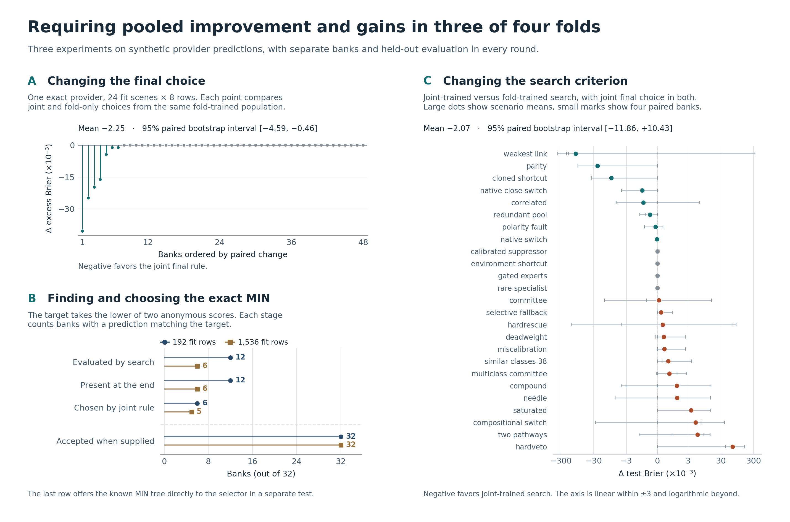

# Replacing the initial tree: three experiments with pooled and per-fold gains

The extra pooled-loss check helped when an ordinary three-of-four-fold win was driven by three small gains and one large loss. In a new 48-bank cohort it reduced native GP's conditional test loss by 0.00225 on the prespecified strong-start comparison. In a separate weak-start cohort it made no change to any of 32 primary decisions. Using the stricter score *during breeding* gave an uncertain average change over the 25 standard scenarios. A terminal guard has a narrower, better supported use here than a replacement for the default search objective. [Verification](results/verification.json)

## What changed in OKAPI

Choose the best initial tree on the fit data from the actual single-model founders and their all-model mean. Keep this *anchor* available. For every candidate tree compute two numbers on those same data:

* **Pooled gain** is the reduction in full-class Brier relative to the anchor over all fit examples.
* **Fold gain** is the reduction attained in at least three of four fixed folds. Compute the four mean reductions separately and take the second smallest. Where observations share a scene, the whole scene belongs to one fold.

Consider a tree with fold gains +0.02, +0.02, +0.02 and −0.10 in equally sized folds. It passes the original fold rule but loses 0.01 in pooled Brier. The new terminal criterion admits a tree only if both gains are strictly positive. When the leading tree fails, **veto** returns the anchor. **Joint selection** looks for the best eligible alternative amongst the remaining final survivors, using fold gain for ranking. **Joint training** is a separate intervention. It scores each candidate during evolution by the smaller of its two gains, with the usual tree-size objective. It can still breed intermediate trees that score below the anchor. All policies deploy one tree. [Frozen protocols](protocol.md) · [OKAPI implementation](https://github.com/damiankucharski/OKAPI/blob/697335b85847b1b05330b72aaed9f9b8245897be/okapi/fold_gain.py)

## What each comparison measures

| Series | What changes? | What stays matched? | Independent replication |
| --- | --- | --- | --- |
| 1. Strong start | Final rule for replacing the anchor | Identical live search and final population | 48 new data banks, each with a perfect-provider and an equal-competence law |
| 2. Weak start | The label probability comes from one model or the minimum of two | Anonymous input scores, label uniforms, search budget, and folds | 32 further banks, 192 and 1,536 fit examples |
| 3. Evolution and transfer | Fitness during breeding | Same joint terminal selection, starting population and audit | All 25 scenarios with four new data seeds each; separately 24 further banks with three search seeds each |

The controlled experiments integrate over possible audit labels using the simulator's known probability. Their excess Brier is twice the mean squared difference between a positive prediction and that probability; zero is perfect. The 25-scenario panel reports ordinary full-class test Brier against the sampled labels. Each contrast uses matched predictions, with uncertainty resampled at the data-bank level. References are arithmetic mean, Brier-ranked prefix Top-N, probability logistic stacking and the pre-existing regularized native-pattern OKAPI. The studies use synthetic data. The deployment guarantee concerns the observed fit set relative to the frozen anchor; audit risk can still rise.

## Results

### 1. Blocking a misleading fit improvement

Under severe scene dependence, one provider emitted the true probability. After fold-based training on 24 eight-row scenes, the ordinary fold score selected trees with mean excess Brier **0.00985**. Restricting the same final population to candidates improving both fold and pooled loss reduced this to **0.00760**. The mean difference was **−0.00225** (95% paired interval −0.00459 to −0.00046). Seven of 48 banks improved and 41 tied. Returning directly to the anchor on a failed check gave **0.00741**. In four of the seven blocks a runner-up qualified; each of the four was worse on fresh scenes than returning to the anchor. Ordinary pooled GP scored 0.00767 and Top-N 0.00748. The anchor alone scored 0.00195. There is a perfect model among the founders by construction in this condition. With 192 eight-row scenes, the joint versus fold difference was only −0.00001 (−0.00009 to +0.00006), including two regressions. [Round-one report and controls](r1-report.md) · [Per-bank decisions](results/r1-events.csv)

### 2. Testing whether the rule also permits a necessary replacement

Repeated independent noisy labels were generated from the smaller of two anonymous provider probabilities. The native MIN operation can construct the true predictor exactly, whereas the best possible population-level starting predictor among the six singletons and their mean has excess Brier **0.13455**. This follows from the exact input distribution. [Population calculation](results/r2-population-founders.csv)

On 192 training rows, the fold and joint terminal rules chose the **same program in all 32 banks**. Both reached excess 0.04796, versus 0.14686 for the empirically selected anchor, 0.13431 for averaging, 0.08131 for Top-N, 0.03623 for stacking and 0.02932 for regularized native-pattern OKAPI. The observed paired difference and both percentiles were zero, meeting the prespecified +0.002 noninferiority tolerance in this sample. Bootstrap resampling of identical decisions cannot reveal unobserved cases where the policies differ. For scale, even zero disagreements in 32 independent trials leaves a one-sided 95% binomial upper bound of 8.9% on their probability under the same sampling law.

Ordinary evolution visited an exact MIN function in **12/32**, kept it in the final population in **12/32**, and selected it in **6/32**. When the exact rule was explicitly offered in a separate two-candidate comparison with the anchor after training, joint selection accepted it in **32/32**. Availability of other finalists therefore matters even when a correct tree has been found. With 1,536 rows, the best visited conditional excess averaged 0.04838, while the full deployed policy averaged about 0.04872. Searching a richer candidate set is the next binding constraint on these banks. [Round-two report](r2-report.md) · [Search and retention](results/r2-diagnostics.csv) · [Supplied witness](results/r2-witness.csv)

### 3. Fitness during breeding and sensitivity to seeds

Holding joint deployment fixed, using joint gain in place of fold gain during breeding changed mean standard-v4 test Brier from **0.32514 to 0.32308**, difference **−0.00207** (95% interval −0.01186 to +0.01043). Eight families improved, 13 regressed and four tied. The new breeding rule did not meet either prespecified criterion for a broad gain. Large opposing effects occurred on `weakest_link` (−0.10718) and `hardveto` (+0.06793). Ordinary pooled native GP scored 0.31803, simple mean 0.39426, Top-N 0.35780, logistic stacking 0.26092 and regularized native-pattern OKAPI 0.23037. [Full panel](r3-panel-report.md) · [Every scenario](results/r3-panel-family-means.csv)

On the independent three-search-seed cohort, the breeding change reduced average MIN-law excess by 0.00751 relative to fold breeding. Ordinary pooled GP still had lower mean excess there than either constrained variant. Fixed-bank ranges did not show a resolved reduction under either the MIN or perfect-provider law. [Search-seed study](r3-seed-report.md)



## What the next test could distinguish

With six inputs there are just 15 unordered two-provider MIN programs. Under the MIN law, more fit labels alone left a substantial realized search gap despite this small expressible family. A budget-matched experiment could vary how native mutation proposes previously unseen pairs, using ordinary pooled breeding as the reference. Record proposals, survival and deployment per generation and retain tasks where MIN is inappropriate to measure the cost of that intervention. The guard studied here remains opt-in. The three samples cannot establish a general fix for transfer on natural datasets.

## Reproduce

From this FusionBench research checkout, install the base project and put the companion OKAPI research commit first on the Python import path. The joint helper is opt-in.

```sh
uv sync --extra okapi
git clone https://github.com/damiankucharski/OKAPI.git ../okapi-joint-study
git -C ../okapi-joint-study checkout --detach 697335b85847b1b05330b72aaed9f9b8245897be
export PYTHONPATH="$PWD:$PWD/../okapi-joint-study"
export BACKEND=numpy OKAPI_LOG_LEVEL=ERROR LOGURU_LEVEL=ERROR
export OPENBLAS_NUM_THREADS=1 OMP_NUM_THREADS=1 MKL_NUM_THREADS=1 NUMEXPR_NUM_THREADS=1
study=docs/ensemble-study/joint-gain
.venv/bin/python "$study/round1.py" --workers 2
.venv/bin/python "$study/round2.py" --workers 2
.venv/bin/python "$study/min_founders.py"
.venv/bin/python "$study/round3_panel.py"
.venv/bin/python "$study/round3_controlled.py" --workers 2
.venv/bin/python "$study/plot.py"
.venv/bin/python "$study/verify.py"
```
