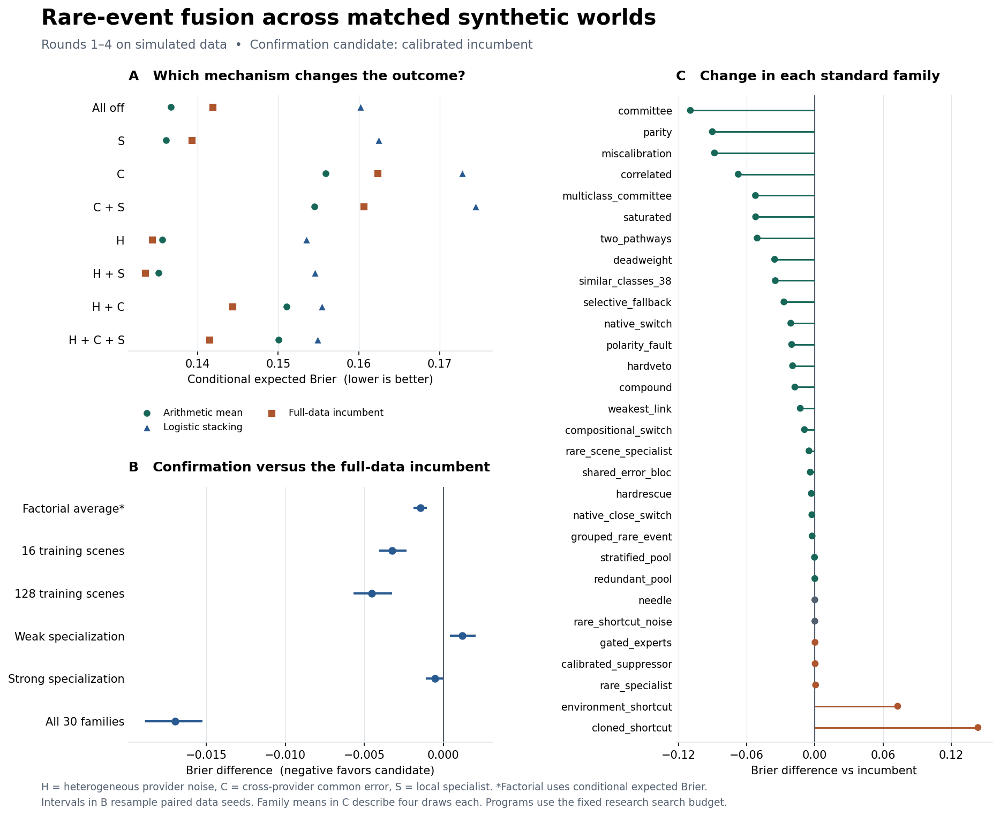

# When does averaging lose its advantage?

We held the examples, labels and event probabilities fixed and changed the way eight providers make errors. In the first round, equally noisy providers with independent errors favored averaging. When quality varied, errors were shared and a specialist helped locally, the existing mean-seeded OKAPI tree beat the arithmetic mean. In both cases methods received only the providers' reports. The change of ordering is a property we can now reproduce and stress deliberately. [Eight paired settings and error decomposition](r1-mechanisms.md)

## Three public scenarios

The standard-v6 catalog contains 30 ready-to-use cases. Its original 27 retain their identities, prespecified slots and the standard-v5 preset. The three new cases have a shared generator and distinct defaults. Each has a bundled reference bank, tests and named stress profiles. Each round includes all 30 cases; the historical 27 are also averaged separately. The new cases each receive a vote in the expanded panel; the eight matched variants used for mechanism analysis form a separate, within-seed comparison.

| Public identifier | Question it isolates |
| --- | --- |
| `shared_error_bloc` | What if six equally accurate providers agree because they share an error, while two offer independent evidence? |
| `rare_scene_specialist` | Can a method use a provider that is ordinary most of the time but exceptionally accurate in a minority of scenes? |
| `grouped_rare_event` | What happens when rare positives, within-scene dependence, differences in provider quality, shared errors and conditional specialization coexist? |

The specialist's region is available for diagnosis after prediction. Fitters receive probabilities and source labels; the temperature penalty can also use the number of training scenes. The example panels simulate matched source and target populations. The event rate is roughly 10% in expectation. Noise, prevalence, scene size, the block of dependent models, the provider order and the strength of specialization can be varied. [Scenario catalog and runnable examples](../../site/scenarios.md#rare-events-in-correlated-scenes-standard-v6) · [Source and audit bank design](banks.md)

## What changed in the algorithms?

1. **Controlled comparison.** On independent errors with equal variance, mean and incumbent OKAPI had expected full-class Brier of .13670 and .14185. Switching on all three mechanisms gave .15001 and .14151 on the same examples. Across the eight settings the average difference was near zero. Sharing 65% of the residual variance increased the mean's loss by .01693, mainly by reducing the improvement it receives from provider diversity. Within its own region the specialist's excess loss fell by .03916, while the mean captured .00464 there. [Round 1](r1-mechanisms.md)
2. **Start from a compact average.** Greedily select providers whose mean approximates the full source mean without using labels, then use their native tree to initialize GP. This reduced the mean deployed provider count from 4.23 to 2.85 across the 30 cases but cost .00706 Brier. The same-size random initialization was sensitive to role order. With eight providers, the single fixed random triple happened to contain the three lowest-noise providers in the heterogeneous law. The exact expectation over all 56 possible triples makes the standalone comparison independent of that draw. [Round 2 and compression trade-off](r2-report.md) · [Native sparse-tree implementation](https://github.com/damiankucharski/OKAPI/blob/50b1b6199357d2d6d072ca3261d2e3a935b89f17/okapi/sparse_mean.py)
3. **Fit one probability-scale parameter after evolution.** Keep the fitted tree and all its providers. On all source labels choose one inverse temperature from a nine-value grid with an identity penalty. For binary predictions, a multiplier above one increases confidence and a multiplier below one reduces it. On the continuous binary factorial there was no change to AP or macro-F1. In screening the temperature reduced the incumbent tree's observed Brier by .01540 across all 30 cases. The same step improved the arithmetic mean by .01907, so the simple calibrated average is an important control. [Round 3 and unpenalized comparison](calibration.md) · [Native implementation](https://github.com/damiankucharski/OKAPI/blob/50b1b6199357d2d6d072ca3261d2e3a935b89f17/okapi/temperature.py)
4. **Confirm on fresh banks.** We froze the calibrated incumbent before the fourth round. The compact GP missed the screening limits for the full suite and the scarce-scene control. The calibrated compact GP missed the scarce-scene threshold. The confirmation compares the winner to the same full-data tree before calibration. Both share a native mean tree at initialization and the same training penalty on distance to the source provider mean. The comparison with ordinary GP has several changes at once. [Frozen selection](selection.json) · [Protocol](protocol.md)
5. **Test the simulator assumption.** A fifth round varies the response of ordinary providers to the signal. It measures whether the temperature gain persists when the ordinary provider slope matches or exceeds the slope used to generate event probabilities. This round uses new data and retains the full standard suite and historical controls. [Separate protocol](slope-protocol.md)

## Results on the independent confirmation draws

The direction change from round 1 replicated. With all three switches off, the uncalibrated incumbent lost to averaging by .00630 in expected Brier (.00388 to .00958). With all three on, it beat averaging by .01643 (.01460 to .01823). The eight configurations within each of the 24 draws use the same labels and underlying noise, so these are 24 independent units. [R4 contrasts by switch setting](results/r4-contrasts.csv)

Temperature scaling improved the same tree's conditional expected Brier by **.00146** (95% paired interval .00104 to .00189) averaged over the eight configurations. The panel and both continuity controls met the prespecified breadth limits. The calibrated tree uses the same providers as its parent. Under the equal-competence 16-scene control an equally calibrated arithmetic mean still beat the calibrated tree by .00697 (.00423 to .01041). Their difference over the mixed factorial remained uncertain; calibrated mean minus calibrated tree was +.00077 (−.00149 to +.00262) in expected Brier. The calibration of the mean used precisely the same nine source-only choices. [Matched mean calibration](calibration-control-protocol.md) · [Primary decision](results/confirmation.json)

| Confirmation population, observed Brier | Ordinary GP | Incumbent | Calibrated incumbent | Arithmetic mean | Top-N | Logistic stacking | Earlier split-based native-pattern |
| --- | ---: | ---: | ---: | ---: | ---: | ---: | ---: |
| Eight matched variants | .14429 | .14484 | .14334 | .14725 | .14741 | .16499 | .14253 |
| Earlier 16-scene control | .14892 | .14399 | .14076 | .13888 | .14951 | .16976 | .14482 |
| Complete standard-v6 (30) | .36617 | .33845 | .32150 | .37593 | .35366 | .27063 | .24328 |
| Historical standard-v5 (27) on the same draws | .39173 | .36113 | .34272 | .40212 | .37748 | .28587 | .25581 |

Of 30 scenario means, 23 improved, two tied and five worsened. The average gain on the historical 27 was .01841, compared with .01695 on all 30. The largest reductions were committee (.10957), parity (.09021) and miscalibration (.08833). Two shortcut scenarios showed large regressions: cloned_shortcut (+.14361) and environment_shortcut (+.07292). A source-fitted scalar can be inappropriate at evaluation, even after its average improvement passes all registered thresholds. The simple LR reference continued to beat this full-data tree on the broad panel. [Scores for all 30](results/r4-families.csv) · [Costs and absolute metrics](results/r4-levels.csv)



[Vector figure](results/mechanism-four.pdf) · [Round 1 family table](results/r1-families.csv) · [Round 2](results/r2-families.csv) · [Round 3](results/r3-families.csv) · [Round 4](results/r4-families.csv)

## How much of the gain came from the generator?

In round 5, 12 fresh draws each supplied 24 worlds (eight cells at three provider slopes). The true event-logit slope was 1.8 in all worlds. The primary statistic paired each tree with its own calibrated version and then compared the effects between slopes. Lower Brier is better.

| Ordinary provider signal slope | Expected Brier change after calibrating the tree | 95% paired interval | Identity retained (of 96 fits) |
| --- | ---: | ---: | ---: |
| 1.3 | −.001670 | −.002327 to −.000990 | 45 |
| 1.8 | +.000022 | −.000030 to +.000097 | 88 |
| 2.3 | −.000045 | −.000234 to +.000100 | 90 |

Matching the ordinary provider's slope to the event slope diminished the calibration benefit by **.00169** (.00101 to .00235). The same change diminished the benefit of calibrating the simple mean by .00280 (.00186 to .00364). Random provider errors and the specialist region still affect forecasts at slope 1.8. Equality of two generating coefficients alone does not guarantee calibration of a noisy forecast.

The 30 standard scenarios used their own usual settings. On their 90 fresh banks the incumbent changed from .34096 to .32377, versus .26907 for LR and .24310 for the earlier split-based reference. The change on the historical 27 was −.01852. The slope interaction concerns the grouped synthetic law. It explains why gains in that law should be measured over more than one choice of provider scale. [Fifth-round report](slope-report.md) · [All 30 families](results/r5-families.csv) · [Paired interaction](results/r5-slope-effects.csv)

## Reproduce the five rounds

Use the FusionBench checkout containing this report and the [OKAPI algorithm-lab revision](https://github.com/damiankucharski/OKAPI/commit/50b1b6199357d2d6d072ca3261d2e3a935b89f17). The runs used Python 3.12.14, NumPy 2.3.5, SciPy 1.17.0, scikit-learn 1.8.0 and pandas 2.2.3. After installing both repositories' dependencies, run from the FusionBench root, substituting the path to your OKAPI checkout. Use a Git checkout with the recorded selection commit for the history checks.

```sh
export PYTHONPATH=".:/path/to/OKAPI"
export BACKEND=numpy OKAPI_LOG_LEVEL=ERROR LOGURU_LEVEL=ERROR TQDM_DISABLE=1
export OPENBLAS_NUM_THREADS=1 MKL_NUM_THREADS=1 OMP_NUM_THREADS=1
study=docs/ensemble-study/mechanism-four
for round in 1 2 3; do
  python "$study/run_four.py" "$round"
  python "$study/stats_four.py" "$round"
done
python "$study/choose_four.py" select
python "$study/run_four.py" 4
python "$study/stats_four.py" 4
python "$study/choose_four.py" confirm
python "$study/verify_four.py"
python "$study/mean_control.py"
python "$study/slope_trial.py" --workers 2
python "$study/verify_slope.py"
python "$study/plot_four.py"
```

There were 1,302 bank conditions and 10,632 method scores in the main trials. An independent audit reproduced 7,812 fit and audit forecast hashes from the three cheap baselines. The main jobs took 121, 114, 121, 183 and 106 seconds; rounds 1–3 ran concurrently, and the last used two single-threaded workers. From the initial protocol commit to the final round's raw scores took 10 min 18 s. These experiments vary data seeds at one bounded GP budget and optimizer seed. The next diagnostic question is whether the source contains evidence that justifies sharpening probabilities when a shared shortcut may fail at evaluation. On cloned_shortcut, each of four confirmation fits chose a multiplier of 1.68. Training Brier fell on all four, and test Brier rose on all four. [Independent audit](results/verification.json) · [Slope audit](results/r5-verification.json) · [Individual fit and audit scores](results/r4-scores.csv)
