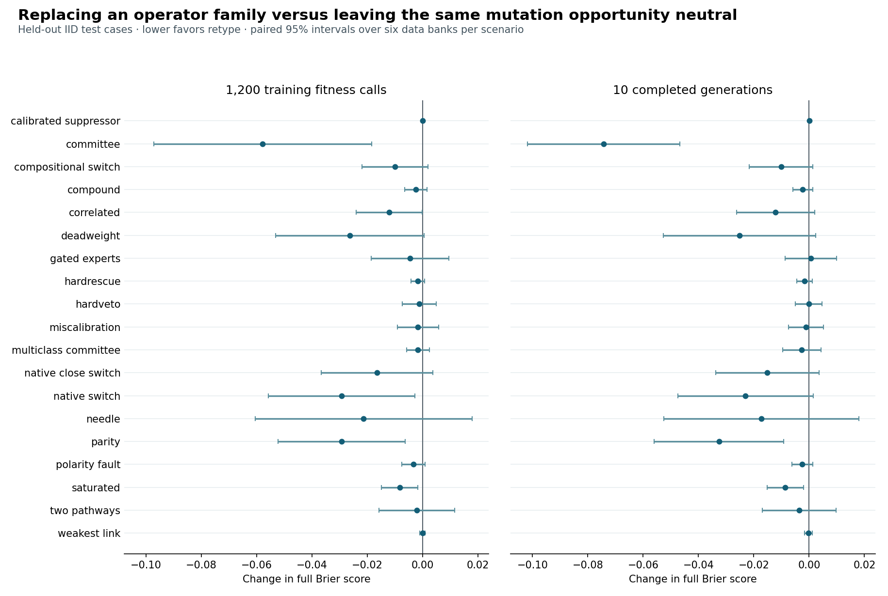

# Does changing the operator family account for the improvement?

A later audit corrected the two multiclass scenarios’ reference probabilities. The primary Brier estimates reported here use true test labels and were independently verified. Revised secondary distances to the reference are linked in the [multiclass correction and historical replay](../multiclass-oracle/README.md).

Yes for the fixed 19-scenario IID panel. At 1,200 actual training fitness evaluations, the ordinary retype achieved **0.25551** full-class Brier versus **0.26753** when the same fourth mutation opportunity returned the unchanged genotype. The paired difference was **−0.01202**, with a 95% interval of **[−0.01756, −0.00648]** across six new data replicates. At a matched 10 completed generations the difference was −0.01219 [−0.01658, −0.00780]. Seventeen of the 19 IID point estimates favored the new operator family. Across the nine predefined shifts the mean difference was −0.00100 [−0.00479, +0.00279]. Regularized logistic stacking had the best suite-wide mean at 0.22610. [Frozen protocol](protocol.md) · [Independent refresh addendum](refresh-addendum.md) · [All aggregate contrasts](suite-contrasts.csv)



## What each control changed

Only the stock arm lacked the new mutation slot. Each enabled arm generated the ordinary alternative family on the same kind of eligible node and preserved the ordered argument subtrees. Identity discarded that alternative. Refresh retained the previous family and sampled new parameters when that family had any. Retype used the proposed alternative. All policies retained the previous selection rules; their populations and subsequent variation could diverge after an edit. Inputs and labels were identical across methods within each bank. [Native controls](https://github.com/damiankucharski/OKAPI/blob/1ae37a58f6d3dd3296c1f6c716ec6d5317b0facd/experiments/point_ablation/README.md)

| 1,200-call comparison | Mean IID Brier difference | Paired 95% interval |
|---|---:|---:|
| True retype minus original stock | −0.00934 | [−0.01267, −0.00601] |
| Fourth-slot identity minus stock | +0.00268 | [−0.00064, +0.00599] |
| Original parameter refresh minus identity | −0.00053 | [−0.00239, +0.00133] |
| Independently seeded refresh minus identity | −0.00069 | [−0.00159, +0.00021] |
| True retype minus independently seeded refresh | −0.01133 | [−0.01671, −0.00595] |
| Independently seeded refresh minus original refresh | −0.00016 | [−0.00179, +0.00147] |

The decomposition from stock to identity to retype gives +0.00268 − 0.01202 = −0.00934. The primary design measures the effect of letting the new family enter native evolution, including any later descendants and displaced individuals. The aggregate cannot establish which proposed operator supplied a winning tree's final prediction.

Selection on unrounded training loss gave a retype-minus-identity difference of −0.01459 on fit and −0.01202 on IID. Selecting the minimum-validation-Brier champion from each same archive gave an IID difference of −0.01204 [−0.01890, −0.00520]. The primary fit-selected IID macro-F1 difference was +0.00077 [−0.00375, +0.00530]. The evidence supports an improvement in predicted probabilities. The aggregate classification decision gain remains uncertain. [Per-method metrics and dispersion](methods.csv.gz) · [All paired estimates and spreads](paired.csv.gz)

## Results for each default scenario

The baseline methods are the mean of all providers, one Brier ranking with every possible prefix evaluated on fit, and a regularized logistic stack. The stock and retype columns use the ordinary native search. Every score below is the full multiclass Brier on a frozen IID test, with lower values better. The shift column gives each available shifted point estimate; the linked data include its interval. Each scenario has six independent data replicates and two GP restarts on each. Individual intervals are unadjusted comparisons. Five exclude zero in favor of retype. Saturated uses four classes, the multiclass committee five, and the other seventeen cases two.

| Scenario | Mean | Top-N | Stack | Stock | Identity | Retype | Retype − identity, 95% IID interval | Shift Δ |
|---|---:|---:|---:|---:|---:|---:|---:|---:|
| calibrated_suppressor | 0.2871 | 0.2275 | 0.1696 | 0.2275 | 0.2275 | 0.2276 | +0.0001 [-0.0001, +0.0004] | -0.0000 |
| committee | 0.2391 | 0.2480 | 0.0309 | 0.2357 | 0.2484 | 0.1906 | -0.0577 [-0.0971, -0.0184] | — |
| compositional_switch | 0.4028 | 0.3571 | 0.3332 | 0.3466 | 0.3480 | 0.3381 | -0.0099 [-0.0218, +0.0021] | -0.0020 |
| compound | 0.3082 | 0.2531 | 0.1439 | 0.1891 | 0.1947 | 0.1923 | -0.0024 [-0.0065, +0.0017] | — |
| correlated | 0.2909 | 0.2805 | 0.1803 | 0.2528 | 0.2589 | 0.2469 | -0.0121 [-0.0240, -0.0001] | -0.0147 |
| deadweight | 0.3277 | 0.1596 | 0.0613 | 0.1401 | 0.1444 | 0.1181 | -0.0263 [-0.0532, +0.0005] | — |
| gated_experts | 0.3869 | 0.3204 | 0.3430 | 0.3122 | 0.3136 | 0.3091 | -0.0045 [-0.0185, +0.0096] | — |
| hardrescue | 0.4250 | 0.4297 | 0.0954 | 0.0998 | 0.1010 | 0.0993 | -0.0017 [-0.0041, +0.0008] | — |
| hardveto | 0.3097 | 0.3120 | 0.0937 | 0.1463 | 0.1462 | 0.1451 | -0.0012 [-0.0073, +0.0050] | — |
| miscalibration | 0.1892 | 0.1895 | 0.0489 | 0.1725 | 0.1765 | 0.1749 | -0.0016 [-0.0091, +0.0059] | — |
| multiclass_committee | 0.7045 | 0.7078 | 0.7149 | 0.7113 | 0.7057 | 0.7040 | -0.0017 [-0.0057, +0.0024] | — |
| native_close_switch | 0.4943 | 0.4936 | 0.4824 | 0.4768 | 0.4662 | 0.4499 | -0.0164 [-0.0365, +0.0038] | +0.0237 |
| native_switch | 0.4493 | 0.3475 | 0.3089 | 0.3069 | 0.3126 | 0.2834 | -0.0292 [-0.0557, -0.0027] | +0.0118 |
| needle | 0.4869 | 0.1969 | 0.2038 | 0.2002 | 0.2222 | 0.2009 | -0.0213 [-0.0604, +0.0179] | — |
| parity | 0.6773 | 0.6773 | 0.5041 | 0.5254 | 0.5265 | 0.4972 | -0.0293 [-0.0522, -0.0063] | -0.0228 |
| polarity_fault | 0.2218 | 0.1517 | 0.1130 | 0.1470 | 0.1474 | 0.1442 | -0.0032 [-0.0074, +0.0010] | -0.0060 |
| saturated | 0.1991 | 0.2004 | 0.1469 | 0.1756 | 0.1771 | 0.1689 | -0.0082 [-0.0148, -0.0017] | — |
| two_pathways | 0.3048 | 0.3085 | 0.2462 | 0.2980 | 0.2982 | 0.2962 | -0.0020 [-0.0157, +0.0117] | -0.0013 |
| weakest_link | 0.4884 | 0.4914 | 0.0755 | 0.0684 | 0.0680 | 0.0680 | +0.0000 [-0.0010, +0.0010] | +0.0022 |

## What the event counts establish

At the call budget, 6,432 of 6,432 point proposals in the retype arm changed their operator family. The independent refresh changed only 579 of 6,629 proposed genotypes; the original refresh changed 624 of 6,670. In 134 of 228 identity trajectories no selected site belonged to a parameterized family. Both refresh controls reproduced the entire identity trajectory and its selected trees in all 134 cases. Such cases empirically assess what happens when that fourth opportunity does nothing. They offer no test of the benefit of resampling a parameter at an eligible site. This sensitivity to the available population was also visible on Wine. [Independent cost and exposure audit](costs-verified.json)

At fixed calls, retype removed 616 within-cohort duplicates per run on average, versus 676 under identity. Its fit-selected winners averaged 17.8 nodes versus 16.6. At ten generations retype scored 1,173 trees on average versus 1,134 under identity. At fixed calls 1,124 of 1,140 synthetic trajectories stopped partway through the already generated cohort. Opportunity counts describe all proposals already constructed, even when the last few awaited a fitness evaluation. Claims about the exact number of improved descendants evaluated would require event-level tracking. [Resource summary](costs.csv)

In the original refresh implementation the private RNG started at the exact post-proposal native state. A threshold could consume the same uniform number as the next native mutation decision. This was discovered after the study started. The study leads had received the main Wine retype-versus-identity result and had not inspected any refresh result when they registered the extra control. The Wine runner had printed the old refresh column and did not communicate it to those making the decision. The additional control derived a private stream from a domain-separated SHA-256 of the complete native state. A native witness found identical threshold and following native variates 256/256 times with the old stream versus 0/256 with the new one. The original data and the independent-stream results are both included. [Native witness and exact implementation](https://github.com/damiankucharski/OKAPI/tree/cfa69aecda3245288f9a2f309d2990e38c572a7b/experiments/point_ablation) · [Prospective amendment](refresh-addendum.md)

## External Wine Recognition test

The test used six independently trained base classifiers on the UCI Wine Recognition data. The stack, the ranked prefix and all native searches learned from the same out-of-fold provider probabilities. In each of five outer folds, the validation and test specimens were excluded from every base-model fit. All 178 specimens appeared once in an outer test. Fold losses below average two GP restarts; pooled losses weight every held-out specimen equally. [Data and split provenance](wine-manifest.json) · [Frozen provider predictions, row IDs and labels](wine-inputs.npz) · [Original data](https://doi.org/10.24432/C5PC7J)

| Frozen method | Pooled outer-test Brier at 1,200 GP calls |
|---|---:|
| All-provider mean | 0.04971 |
| Ranked-prefix Top-N | 0.04633 |
| Logistic stack | **0.04276** |
| Native stock | 0.05104 |
| Fourth-slot identity | 0.05254 |
| Both same-family refresh controls | 0.05254 |
| Native retype | **0.05096** |

Retype minus identity was −0.00157. The five paired fold differences were −0.00145, −0.00087, −0.00163, −0.00013 and −0.00382. After ten generations the pooled comparison was −0.00080, with three of five point estimates favorable. The arms used 282 point opportunities under identity by 1,200 calls, all on operators without parameters. Both refresh trajectories therefore reproduced identity exactly. The three inexpensive baselines beat retype on this dataset, despite the transferred direction of its advantage over identity. Wine provides one small external domain, with overlapping outer training sets and disjoint tests. [All fold losses](wine-folds.csv) · [Pooled results](wine-pooled.csv) · [Fold-level contrasts](wine-contrasts.csv) · [Exact refresh parity](wine-refresh-parity.json)

## Verification and reproduction

The four preregistered arms use OKAPI 1ae37a5. The additional arm uses cfa69ae. A second native runner independently constructed the usual 30 shallow starting trees, omitted the experimental mutation mixin, and reproduced both ordered fitness-trace digests for all 476 stock/retype runs, including Wine. Their later checkpoints covered 593,091 fitness evaluations. A separate NumPy interpreter reconstructs predictions from the saved ordered trees. It also refits all three baselines independently and checks provider ranks, prefix losses and reported metrics. The independent replay matched all 17,673 prediction vectors bitwise and all 87,720 reported metric values, with largest absolute discrepancy zero. A separate reader recomputed all 608 fixed-call and fixed-generation per-scenario IID Brier intervals and 32 aggregate estimates, along with 32 sample-weighted external contrasts. [Native trajectory agreement](native-verified.json) · [Prediction verification](predictions-verified.json) · [Effect estimates verified from raw rows](agreement.json)

The synthetic four-arm and additional-control files are [original runs](runs.csv.gz) and [independent-stream runs](refresh-independent-runs.csv.gz). The corresponding external files are [Wine runs](wine-runs.csv.gz) and [Wine independent-stream runs](wine-refresh-independent-runs.csv.gz). They contain fit/validation/IID/available shifted scores, full selected trees and per-split prediction digests. There were 1,140 synthetic trajectories and 50 external trajectories, using 1,412,797 and 60,295 training fitness evaluations through their later checkpoints.

From the FusionBench repository, use one BLAS/OpenMP thread per worker. Put the indicated OKAPI checkout and the current FusionBench repository on PYTHONPATH. The second checkout preserves the previously defined controls. Use scikit-learn and NumPy versions recorded in the Wine manifest for bitwise prediction replay.

```bash
python -m fusionbench.eval.mutation_opportunity --out /tmp/opportunity --workers 2
python -m fusionbench.eval.opportunity_wine --out /tmp/opportunity
# Use the cfa69ae OKAPI checkout for these two additional-control commands.
python -m fusionbench.eval.mutation_opportunity --out /tmp/opportunity --workers 2 --intervention-only refresh_independent
python -m fusionbench.eval.opportunity_wine --out /tmp/opportunity --independent-refresh
python docs/ensemble-study/mutation-opportunity/summarize.py /tmp/opportunity
python docs/ensemble-study/mutation-opportunity/verify_predictions.py /tmp/opportunity
python docs/ensemble-study/mutation-opportunity/verify_primary.py /tmp/opportunity
python docs/ensemble-study/mutation-opportunity/plot.py /tmp/opportunity
# Replay the ordinary native trajectories from the original checkout.
python docs/ensemble-study/mutation-opportunity/verify_native.py /tmp/native-reference.jsonl --workers 2
python docs/ensemble-study/mutation-opportunity/verify_native.py /tmp/native-reference.jsonl --compare /tmp/opportunity
```

Langdon, Barrett and Buxton used same-arity replacement of an existing function preserving its arguments in an experiment combining networks. The paper mixed several GP operators. Here the identity and same-family controls isolate the effect of the categorical replacement in this specific native search. Ting and Witten studied stacking with out-of-fold predictions and multiple-response linear regression. The Wine evaluation uses the OOF principle with a regularized logistic stack and full-class Brier. [Langdon et al., §5.5](https://doi.org/10.1007/978-1-4471-0123-9_51) · [Ting and Witten, Tables 3–4](https://doi.org/10.1613/jair.594) · [Dated review](../literature/2026-11-21.md) · [Literature index](../literature/README.md)
