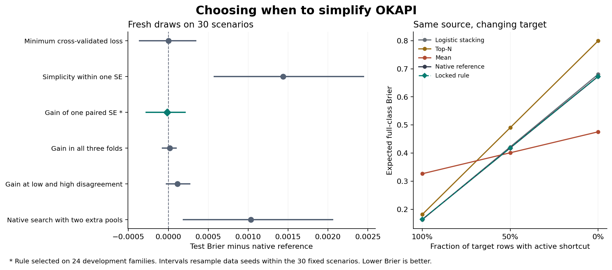

# When is an arithmetic pool preferable to the native search?

A simple average reduces variance. A ranked subset can remove persistently weak providers. Either choice can also discard a nonlinear relation that OKAPI could have learned. We studied whether source predictions and labels can identify the cases worth simplifying. Each of ten rounds evaluated the complete 30-scenario FusionBench standard-v6 suite. Four extra controls tracked training with few independent scenes and weak or strong specialization. The only data used here were synthetic. [Registered protocol](protocol.md)

## What competed

The native reference is regularized native-pattern OKAPI with an eight-program GP shortlist. It evolves candidate bases, fits native logit heads, and chooses a program on its internal validation rows. This is the stronger reference from our three-round configuration study. Every comparison also contains the ordinary mean, the best Brier-ranked prefix of providers (Top-N) and regularized logistic stacking on the probabilities. Top-N ranks on fusion-fit labels, evaluates all prefixes, and retains the prefix having the lowest fitted Brier. Logistic stacking is a fixed external comparison. [Previous study](../autoconfig-three/README.md)

We tried two ways to admit simpler predictions. One trains the three procedures on identical outer folds and asks when the estimated gain for an arithmetic pool warrants switching from the native reference. Each training row has one out-of-fold prediction per candidate. When scene identities exist, whole scenes stay together and each scene contributes one average loss. The final fit of the selected procedure receives the whole source bank. The native estimator retains its internal 70/30 row split. A second approach admits native arithmetic trees into the existing internal candidate comparison, with no extra holdout. In that approach the prefix is chosen on discovery data and reranked on all source rows if selected. Both approaches produce one deployed predictor. [Implementation and API examples](../../site/okapi.md)

## Reading the ten rounds

Risk differences are test Brier for the rule minus test Brier for the native reference. Lower is better. A round uses the same generated banks for every comparison. Data draws are independent across rounds. Each standard scenario gets equal weight. Intervals resample data seeds within the fixed scenario panel. They do not represent uncertainty about the universe of real-world tasks. Round 9 used 24 families to choose a rule. Round 10 is its independent confirmation. The six omitted families are grouped rare event, shared error bloc, rare scene specialist, cloned shortcut, parity and similar classes 3/8.

**The independent confirmation found a near tie across the 30 scenarios.** The helper scored 0.246533 against 0.246547 for the strong native reference, a paired change of −0.000015 [−0.000285, +0.000218]. The primary superiority criterion failed. The six withheld families met their +0.005 guardrail (+0.000083 [−0.000435, +0.000596]). The prespecified weak-specialization control improved by 0.00990. Strong specialization exposed a cost of 0.00481. These outcomes support keeping the choice optional. [Confirmation criteria](results/confirmation.json) · [All 30 scenarios](results/r10-families.csv)

| Round | Rule shown | Native Brier | Rule Brier | Change (95% interval) |
|---:|---|---:|---:|---:|
| 1 | `apparent` | 0.24851 | 0.24853 | +0.00002 [+0.00000, +0.00007] |
| 2 | `cv` | 0.24404 | 0.24462 | +0.00058 [+0.00016, +0.00103] |
| 3 | `one_se` | 0.24546 | 0.24650 | +0.00104 [+0.00032, +0.00192] |
| 4 | `sign` | 0.24524 | 0.24519 | -0.00005 [-0.00020, +0.00004] |
| 5 | `stress` | 0.24442 | 0.24430 | -0.00012 [-0.00022, -0.00001] |
| 6 | `augmented` | 0.24796 | 0.24752 | -0.00044 [-0.00095, -0.00002] |
| 7 | `paired` | 0.27060 | 0.27114 | +0.00054 [-0.00239, +0.00367] |
| 8 | `paired` | 0.24303 | 0.24291 | -0.00012 [-0.00047, +0.00022] |
| 9 | `paired` | 0.24775 | 0.24777 | +0.00001 [-0.00006, +0.00011] |
| 10 | `paired` | 0.24655 | 0.24653 | -0.00001 [-0.00029, +0.00022] |

The table shows one registered comparison per round. R7 and R8 show the paired-gain rule at the primary source size and GP seed, respectively. All six candidates and their matched interventions are in the per-round files. Round 9's table entry covers all 30 families; only the 24 development families entered its rule selection.

### Why the methods made different choices

- **Results on the fit data can hide a case for simplicity.** In R1, choosing by the apparent fitted Brier kept the native reference on 89 of 90 standard banks. In R2, comparing out-of-fold forecasts cut Brier by 0.03367 on the separate weak-specialization control (eight independent banks). Across all 30 standard scenarios the same rule added 0.00058 [0.00016, 0.00103].
- **Which side gets the benefit of the doubt matters.** In R3, preferring a simple model within one standard error of the best OOF score changed 19 of 90 standard forecasts and increased Brier by 0.00104. Reversing the burden of evidence in R4 meant keeping native unless a simple rule could demonstrate a gain. Requiring a positive gain in all three folds changed only two standard forecasts. On weak specialization its change was −0.00391 [−0.01368, +0.00325], compared with −0.02581 [−0.04380, −0.00968] for unconstrained CV on the same banks. In R5 the extra requirement of nonnegative gain at low and high provider disagreement gave the same aggregate standard Brier as the paired-gain rule.
- **Adding options directly to native search was inexpensive but conditional.** In R6 the two extra native finalists changed five of 90 standard forecasts and lowered Brier by 0.00044. On the strong-specialization control they raised Brier by 0.02419 [0.00215, 0.04582]. A better shortlist depends on how much the data reward regional expertise.
- **Changing the source sample had a larger aggregate effect than changing the search seed here.** In R7, reducing 512 training examples to a nested 128 raised native Brier by 0.02193 [0.01547, 0.02832] on identical tests. The unconstrained CV choice changed action in 28/90 matched banks. In R8, changing only the GP seed changed its action in 2/90. For native itself the average Brier change under the seed swap was +0.00063 [−0.00171, +0.00286], yet the absolute change exceeded 0.01 in 16/90 banks and reached 0.05072 on one `two_pathways` draw. Only two optimizer seeds were compared. [Source-size intervention](results/r07-intervention.csv) · [Paired seed choices](results/r08-paired-choices.csv)
- **The rule used in confirmation was frozen on other data.** In R9 the plain paired-gain rule, agreement across folds and agreement across disagreement strata tied at 0.256833 on the 24 development families. Their place in the protocol selected the plain paired rule. The original native reference was 0.000017 better than that choice at this stage. [Round-nine lock](https://github.com/damiankucharski/fusionbench/commit/e48fdcdda27f58624d3c076d7a3e4b144adbbfb5)

## Independent confirmation

The main panel contains **30 distinct scenario definitions and 10 fresh draws per scenario**. Each draw supplies 512 fusion-fit and 512 separate test examples. Across those 300 comparisons, the rule deployed native 284 times, the mean seven times and Top-N nine times. Six switches helped and ten hurt. The average gain on the six was 0.01044 and the average cost on the ten was 0.00582. The 16 selected pools looked 0.01044 better than native on average in source cross-validation, yet their fresh-test gain was only 0.00028. This is a descriptive estimate of how much the selected apparent advantage transferred. Different fit sizes in the inner folds and true changes of law can also affect the gap. [Per-bank source evidence and test gain](results/r10-transfer-bins.csv) · [Switches](results/r10-switches.csv)

| Method | Standard Brier ↓ | Macro-F1 ↑ | Providers per prediction |
|---|---:|---:|---:|
| Native reference | 0.24655 | 0.78376 | 9.16 |
| Frozen paired-gain rule | 0.24653 | 0.78375 | 9.18 |
| Logistic stacking on probabilities | 0.27408 | 0.75699 | 9.83 |
| Ranked-prefix Top-N | 0.35806 | 0.70465 | 3.92 |
| Arithmetic mean | 0.37650 | 0.69375 | 9.83 |

The native reference already beat LR by 0.02753 [0.02611, 0.02898] in Brier. Adding the helper contributed about 0.000015. With weak specialization the paired rule lowered Brier from 0.49813 to 0.48823 [change −0.01653 to −0.00414]. It switched to the mean on nine of 16 draws, and all nine switches helped. The mean alone scored 0.48187. With strong specialization the rule raised native Brier from 0.43572 to 0.44052 [change +0.00035 to +0.01191]. Five of its six switches hurt. With only 16 fit scenes the change was +0.00227 [−0.00121, +0.00743]. [Absolute scores](results/r10-levels.csv) · [Paired comparisons](results/r10-contrasts.csv)



### Where did useful alternatives escape selection?

Picking the best of the *same three procedures* separately after seeing every test score would have lowered Brier from 0.24655 to 0.23754. Two scenarios accounted for 94.1% of that retrospective headroom. In `rare_shortcut_noise` (84.2%), a rare region becomes common, a formerly useful provider shortcut disappears and provider reports acquire noise. The best test-time alternative gained on all ten draws. The other concentration was `environment_shortcut` (9.9%). Hindsight includes sample noise and cannot identify an attainable training-only improvement. [Scenario-level headroom](results/r10-headroom.csv)

We also isolated the effect of the shortcut in a separate paired control. Both training and target had the same 5% specialist prevalence and zero added label and provider noise. Only the fraction of test rows on which the shortcut was informative changed. Training data, support of the test reports, and predictions returned by each fitted rule were identical across the three laws. The frequencies of those reports and their label probabilities could change.

| Active shortcut fraction on target | Native | Frozen rule | Mean | Top-N | LR |
|---:|---:|---:|---:|---:|---:|
| 100% | 0.16389 | 0.16389 | 0.32656 | 0.18164 | 0.16315 |
| 50% | 0.41832 | 0.41832 | 0.40111 | 0.49039 | 0.42177 |
| 0% | 0.67275 | 0.67275 | 0.47566 | 0.79914 | 0.68040 |

For a fixed predictor the loss is linear in the mixing fraction in this generator. Interpolating the **exact population risks** for each source fit gave a native/mean crossover at **54.8% active** [52.6%, 56.7%] on 16 new source draws. The secondary analysis was specified after observing a 51.7% crossover in R5. This fraction describes the generator. A training-only rule cannot observe the future fraction. [Risk curves](results/r10-shortcut.csv) · [Crossover calculation](shortcut_crossover.py) · [Final estimate](results/r10-crossover.json)

**Next question.** Can several observed training environments expose a provider whose apparent value disappears when the environment changes? A follow-up could hold total training size fixed and compare one homogeneous source against multiple environments with different shortcut activity. It would test whether environment-level evidence recovers some of the 94% concentration above. A stationary, genuinely specialized provider is needed as a control for the cost of discounting reliable expertise.

The ten rounds scored 1,774 conditions and produced 14,618 method scores. This count includes matched interventions and repeated seeds within a family. The fitting and scoring runs took 1,168 seconds in total (19.5 minutes). Three single-threaded CPU workers ran rounds 1–9 and four ran confirmation. An independent replay reconstructed all 1,774 bank identities, 210 representative cheap-reference fits and 500 paired intervals. Replaying source losses independently recovered 6,382 decisions. The two repos' suites passed 911 FusionBench tests and 838 OKAPI tests in this environment. [Confirmation replay](results/r10-cheap-replay.json) · [Independent interval checks](results/r10-interval-check.json)

## Reproducing a round

From a checkout of this research branch install the optional OKAPI dependency with `pip install '.[okapi]'`. The model runner freezes all choices before scoring. It archives the source losses, fold and group assignments used by each decision, test/source prediction hashes, Brier, macro-F1, provider counts and run time. The stratified controls and shortcut intervention integrate Brier and macro-F1 over the finite data-generating distribution. Other standard-suite results are evaluated on the sampled test rows.

```sh
export PYTHONPATH=.
export BACKEND=numpy OKAPI_LOG_LEVEL=ERROR
export OMP_NUM_THREADS=1 OPENBLAS_NUM_THREADS=1 MKL_NUM_THREADS=1
study=docs/ensemble-study/native-choice-ten
for r in 1 2 3 4 5 6 7 8 9 10; do
    python "$study/run_ten.py" "$r" --workers 3
    python "$study/summarize.py" "$r"
    python "$study/replay_cheap.py" "$r"
    python "$study/audit_choices.py" "$r"
done
python "$study/check_intervals.py" 1 2 3 4 5 6 7 8 9 10
python "$study/paired_choices.py" 7
python "$study/paired_choices.py" 8
python "$study/shortcut_crossover.py" 5
python "$study/shortcut_crossover.py" 10
python "$study/transfer_readout.py"
python "$study/plot_ten.py"
```

On this checkout the round-nine lock is already committed. Round ten rejects a missing lock or a mismatch between its recorded decision, raw input hash and the Git version. The benchmark scripts preserve this check on replay. [Data generators](banks_ten.py) · [Cost and selection records](results/) · [Standalone native Top-N constructor](https://github.com/damiankucharski/OKAPI/blob/aa8f78229d3fd0f7b1165c50d998eb656d638e44/okapi/ranked_prefix.py)
