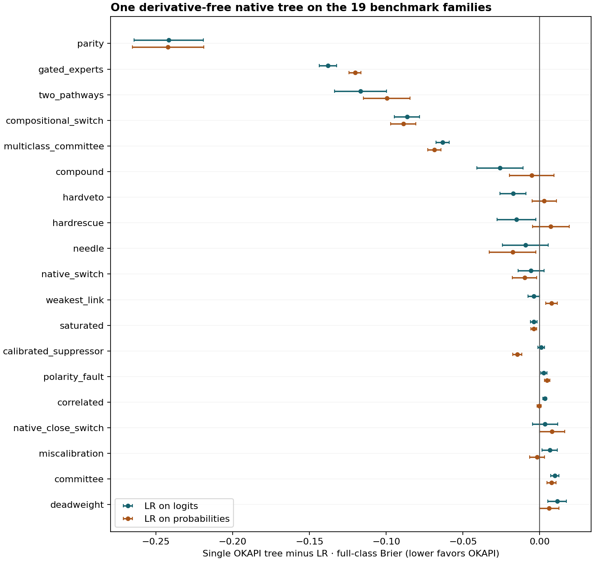

# One native OKAPI tree beats both default logistic stackers on the fixed IID suite

We trained one native OKAPI tree per prediction bank. On fresh examples from the same generators, it reached **0.18388** full-class Brier, averaged equally over the 19 FusionBench scenarios. The logistic stackers scored **0.21698** on probability features and **0.22017** on logit features. Lower is better. Both paired differences met the criterion in the [frozen protocol](protocol.md). On nine predefined shifts both regressions had lower average Brier than the tree.

## What the tree learns

In the binary case the fitted node applies a sigmoid to a signed, weighted sum of incoming logits plus an intercept. Each input can be a base model's probability or the output of a complete evolved subtree. For example, when the reliability of a model depends on agreement with another model, a threshold subtree can supply a conditional signal that a flat sum of provider logits lacks. The search tries weight changes and keeps moves that improve the supplied scalar fitness. The multiclass version weights each provider's class log probabilities and normalizes. It shares one weight across classes per provider, a more constrained family than multinomial LR.

The native GP explores structures. The training procedure then considers three candidates on held-out rows: a flat logit node, a logit node with up to three additional evolved subtrees, and the strongest validation tree in the GP archive. Prediction evaluates one selected OKAPI tree. Both logistic regressions run separately for comparison. The [OKAPI implementation](https://github.com/damiankucharski/OKAPI/tree/acd4685/okapi) contains the local parameter search and subtree screening. The [FusionBench method](../../../fusionbench/methods/native_pattern.py) runs discovery, validation selection and refitting.

## Results

| Method | 19 original scenarios | 9 shifted scenarios |
|---|---:|---:|
| Single OKAPI tree selected on validation | **0.18388** | 0.32062 |
| LR on base probabilities | 0.21698 | **0.30544** |
| LR on base logits | 0.22017 | 0.31560 |
| Top-N mean, best ranked prefix | 0.33226 | 0.36261 |
| All-provider mean | 0.37726 | 0.38545 |
| Flat native logit node | 0.21891 | 0.32081 |
| Native logit node with subtree search | 0.18248 | 0.32102 |
| Native GP without the logit fitting step | 0.26004 | 0.31737 |

On IID data the paired native-minus-LR difference was **−0.03310** (95% CI −0.03511 to −0.03110) against probability LR and **−0.03629** (−0.03843 to −0.03415) against logit LR. The tree won in 12 of 19 scenarios against each comparator individually and in 9 of 19 against both simultaneously. Omitting any single scenario left the macro-average favorable against each. On the nine shifts the differences were **+0.01518** (+0.01182 to +0.01854) against probability LR and **+0.00503** (+0.00186 to +0.00819) against logit LR. The largest shift loss against probability LR was +0.08059 on `calibrated_suppressor`.

The flat node alone came within 0.00127 of logit LR on the IID average. Allowing additional evolved subtrees reduced the average from 0.21891 to 0.18248 under the same head optimizer. On `gated_experts` this changed 0.34733 to 0.20813, on `parity` it changed 0.50418 to 0.26243, and on `two_pathways` it changed 0.24931 to 0.12587. On `deadweight` logit LR still beat the selected tree, 0.0540 to 0.0653. Of 228 selections, 115 used the augmented head with at least one nonzero subtree coefficient, 84 used the flat node and 29 used the GP tree directly. Always using the augmented candidate was numerically better on IID by 0.00140; its paired interval against the selection policy includes zero.



## Scope and verification

Each scenario used 12 independent prediction banks. All methods had 640 labeled examples per bank. OKAPI used 448 to discover subtrees and 192 for validation, then refitted the heads on all 640. Each test condition used 4,096 fresh examples per bank. The same data seed determined the search seed, so these runs measure joint variation across data and search. The intervals use 12 paired replicate averages with the 19 scenarios fixed (nine for shifts). The native method optimized Brier directly. Both standardized LR baselines fitted penalized log loss using their default `C=1`. The study measures these training procedures on synthetic classification tasks. It leaves open the effects of matching the objective, tuning regularization, and using real out-of-fold predictions.

The evaluation took 59.4 s elapsed with three workers. Summed across 228 fits, native search took 165.8 s and 1,323,421 objective evaluations. The two LRs plus Top-N together took 5.0 s to fit. These timings include the ablation fits in their respective groups. Protocol freeze through independent verification and reporting took about nine minutes. An independent implementation replayed all 684 pre-refit validation scores, the 228 selections, and all 2,688 test Brier scores and prediction hashes, including independently fitted LR controls. This checks the saved trees and selection outcomes. The raw bank manifests also contain the discovery and refit evaluation counts.

To reproduce, use this branch of FusionBench and OKAPI at `acd4685` in an adjacent checkout named `OKAPI`. From the FusionBench root, with both projects' dependencies and Matplotlib installed, run

```bash
export PYTHONPATH=".:../OKAPI"
export OPENBLAS_NUM_THREADS=1 MKL_NUM_THREADS=1 OMP_NUM_THREADS=1
python docs/ensemble-study/native-pattern/run.py --workers 3
python docs/ensemble-study/native-pattern/verify.py
python docs/ensemble-study/native-pattern/figure.py
```

The [family means](families.csv), [paired comparisons](contrasts.csv), [individual scores](scores.csv.gz) and [saved trees and counts](banks.jsonl.gz) accompany the [evaluation code frozen before the run](https://github.com/damiankucharski/fusionbench/tree/c32e7f1).

**Next question.** If we shrink only the coefficients on evolved subtrees toward zero, can one native tree retain its IID gains while narrowing the gap to LR on the nine shifts? Use fresh banks and a matched-objective flat control to separate robustness of the learned interactions from the choice of training loss.
