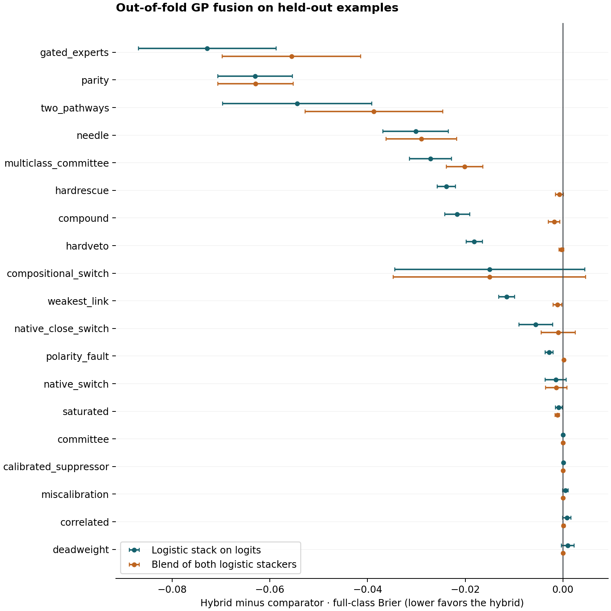

# A native GP tree improves logistic stacking on the fixed 19-family battery

On fresh IID examples the cross-fitted hybrid achieved a full-class Brier of **.20219**, compared with **.21747** for logistic stacking on probabilities, **.22039** on logits and **.21421** for a cross-fitted blend of the two logistic models. Adding an OKAPI tree to the blend reduced mean loss by **.01202** (paired 95% interval .01012–.01392). All three preregistered criteria were met. A standalone native GP tree scored .26187. The deployed hybrid uses the tree and logistic predictions with learned nonnegative weights. [Frozen protocol](protocol.md) · [Paired estimates and leave-one-family-out ranges](contrasts.csv)

| Method | Mean across 19 IID families | Mean across 9 prespecified shifts |
| --- | ---: | ---: |
| Hybrid, two logistic stackers and one GP tree | **.20219** | .30599 |
| Cross-fitted convex blend of logistic stackers | .21421 | .31016 |
| Logistic stacking on raw probabilities | .21747 | **.30472** |
| Logistic stacking on logits | .22039 | .31552 |
| Native mixed-start OKAPI tree | .26187 | .32265 |
| Ranked-prefix Top-N averaging | .33195 | .36171 |
| Mean of all providers | .37729 | .38487 |

Each family has equal weight and 12 independently generated data banks. Every candidate used the same 640 labels and anonymous provider columns. Within each bank, base models fitted on three training folds supplied predictions on their held-out rows. Minimizing Brier on the stitched predictions determined the mixture weights. The GP used 80% of its available labels to evolve and 20% to select a tree within each training fold and final refit. The two logistic models used all the available training rows at each fit. Only the three components refitted on the full bank enter deployment. Cross-validated combination has a long history; this study measures the incremental contribution of native OKAPI in a particular public benchmark. [Method implementation](../../../fusionbench/methods/crossfit_okapi.py) · [Super Learner](https://doi.org/10.2202/1544-6115.1309)

## Where the tree mattered

The IID hybrid-minus-logit difference was −.01820 (95% interval −.02022 to −.01619), and the hybrid-minus-probability-LR difference was −.01528 (−.01723 to −.01334). The hybrid had lower point estimates in 14 of 19 families versus logit LR, 19 of 19 versus probability LR and 13 of 19 versus their blend. The biggest IID regression versus logit LR was +.00102 on DeadWeight. Removing any one family left the average improvement over the LR-only blend between .00919 and .01270. Intervals reflect fresh draws and search randomness on these fixed synthetic laws; they do not estimate transfer to new task families.

On Parity the GP alone scored .5539 and the blend of the two logistic models .5024. Including that individually weaker tree reduced Brier to .4394. On TwoPathways the corresponding scores were .2178, .2269 and .1882. A component can improve a probability mixture even when its individual loss is higher, because Brier depends on how the prediction errors co-vary across examples. Across the 228 banks the learned average weights were .419 on logit LR, .339 on probability LR and .242 on GP. The GP received weight above 1e-8 in 182 banks. [Family scores](families.csv)



Under shift the hybrid improved on the LR-only blend by .00417 (95% interval .00255–.00580) and on logit LR by .00953. Probability LR was slightly better on aggregate: hybrid-minus-probability-LR +.00127 (−.00035 to +.00289). The largest shift regression versus probability LR was +.05885 on CalibratedSuppressor. The comparison uses the public default C=1 regression estimators. It establishes neither superiority to tuning their regularization nor a method that can discard the component models at inference.

## Computation, verification and use

Training and evaluation of the complete panel took 156.9 seconds on three local CPU workers, with 912 GP fits and 547,200 native objective calls. The hybrid spent more compute than any single logistic comparator. Each IID and shifted set had 4,096 test rows. Recorded full-class prediction fingerprints identify each of the 2,352 evaluated matrices. The independent verifier checked 912 data partitions, the simplex optimality conditions and independent solutions for all 456 sets of weights, all family and macro contrasts, all family omissions and ranks. It independently matched the 196 held-out prediction fingerprints for one bank from each family on all available splits, refitted both logistic models' OOF predictions on 57 folds, and replayed six GP folds across a binary and a multiclass bank. All 168 complete held-out multiclass probability matrices were separately restored against their original hashes. [Verifier](verify.py) · [Scores](scores.csv.gz) · [Weights, trees and fold metadata](banks.jsonl.gz) · [OOF component matrices](oof.npz) · [Saturated probabilities](saturated-probabilities.npz) · [MulticlassCommittee probabilities](multiclass_committee-probabilities.npz)

Select the opt-in FusionBench method through its public factory, for example `default_methods(["okapi_crossfit_stack"])`. To reproduce from the repository root, put the pinned OKAPI checkout at ../OKAPI and run:

```sh
export PYTHONPATH=.:../OKAPI OPENBLAS_NUM_THREADS=1 MKL_NUM_THREADS=1 OMP_NUM_THREADS=1
python docs/ensemble-study/oof-gp-stack/run.py --workers 3
python docs/ensemble-study/oof-gp-stack/verify.py
python docs/ensemble-study/oof-gp-stack/multiclass.py
python docs/ensemble-study/oof-gp-stack/figure.py
```

A remaining question is whether the same component can beat a cross-validated, regularization-tuned LR on an external bank of real out-of-fold provider predictions. This one-round run ends with the scheduled program paused.
