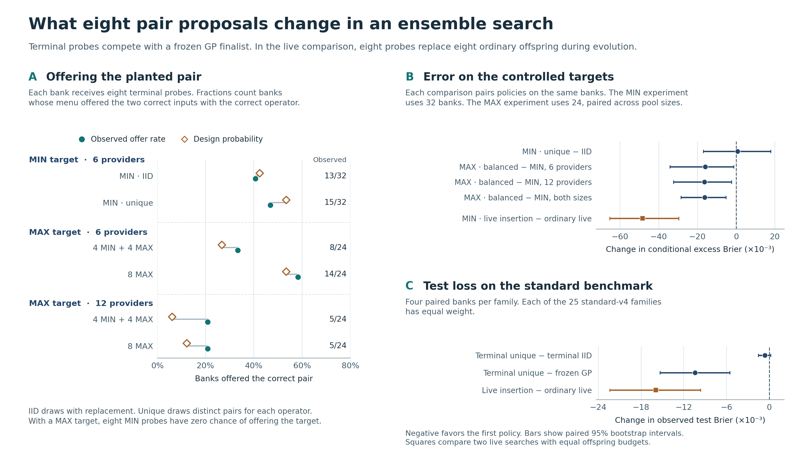

# Can proposing simple trees help OKAPI find rules that transfer?

Suppose the correct probability is the lower of two model predictions. OKAPI can express that rule in three nodes. The preceding study found that an exact rule often survived once discovered, but evolution rarely proposed it. Here we ask what happens when eight chances to try a pair are made explicit. On all 25 standard scenarios, inserting pairs into evolution improved mean test Brier from 0.33461 to 0.31869 at an identical fitness budget. Almost all of this aggregate gain came from two scenarios. The gap between fit and test loss persisted. [Previous discovery experiment](../joint-gain/README.md) · [Matched live search results](results/live-contrasts.csv)



[Vector figure](results/pair-coverage.pdf) · [Registered comparisons](https://github.com/damiankucharski/fusionbench/commit/4367929bb0cedbc9a7ab1079121720d928b48801) · [Independent replay](results/verification.json)

## Three experiments

1. **Can avoiding repeated proposals recover a hidden MIN?** Six anonymous providers give 15 possible pairs. In 32 independent banks, the search without replacement proposed the correct pair 15 times, versus 13 with replacement. Each method ultimately deployed the exact function in 16 banks, up from five for the original GP finalist. Each had access to an exact function in 17 banks when its finalist was included. The two methods did not recover it on the same 16 banks. Their paired difference in excess Brier was +0.00065 (95% interval −0.01691 to +0.01777). Access to simple candidate trees helped in this setting. The incremental benefit of avoiding repeats is unresolved. [Series 1](r1-report.md)
2. **What if the chosen operator is wrong?** We changed the generating rule to the higher probability of two providers. With the same eight fit evaluations, reserving four for MAX instead of spending all eight on MIN reduced excess Brier by 0.01620 (95% interval for the reduction 0.00530–0.02856). Twenty-four new banks each contributed one paired difference averaged over six and twelve inputs. With a uniformly located hidden pair and four distinct MAX proposals, the chance of offering it falls from 4/15 to 4/66 as the pool grows. On the single-provider control all terminal menus kept the original finalist across all 48 size-specific comparisons. [Series 2](r2-report.md)
3. **Do these gains survive the full benchmark?** Each of 25 standard-v4 families contributed four fresh data seeds. The same ordinary GP finalist competed against eight additional candidates, four MIN and four MAX. The distinctive-pair menu improved the mean in six families and tied in nineteen. Compared with the equally costly menu that allowed repeats, the difference was −0.00062 (95% interval −0.00153 to +0.00019). The two menus produced identical test probabilities in 91 of 100 banks. [Series 3](r3-report.md) · [Individual families](results/r3-family-means.csv)

| Method | Mean full-class test Brier on standard-v4 |
| --- | ---: |
| Arithmetic mean | 0.39149 |
| Fit-ranked best prefix average (Top-N) | 0.35381 |
| Ordinary GP finalist | 0.32872 |
| Same finalist plus eight pair candidates, distinct within each operator until exhausted | 0.31831 |
| Probability logistic stacking | 0.26085 |
| Regularized native-pattern OKAPI | **0.23170** |

Lower is better. Each family is equally weighted. All fits within a bank use the same labeled examples. The standard GP finalist received eight additional evaluations in the two terminal pair menus. The distinct and with-replacement menus received equal budgets. The reference methods have their own training budgets. The controlled MIN and MAX studies report *excess* full-class Brier relative to the known generating probability on fresh audit examples. The panel reports ordinary full-class Brier against the sampled test labels. [Scores and costs](results/r3-scores.csv)

## What happens if the eight pairs can reproduce?

A secondary comparison specified before any results spent eight of 128 ordinary offspring evaluations on the scheduled pairs. Both arms still scored 128 offspring plus the same founders. We kept crossover, mutation, fitness, node-count preference and the final choice the same. A new pair could survive and become a parent. This fixed-width search has its own ordinary-offspring comparator, so the beginning of its comparison is 0.33461 on the panel. Its terminal-menu counterpart starts from the usual 16-generation search at 0.32872. [Live protocol](live-protocol.md) · [Runner](live.py)

| Task | All ordinary offspring | Eight offspring replaced by pair trees | Paired change (95% interval) |
| --- | ---: | ---: | ---: |
| Hidden MIN, 32 banks, excess Brier | 0.07654 | 0.02824 | −0.04830 (−0.06530 to −0.02971) |
| Correct singleton, same 32 banks, excess Brier | 0.00217 | 0.00237 | +0.00020 (−0.00075 to +0.00129) |
| Standard-v4, 100 banks, test Brier | 0.33461 | 0.31869 | −0.01593 (−0.02240 to −0.00963) |

On the planted MIN law, the number of exact rules deployed rose from two to 21 of 32. On the standard suite, 15 scenario means improved, three tied and seven worsened. After inspecting the results, we found that **86% of the net reduction** came from `weakest_link` and `parity`. Across the other 23 families the mean change was −0.00237. The largest regression was `cloned_shortcut` (+0.02363). This concentration estimate is descriptive. The live intervention includes any downstream change in the breeding path. The design cannot attribute its effect specifically to descendants of an inserted tree. [Generation records](results/live-generations.csv.gz) · [Family deltas and replay of all 328 fits](results/live-audit.json)

Mean fit loss on the suite improved from 0.30159 to 0.28419. Mean test loss improved almost as much. The resulting **test-minus-fit gap was 0.03302 with ordinary offspring and 0.03450 with pair proposals**. These runs support a change in which representable rules the search reaches. They provide no evidence that the change cures optimistic selection on reused validation labels. Both 25-family comparisons used four data seeds per fixed family and one GP seed. They do not measure how the result transfers to new families, natural datasets, or other search seeds.

## What regularized OKAPI means here

The reference method `okapi_native_pattern_l2` runs a gradient-free coordinate search for signed weights on logits. During fitting, its predictive score is reduced by $(0.25/N)\sum_j w_j^2 v_j$, where $N$ is the number of fit rows for that stage and $v_j$ measures how much feature $j$ varies in those rows. In binary classification it uses logit variance and leaves the intercept unpenalized. In multiclass classification it uses log probabilities centered across classes within each row and averages the resulting across-row variances. A fixed weight carries a larger penalty if it amplifies a more variable input. [Native optimizer](https://github.com/damiankucharski/OKAPI/blob/92f0e96d7ba29f047134ffb3640f444fff5adc7a/okapi/pattern_logit.py#L122-L153)

The 70% discovery partition supplies three candidates. The first fits the native head directly to provider predictions. The second adds up to three nonlinear features discovered by GP. The third is the best GP tree from the candidate archive according to internal validation. On the other 30%, unpenalized Brier selects the family. The linear-weight heads are refit on the full fit set with fixed feature structure. The deployed model is one native tree. On the 100 panel banks the augmented head won 48 times, the raw-provider head 34 times and the standalone GP 18 times. Those last 18 deploy an ordinary GP tree with no L2-fitted head. The method beat logistic stacking on the average of 19 of 25 families. Isolating the effect of the penalty requires a matched run with strength zero. An earlier paired ablation on 19 families and a different stress protocol measured a reduction of 0.00851. [Family selection code](https://github.com/damiankucharski/fusionbench/blob/a16e33d0340ca13926711881805e972aba4402c7/fusionbench/methods/native_pattern.py#L152-L259) · [Earlier ablation](../pattern-iterations/README.md)

Dissertation prior anchoring blends the tree prediction and a fixed prior predictor with a specified mixing weight. The references used there included the all-model or Top-6 arithmetic average. The current regularized method has no such output blend and requires only the providers used by its selected tree. [Dissertation, section 5.7](https://bip.polsl.pl/wp-content/uploads/sites/4/2026/11/Damian-Kucharski_rozprawa-doktorska.pdf#page=124)

## Reproduce

Use the FusionBench checkout containing this directory and the companion [OKAPI research revision](https://github.com/damiankucharski/OKAPI/commit/92f0e96d7ba29f047134ffb3640f444fff5adc7a). Install FusionBench with its research/test dependencies as in the preceding study. From the FusionBench root run the following commands with the study environment active.

```sh
export PYTHONPATH="$PWD:$PWD/../OKAPI"
export BACKEND=numpy LOGURU_LEVEL=ERROR OKAPI_LOG_LEVEL=ERROR
export OPENBLAS_NUM_THREADS=1 OMP_NUM_THREADS=1 MKL_NUM_THREADS=1 NUMEXPR_NUM_THREADS=1
study=docs/ensemble-study/pair-coverage
python "$study/round1.py"
python "$study/r2.py"
python "$study/r3_panel.py"
python "$study/live.py"
python "$study/audit_live.py"
python "$study/verify.py"
python "$study/plot.py"
```

The three main runs took 29.0, 57.3 and 59.4 seconds each on one worker. The live arms took 14.5 seconds. The studies ran concurrently. Chronological tables and manifests include the seeds, bank-level records and budgets. The next question is whether the regularized native-pattern pipeline itself benefits from a fixed share of pair proposals when the number of GP evaluations is held constant, particularly under shared scene errors or when a shortcut reverses at test time.
