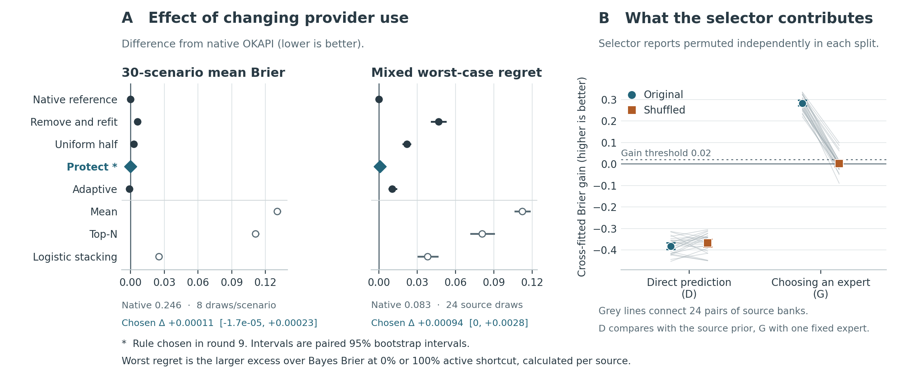

# Which providers help an ensemble choose its experts?

Imagine two models that work well under different conditions. A third model reports which condition applies. Its prediction may be useless as a direct answer to the classification question and still be the most expensive input to discard. In the preceding study, a screen based on standalone errors removed this selector from `gated_experts` in eight out of eight trials. These ten synthetic experiments ask whether its contribution can be recognized from training examples, and how to act on that evidence when the next environment is uncertain. [Previous results](../environment-ten/README.md) · [Registered protocol](protocol.md)

## What the ten rounds established

The training diagnostic detected the selector's interaction: shuffling its votes reduced its held-out routing gain by **0.28041 Brier** [0.26653, 0.29426] across 24 paired source draws. The selected protection policy preserved all the original native predictions on the eight fresh standard `gated_experts` draws. Removing the flagged model and retraining cost 0.10765 [0.09546, 0.11797] on that family.

Protect passed all three prespecified safety checks. It **missed the primary objective** of improving maximum regret on the mixed source. Regret rose from 0.08341 to 0.08435. All 24 shortcut providers were correctly flagged, but direct or routing evidence kept their influence unchanged in 23 cases. The single intervention reduced Brier at zero shortcut activity and raised the larger regret at full activity. [Frozen decision](selection.json) · [Confirmation](results/confirmation.json) · [Known-selector control](results/r10-gate-utility.csv)



### Independent confirmation

Every round evaluated the same 30 distinct standard-v6 scenarios. The confirmation round used eight new training/test draws per standard scenario (240 paired comparisons), 24 new draws per focal profile and 24 matched original/shuffled gate pairs. Brier and maximum regret are both lower-is-better.

| Method | 30-scenario Brier | Gated experts Brier | Mixed, shortcut absent | Mixed, shortcut works | Mixed max regret |
|---|---:|---:|---:|---:|---:|
| Regularized native-pattern OKAPI | 0.24586 | 0.22457 | 0.25789 | 0.19235 | **0.08341** |
| Protect (locked) | 0.24596 | 0.22457 | 0.25742 | 0.19329 | 0.08435 |
| Adaptive | **0.24496** | 0.22457 | 0.25158 | 0.20296 | 0.09402 |
| Uniform half | 0.24862 | 0.25510 | 0.24704 | 0.21427 | 0.10533 |
| Remove and retrain | 0.25203 | 0.33223 | **0.23911** | 0.23911 | 0.13017 |
| Logistic stacking | 0.27101 | 0.33505 | 0.34972 | 0.21114 | 0.12170 |
| Ranked-prefix Top-N | 0.35715 | 0.32748 | 0.36556 | 0.26836 | 0.16420 |
| Arithmetic mean | 0.37634 | 0.38937 | 0.40756 | 0.30466 | 0.19572 |

On the standard panel, the screen flagged a provider on 117/240 draws. Protect changed forecasts on 29/240. Relative to native, its standard Brier change was +0.00011 [−0.00002, +0.00023]. Three family means improved, 25 tied and two worsened. Relative to outright exclusion its standard Brier improved by 0.00606 [0.00414, 0.00804]. The adaptive candidate had a small standard gain of 0.00089 [0.00042, 0.00131] versus native, at the cost of 0.01061 [0.00811, 0.01360] additional mixed maximum regret. When the source association between prevalence and shortcut activity reversed, adaptive instead **reduced** maximum regret by 0.03470 [0.02882, 0.04024]. These secondary comparisons use the prespecified candidates. The frozen choice was protect. [All levels](results/r10-levels.csv) · [Paired contrasts](results/r10-contrasts.csv) · [Standard family breakdown](results/r10-families.csv)

On the separate gate-control draws, the selector's direct gain was −0.38211 before shuffling and −0.36762 after, with paired difference −0.01449 [−0.03353, 0.00456]. Its corresponding routing gains were +0.28253 and +0.00212. Routing gain exceeded 0.02 on all 24 original draws and on four of 24 shuffled draws. Thus this scalar threshold can assign positive routing evidence to a shuffled provider on a finite sample. The known selector was evaluated in every bank regardless of the screen. For providers chosen by the screen the held-out gains are conditional on that choice, which had access to all source labels. [Selector measurements on each draw](results/r10-gate-utility-sources.csv) · [Source decisions](results/r10-diagnostics.csv)


## Two questions to ask about a model

**Does it predict the class?** Compare the model's Brier with always reporting the training class frequencies. **Does it indicate which other model to use?** Split training examples by one coordinate of the model's report. Learn the better remaining expert on each side and compare this rule with always choosing the best fixed remaining expert. Both choices are trained on one half and measured on the opposite half, then the halves exchange roles. Positive gains mean lower held-out Brier. In grouped scenes the screen and diagnostics use one example per scene. Every fusion still receives the full source bank. This simple gate can detect a binary routing relationship. More complicated joint relationships can escape it. [OKAPI implementation](https://github.com/damiankucharski/OKAPI/blob/811ad436de1aed697a14dab2722a6d4cc2a73394/okapi/provider_use.py)

A previously registered screen first flags at most one provider whose own Brier changes across source environments at common context proportions. The **hard** intervention excludes that provider and retrains a tree. The **half** intervention reuses one fitted native tree. We compute its ordinary forecast and a second forecast averaged over eight replacements of the flagged report, drawn at fixed quantiles of its training distribution. An equal blend of those forecasts reduces dependence on the provider. This preserves one fitted model and incurs additional inference calls. Replacing one report independently can create uncommon combinations with the other providers. **Protect** uses the half intervention only when both direct and routing gains are at most 0.02. **Adaptive** uses routing and direct gains to choose strengths of zero, one quarter or three quarters. An abstaining screen preserves the ordinary prediction. [Intervention and controls](run.py) · [Marginalization API](../../../fusionbench/methods/provider_reliance.py)

## What counts as a transfer improvement?

The controlled generator includes a stable specialist, an observable cue, a generalist and a provider that exploits a shortcut. All four issue equally confident reports. In one training environment the shortcut works. In the other it disappears. In the mixed source, the prevalence of cases served by the specialist also differs between environments. Each trained rule sees the same 16 report patterns at test. Their probabilities and class labels follow different exact target laws. The best achievable Brier using all reports is 0.23217 when the shortcut disappears and 0.10895 when it always works.

For each target we subtract its own optimal Brier from the fitted model's Brier. This difference is **regret**. We take the larger of the two endpoint regrets on each training draw. Minimizing this quantity penalizes a method that forgoes a useful signal on the easier target. Minimizing worst *absolute* Brier can reward the same decision. With the full generator known, the smallest possible worst-endpoint regret is **0.03568**. A fixed predictor attains it by using the shortcut partly, with Brier 0.26785 and 0.14462 at the two endpoints. Dropping the shortcut entirely attains the best worst absolute Brier while leaving 0.12322 regret at the favorable endpoint. These are population bounds under the specified target laws and 50% specialist-region prevalence. No candidate received the generator probabilities during fitting. [Derivation and independent numeric check](oracle.md)

## Ten rounds at a glance

| Round | Intervention or control | Observation |
|---:|---|---|
| 1 | Compare hard exclusion with two tests of provider usefulness | On the two standard gate draws, protecting useful providers improved Brier by 0.11948 against exclusion and matched native. |
| 2 | Shuffle source environment identifiers with the training data held fixed | With varying shortcut accuracy at fixed regional prevalence, the shuffled-environment rule matched native at 0.05619 maximum regret. Adaptive intervention with the genuine IDs scored 0.06898. A correct signal of instability need not justify attenuating the provider. |
| 3 | Independently shuffle only the selector in training and test | Across six paired draws, routing gain fell from 0.28926 to 0.01369. The direct gain changed by −0.00197 comparing original with shuffled, with interval [−0.05386, 0.05017]. |
| 4 | Vary intervention strength from zero to one on the same fitted model | Full marginalization raised mixed maximum regret by 0.05680. All six sources achieved their best value at strength zero, even under retrospective selection over the entire continuous strength range. |
| 5 | Vary how many observed donor reports approximate marginalization | Using two donors instead of eight raised average standard Brier by 0.00074 [−0.00028, 0.00177]. The fixed half intervention still scored 0.25094 versus native at 0.24632 with eight donors. |
| 6 | Halve the variation in shortcut activity across the two source environments | Protect raised maximum regret by 0.00270 [0.00000, 0.00809] on the narrower source. |
| 7 | Reduce the mixed source from 512 to 128 training rows | On the six smaller draws protect matched native's mean maximum regret exactly. |
| 8 | Evaluate direct and routing evidence separately | Direct evidence alone cost 0.03225 Brier on the standard gate versus native. Routing evidence alone matched native there but cost 0.02100 maximum regret on the mixed source. |
| 9 | Freeze one rule before the confirmation draws | All three rules qualified on the standard panel. Protect had the lowest mixed maximum regret (0.08619), followed by adaptive (0.09575) and uniform half (0.10893). |
| 10 | Fresh draws on all standard scenarios, seven focal sources, and the paired gate controls | See the independent confirmation above. |

The R4 dose check reconstructed the complete Brier-versus-strength curve from three measured strengths. The other two measured strengths matched within 3.9×10⁻¹⁶. All six active-endpoint losses already had positive slope at zero and dominated maximum regret there. Attenuating this fitted predictor in that direction can only worsen its maximum regret on those draws. The gap to the 0.03568 theoretical bound is therefore a reason to investigate the learned response to individual report patterns. It leaves open whether the native representation can express it and whether training finds it. [Dose curves for each draw](results/r04-dose-curves.csv) · [Comparison definitions](analysis.md)

## A training intervention to test next

The mixed source contains two measured conditions, each accounting for half the rows. Shortcut activity is 0 in one and 1 in the other, but their fractions of specialist cases are 0.15 and 0.85, respectively. A pooled training loss therefore ties the region to shortcut reliability. The exact 50%-activity target used for evaluation breaks this association. After adjusting the flagging test for case mix, all methods in these ten rounds still fit their fusion tree on the original distribution.

This creates a specific training hypothesis. Give every source environment the same *observed* region mix when evaluating native tree fitness. Under the controlled mixed generator, with known population weights and half of each region, the standardized joint law is the equal mixture of the two exact target endpoints. A Bayes predictor trained on that population has worst-endpoint regret **0.04194**, close to the unrestricted lower bound of 0.03568. That value is an analytic reference with full knowledge of the distribution. It does not establish how well finite-sample OKAPI can fit the predictor. [Equal-mixture frontier and 16 report patterns](results/endpoint-regret-oracle.json)

There is also a concrete sampling cost. For environmental region fraction p and desired fraction 0.5, the weights are 0.5/p inside the region and 0.5/(1−p) outside it. For p equal to 0.15 or 0.85, their mean is 1 and their mean square is about 1.96. The usual weight-based effective sample size is approximately 51% of the source count. A follow-up can compare ordinary fitness, region-standardized fitness, and capped weights on matched source examples. Sources with limited overlap and uninformative environment labels provide essential controls. This change would act during search and would add no model or environment input to the deployed tree.

## Reproduction and scope

Install FusionBench with its pinned optional dependency, `pip install '.[okapi]'`, in the research checkout. Run the following commands from the repository root. Round nine's committed decision and input hash are checked before round ten. Scores include per-source hashes and full-class Brier, macro-F1 and provider counts. The underlying rules fit using source reports and source labels alone. On the 30 standard families the screen uses prediction disagreement as an environment proxy. On the controlled sources it uses observed environments. The standard panel weights all families equally. The uncertainty intervals use 10,000 paired source-seed bootstrap samples; the standard macro resamples within each fixed family. The native fit uses variance-scaled L2 regularization with GP seed zero, split seed zero and an eight-program GP shortlist. The study varies data draws and reports aggregate risks over these synthetic families.

```sh
export PYTHONPATH=. BACKEND=numpy OKAPI_LOG_LEVEL=ERROR
export OPENBLAS_NUM_THREADS=1 OMP_NUM_THREADS=1 MKL_NUM_THREADS=1
study=docs/ensemble-study/provider-use-ten
for r in 1 2 3 4 5 6 7 8 9 10; do
  python "$study/run.py" "$r" --workers 4
  python "$study/analyze.py" "$r"
  python "$study/verify.py" "$r"
done
python "$study/regret_oracle.py"
python "$study/dose_curve.py"
python "$study/plot_results.py"
```

The ten fit-and-score runs took 311.9 seconds in total on four CPU workers, including 94.3 seconds for confirmation. The interval from the preregistration commit to the final raw scores was 7 min 14 s. Across 1,224 generated source banks (840 standard, 324 focal, 60 gate controls), the study recorded 2,196 source–target conditions and 20,700 method scores. Independent checks verified 6,714 source decisions and 1,408 paired intervals, regenerated 250 core policy forecast-hash pairs and replayed 150 inexpensive-comparator Brier calculations. The FusionBench test suite passed 948 tests (11 skipped), and the OKAPI checkout passed 902 (one skipped). [Independent confirmation audit](results/r10-verification.json) · [Cohort construction](banks.py)
