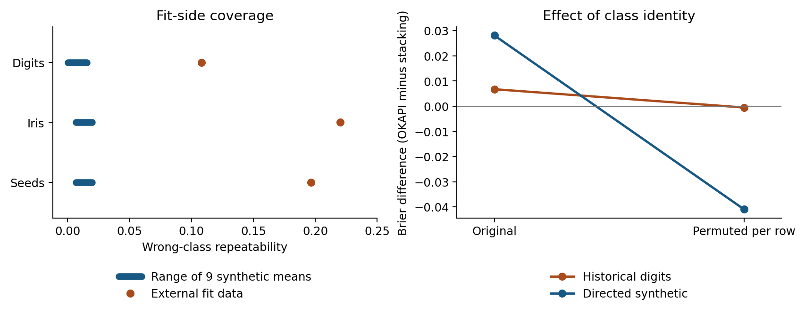

# Predicting fusion performance from the runner-up class

The two added fit-side measurements exposed an uncovered range of provider behaviour. They gave no improvement in the registered forecasting experiment. Both with and without these coordinates, the nearest candidate in the existing synthetic library was B for the new digits pool and E for Iris and Seeds. The mean absolute forecast error was **0.01360 full-class Brier** under all three rules. The primary requirement was a reduction in overall error and strict improvement on at least two of three targets. None improved. [Frozen design](protocol.md) · [Forecasts published before scoring](https://github.com/damiankucharski/fusionbench/blob/d4d84f3/docs/ensemble-study/runner-up-transfer/predictions/forecasts.csv) · [Decision](decision.json)

## Prospective external results

The signed gap is the regularized native OKAPI Brier minus probability-stacking Brier. Positive values favour the probability stacker. Each forecast used eight fusion-fit profiles. The target outcomes average the corresponding eight held-out partitions. Source cohorts matched the target class count, provider count and number of fusion-fit labels. Historical synthetic losses were reused without any new tuning.

| External bank | Predicted gap, all rules | Observed gap | Mean | Ranked Top-N | Probability LR | Logit LR | Native OKAPI | Five-method rank agreement (Kendall τ-b) |
| --- | ---: | ---: | ---: | ---: | ---: | ---: | ---: | ---: |
| Digits, new provider pool | −0.00613 | +0.00667 | 0.07213 | 0.04646 | 0.03601 | 0.06522 | 0.04267 | 0.60 |
| Iris | +0.00739 | −0.01848 | 0.07613 | 0.08884 | 0.09957 | 0.07581 | 0.08109 | −0.40 |
| Seeds | +0.00739 | +0.00525 | 0.12225 | 0.12660 | 0.12762 | 0.13383 | 0.13286 | −0.40 |

Correctly predicting the native-versus-stacking winner on Seeds still left the five-method ranking poorly reproduced. The simple mean was best there among those five. On Iris the native method beat probability stacking in six of eight partitions, while logit stacking and averaging both had lower mean losses than OKAPI. Digits used Gaussian naive Bayes, distance-weighted 11-NN and extremely randomized trees, a new pool on the previously studied images. Iris and Seeds used logistic regression, 5-NN and random forest. Each uses just 44 examples for fusion-fit; their test sizes are 32 and 62. Repeated partitions overlap. [Full scores](observed-brier.csv) · [Per-split predictions and scores](external-results/) · [Data sources and splits](external-fit/README.md)

## Coverage of wrong-class preferences

For each provider and observation, choose its highest-scoring incorrect class, sharing a vote across ties. If the prediction is correct, this is its strongest competitor. If it is wrong, it can be the predicted class itself. The public `runner_up_profile` measures whether these wrong destinations recur in two disjoint halves within each true class. It also returns the average difference between the two largest probabilities. It consumes fusion-fit labels. [Public usage example](../../site/scenarios.md) · [Estimator implementation](../../../fusionbench/eval/confusion_profile.py)

| Target | Mean repeatability | Range of the nine synthetic configuration means, matched C and fit budget |
| --- | ---: | ---: |
| Digits (10 classes) | 0.1082 | 0.0003–0.0156 |
| Iris (3 classes) | 0.2202 | 0.0069–0.0197 |
| Seeds (3 classes) | 0.1967 | 0.0069–0.0197 |

All three target means lay above the tested synthetic configuration means. The previous forecast protocol always selects one of those nine settings, including for out-of-range profiles. Adding a coordinate can reveal this mismatch without moving the nearest candidate or altering its forecast. These ranges refer to the studied configurations and sizes, not the entire parameter space of the scenario API. [All fit-only profiles](predictions/centroids.csv) · [Distances and selected settings](predictions/distances.csv)

On the historical heterogeneous digits pool, we went beyond a marginal statistic. A table fitted on half the fusion-fit rows predicted the strongest incorrect class from the provider and true class; we evaluated it on the other half and swapped roles. Knowing the true class gained **0.183 nats per provider-row** versus the provider's general preference for each wrong destination. Logistic regression and random forest supplied most of this signal. In the five-neighbour model all nine wrong classes tied on about 90% of row appearances. Under panel E, the planted preference was much stronger among actual mistakes than across all rows. The historical raw data establish a repeatable pattern, without identifying a specific pair or a Brier advantage solely attributable to it. [Mechanism check and shuffle controls](mechanism/README.md)

## What happens when class identities stop carrying across examples?

In a separate intervention on the **previous** heterogeneous digits pool (LR, five-neighbour classifier, random forest), independently draw a permutation per example. Move all providers' class probabilities and the true label together. Refit every fusion rule on permuted training rows and evaluate on independently permuted test rows. This preserves each provider's multiset of probabilities and its probability for the correct class. A fixed class slot can no longer acquire the same meaning across images. Merely renaming all classes once would retain that meaning.

| Eight paired splits | OKAPI, raw → permuted | Probability stacking, raw → permuted | Change in OKAPI-minus-stacking gap |
| --- | ---: | ---: | ---: |
| Historical digits | 0.03868 → 0.03868 | 0.03193 → 0.03919 | −0.00726 |
| Synthetic panel E with directed confusion | 0.03615 → 0.03616 | 0.00805 → 0.07710 | −0.06905 |

The original stacking advantage practically disappeared on this real digits pool. Its change was much larger in the constructed directed-confusion case. Mean-pool Brier was invariant in both. An independent control with matched feature scaling also changed direction: full LR beat class-symmetric LR by 0.00227 on original digits, then fell behind by 0.00487. This intervention removes class priors, per-class calibration and cross-class confusion patterns together. Its effect gives evidence for stable class identity as a whole rather than the share due to one particular runner-up class. Digits partitions reuse images. [Matched intervention, controls, uncertainty and replay](permutation/README.md)



A next controlled generator could take the probabilities assigned to incorrect classes and reassign their class IDs with an adjustable preference for particular class pairs, on both easy and hard rows. This would preserve the true-class probability and per-provider Brier on every example while changing the structure that a fusion method can learn. Future evaluation could ask, on unseen real banks, whether expanding the synthetic range in this way improves the frozen ranking rule. The current experiment measured the coverage gap and the effect of per-row relabeling; it did not select a new OKAPI variant.

## Reproduction

Use the FusionBench research checkout with the pinned OKAPI optional dependency. From the repository root, use one numerical thread per process. The fit-only phase downloads the published UCI Seeds archive and checks its digests; passing a cached copy with `--seeds-archive` supports offline use. The repository contains the released fit and test predictions. [Seeds provenance and attribution](external-fit/README.md)

```sh
export BACKEND=numpy OKAPI_LOG_LEVEL=ERROR OMP_NUM_THREADS=1 OPENBLAS_NUM_THREADS=1 MKL_NUM_THREADS=1
study=docs/ensemble-study/runner-up-transfer
out=/tmp/fusion-runner-up
python "$study/external.py" --profiles-only --out "$out"
python "$study/forecast.py" --fit "$out/external-fit" --out "$out/predictions"
# Record the forecast before computing external losses.
python "$study/external.py" --score --out "$out"
python "$study/compare.py" --root "$out"
python "$study/mechanism.py" --out "$out/mechanism"
python "$study/permutation.py" --workers 2 --out "$out/permutation"
```

To use the released predictions directly via FusionBench, export one split without refitting the providers:

```sh
python docs/ensemble-study/external-coverage/export_bank.py --suite seeds --seed 3320000 --source "$study/external-fit" --test-source "$study/external-results" --out /tmp/fusion-banks
```
