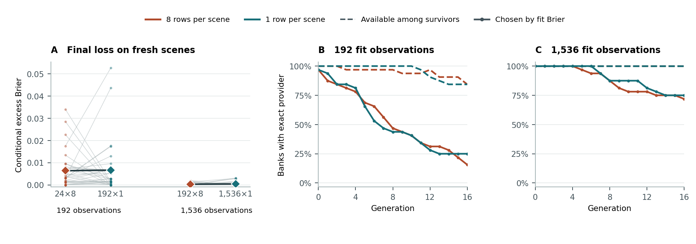
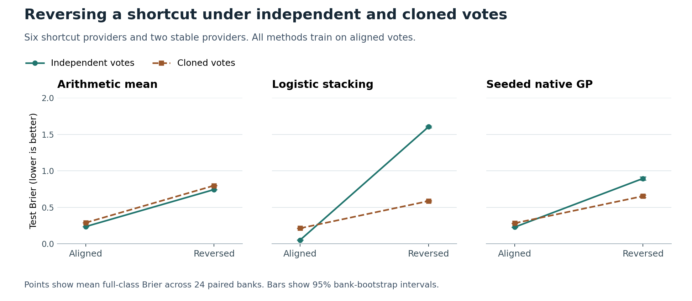

# How many observations does OKAPI need to keep choosing a good model?

Starting with a perfect provider makes it possible to watch a search replace a correct prediction with a worse one. With **192 observations from 192 different scenes**, seeded OKAPI initially chose the perfect prediction in 31 of 32 trials. After 16 generations it chose it in eight. Adding seven observations from **each of the same scenes** brought the final count up to 23 and reduced the excess loss by about 95%. A separate comparison investigated whether scene dependence itself explained the mistakes. At fixed row count we could not resolve such an effect under this generator. [Protocol](protocol.md) · [Results for every fit](results/scores.csv)

## Scene count and sample size

The eight models were synthetic, with 32 independent sets of model outputs and labels. On each set, we picked base-model checkpoints on 24 calibration scenes, trained on the layouts below and assessed all predictions on the same 512 new scenes. In the **signal** condition, one model supplied the true probability of the target. In the **equal** condition, all models were noisy, equally competent views of the same signal. Training saw ordinary sampled labels. Evaluation could also use the hidden probability to compute excess full-class Brier loss above the true prediction. Lower is better and zero denotes an exact match.

Each row below uses the signal condition. A provider counts as chosen when the deployed function matches it on every fit and audit row. The numerator for the two count columns is out of 32 independent trials.

| Fit design | Observations | True prediction available at end | True prediction chosen at end | OKAPI excess | Mean excess | Top-N excess | LR stacking excess | Regularized native OKAPI excess |
| --- | ---: | ---: | ---: | ---: | ---: | ---: | ---: | ---: |
| 24 scenes × 8 | 192 | 27 | 5 | 0.00637 | 0.01951 | 0.00755 | 0.02289 | 0.02198 |
| 192 scenes × 1 | 192 | 27 | 8 | 0.00663 | 0.01951 | 0.00373 | 0.01788 | 0.02583 |
| 192 scenes × 8 | 1,536 | 32 | 23 | 0.00030 | 0.01951 | 0.00000 | 0.00555 | 0.00316 |
| 1,536 scenes × 1 | 1,536 | 32 | 24 | 0.00041 | 0.01951 | 0.00000 | 0.00515 | 0.00319 |

**Same row count, different scenes.** The prespecified difference between 24×8 and 192×1 was −0.00026 excess Brier (95% paired bootstrap interval −0.00516 to +0.00444). This interval allows meaningful differences in either direction. At 1,536 rows the corresponding difference was −0.00012 (−0.00050 to +0.00024). With equal providers, both fixed-row contrasts also included zero. We used one GP search seed per data seed, so the intervals include their combined variation. They describe this simulator at its current within-scene dependence.

**Same scenes, more observations.** Expanding 192×1 to 192×8 reduced excess loss by 0.00634 (0.00280–0.01080) with a perfect provider and by 0.00657 (0.00418–0.00939) with equal providers. Extra rows from one scene have shared and individual sources of variation. On the signal condition, the 19 small-sample runs that bypassed an available perfect provider incurred an average excess loss of 0.00726. In the larger sample the nine remaining misses averaged 0.00106. The frequency and the cost of poor selection both fell. Ranked-prefix Top-N chose the perfect provider in all 32 runs at each larger size.

When **all providers were equally competent**, simple averaging had excess loss 0.02430. Under 192×1 it beat the seeded GP (0.03123) and LR stacking (0.02977). Under 192×8 GP reached 0.02466, while stacking improved to 0.01613. The value of sample size therefore also depends on what the method can learn from the larger sample. [Paired contrasts](results/design-contrasts.csv) · [Control comparisons](results/control-contrasts.csv) · [Availability, choices and cost](results/selection-events.csv)



**How dependent were the observations for a fixed choice?** We separately estimated the variance of the observed Brier difference between the mean and one prespecified provider. At the same row count, sampling eight observations per scene inflated this variance by **1.074×** under the signal law (interval 1.058–1.089), a 3.6% increase in standard error. Under equal competence it rose by **1.559×** (1.531–1.587), a 24.9% increase in standard error. Rows from the same scene can therefore be dependent to different degrees for different decisions. This calculation uses a fixed pair. The identity of the perfect provider was supplied to that diagnostic; the GP had to select from its own growing population. [Diagnostic specification](fixed-comparison.md) · [Variance estimates](results/fixed-variance-summary.csv)

## Two problems in one ready-made scenario

`cloned_shortcut` is the 25th standard scenario. Two stable models keep their signal. Six other models report a cue that is predictive during training. At test time its direction can reverse. A separate knob controls the chance that the six predictions are copies of a single vote. Either knob can be disabled independently or set to an intermediate probability. The four endpoints use identical underlying draws, and reversal changes only the test data. [Scenario guide and Python example](../../site/scenarios.md#cloned-shortcut-in-standard-v4) · [Generator and exact posterior](../../../fusionbench/scenarios/cloned_shortcut.py)

We fitted on 1,024 rows and evaluated on 4,096 rows in each of 24 independent banks. The values are sampled full-class Brier (range 0 to 2). The interaction is the reversal penalty with copies minus the reversal penalty with independent votes. [Raw scores](results/factorial-scores.csv) · [Effects with paired intervals](results/factorial-effects.csv)

| Method | Neither | Copies only | Reversal only | Both | Interaction |
| --- | ---: | ---: | ---: | ---: | ---: |
| Simple mean | 0.236 | 0.289 | 0.743 | 0.798 | +0.001 |
| Top-N | 0.224 | 0.289 | 0.946 | 0.798 | −0.213 |
| Logistic stacking | 0.052 | 0.213 | 1.603 | 0.586 | −1.179 |
| Seeded native GP | 0.228 | 0.283 | 0.895 | 0.653 | −0.296 |
| Regularized native-pattern OKAPI | 0.054 | 0.214 | 1.555 | 0.585 | −1.130 |

Six independent votes give strong evidence during training. When they all reverse, trusting that evidence is costly. With six identical votes, there is only one independent cue to learn from. Stacking's penalty for reversal was 1.551 with independent votes and 0.372 with copies. Its interaction was −1.179 (95% interval −1.198 to −1.159). Copies still hurt stacking when tested in the aligned domain. The simple mean has a population interaction of exactly zero here: copying changes the variance of its sum of votes by the same amount in both domains. The observed interval (−0.0021 to +0.0046) includes zero. The losses above reflect training on aligned cues and transferring without target labels or refitting. [Exact four-condition reference](results/compound-oracle.csv)



The exact calculation distinguishes loss of information from use of the wrong rule. Knowing the target law, the lowest attainable Brier is **0.05152** with independent votes and **0.21356** with copies. Reversal preserves those optima because it can be undone when its direction is known. Transferring the exact *source* rule unchanged gives Brier **1.60914** under reversal without copies and **0.58202** under reversal with copies. These values follow from summing the probabilities of every possible vote pattern. They require no fitted parameters or sampled test labels. [Exact calculation](compound_oracle.py)

## Regression coverage and scope

| Full-class test Brier, lower is better | Seeded GP | Simple mean | Top-N | LR stacking | Regularized native-pattern OKAPI |
| --- | ---: | ---: | ---: | ---: | ---: |
| Historical 24 families | 0.31765 | 0.37752 | 0.34046 | 0.25187 | 0.21935 |
| Current 25 families | 0.33096 | 0.39459 | 0.35901 | 0.26467 | 0.23357 |

Both rows use the same two fresh seeds per scenario, 512 fit and 512 test observations. The added scenario changes the suite composition. The earlier 19-, 20- and 24-scenario transfer presets remain available under their versioned names. The algorithms kept their previous settings. A real-data claim about STARCOP or MedMNIST would require their grouped predictions and splits. [All 25 scenario results](results/panel-family-means.csv)

The next controlled test would vary the relative magnitude of scene-shared and row-specific provider errors while holding the marginal variance of individual scores fixed. Repeating the 192-row comparison along this axis would show whether selection deteriorates predictably when the measured *loss differences* become more correlated. The same diagnostic could later be estimated from repeated observations within real acquisitions.

## Reproduce

Use this study's FusionBench checkout and its pinned OKAPI optional dependency (1d7ad2d). Run from the repository root.

```sh
uv sync --extra okapi
export BACKEND=numpy OKAPI_LOG_LEVEL=ERROR LOGURU_LEVEL=ERROR
export OPENBLAS_NUM_THREADS=1 MKL_NUM_THREADS=1 OMP_NUM_THREADS=1 NUMEXPR_NUM_THREADS=1
study=docs/ensemble-study/scene-count
.venv/bin/python "$study/run.py" --workers 3
.venv/bin/python "$study/analyze.py"
.venv/bin/python "$study/fixed_comparison.py"
.venv/bin/python "$study/panel.py" --workers 3
.venv/bin/python "$study/compound_oracle.py"
.venv/bin/python "$study/verify.py"
```

The 32-bank main run took 59.12 s, the regression panel 15.17 s and the four-condition comparison 13.76 s. Each used three CPU workers with one numerical thread per worker. A separate verifier regenerated all bank inputs, independently recovered all 512 main mean and Top-N scores to within 8.4 × 10⁻¹⁷, and reproduced the main contrast and all five compound interactions. On a replayed bank, replacing both audit labels and hidden probabilities changed measured loss while preserving the search trajectory and selected predictions byte for byte. [Verification](results/verification.json) · [Timing and fingerprints](results/run.json) · [Generation-by-generation results](results/generation-performance.csv)
