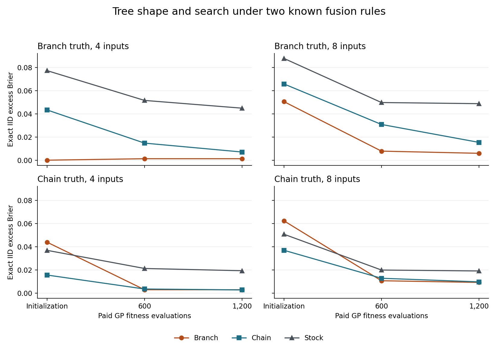
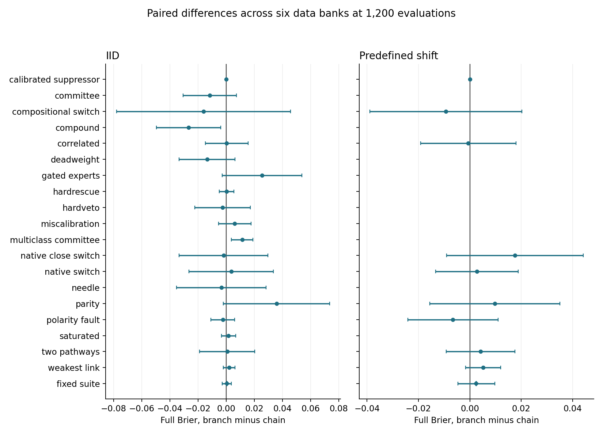

# A branched starting population helped GP recover two hidden pathways

With four relevant signals hidden among eight anonymous inputs, native MIN/MAX search found the true two-pathway rule in **21 of 24 runs** when its initial trees had two branches. Only one of those runs started with the true rule. Search found it in **11 of 24** runs starting from matched chains and **2 of 24** starting from the ordinary shallow programs. After validation selected a single tree, exact IID Brier was **0.19047 for branched starts and 0.19991 for chains**, a paired difference of −0.00944 [−0.01619, −0.00269]. On the full 19-scenario regression suite the difference was +0.00044 [−0.00286, +0.00374]. [Prospective protocol](protocol.md) · [Primary and secondary contrasts](focal-paired.csv)

## What changed at initialization

Each run began with the single-provider trees and 30 scored proposals. For each proposal the two interventions used the same four anonymized input occurrences, the same three MIN/MAX operators, and seven native nodes. One proposal combined two pairs. The other applied the operators successively to four inputs. All later moves, selection settings and the 1,200 actual training-score calls were shared in configuration. Native GP could produce other topologies during evolution. Fit and validation used 256 independent binary outcomes each in the mechanism panel. Test risk integrates over all 65,536 equally likely four-level input combinations at eight signals. Twelve data banks each shared two fixed search streams. Intervals pair data banks after averaging the two starts. [Reusable native seed generator](../../../fusionbench/eval/seed_geometry.py) · [Focal implementation](../../../fusionbench/eval/seed_geometry_focal.py)

On four inputs the branched template yields six different functions and the chain yields 24, even though both admit 48 serializations. On eight inputs those counts are 420 and 1,680. For fresh random plan draws the chance that 30 branched proposals contain a prescribed two-pathway rule is 99.58% with four inputs and **6.90% with eight**. Full truth tables identify aliases in scalar MIN/MAX programs because every real-valued output threshold obeys the same Boolean rule on thresholded inputs. The older OKAPI equivalence study documented identical predictions under different program descriptions. Exhaustive enumeration here verified every ordered plan and both orientations. [Coverage and expected unique functions](template-coverage.csv) · [Earlier equivalent programs](https://github.com/damiankucharski/OKAPI/blob/86e84ec/experiments/operator_equivalence.py)

| Starting programs on eight inputs | True at start | First found later | In archive by 1,200 | Selected by validation | Distinct functions by 1,200 |
|---|---:|---:|---:|---:|---:|
| Two branches | 1/24 | 20/24 | 21/24 | 14/24 | 247.3 |
| Chain | 0/24 | 11/24 | 11/24 | 8/24 | 280.2 |
| Ordinary shallow | 0/24 | 2/24 | 2/24 | 2/24 | 110.6 |

The chain searches explored more functions than the branched searches. Which functions they reached mattered for recovery. At 600 calls branched searches had reached the target in 17/24 runs and validation selected it in 15/24. By 1,200 calls more runs included the correct program, while one fewer returned it on validation. The outcome at a checkpoint records whether the archive contains the right function. The intervening descendant operators and ancestry remain unmeasured. [Ordered seeds and truth tables](focal-seeds.jsonl.gz) · [Individual selections and archive counts](focal-runs.csv.gz)



## Optimization and out-of-sample error

The table reports positive-channel Brier on the eight-signal branched law, with 256 true fit and 256 validation labels. The three baselines use the same fit data. Top-N fits one Brier ranking and scores all eight prefixes. The shifted input marginals change from uniform to .40/.30/.20/.10 from lowest to highest prediction, preserving the target rule. Conditional excess is mean squared distance from the known posterior.

| Fitted or selected predictor | Fit Brier | Exact IID Brier | IID conditional excess | Exact shifted Brier |
|---|---:|---:|---:|---:|
| Two-branch initial trees, then GP | 0.18865 | **0.19047** | 0.00593 | **0.17250** |
| Chain initial trees, then GP | 0.19456 | 0.19991 | 0.01538 | 0.17953 |
| Shallow initial trees, then GP | 0.22806 | 0.23332 | 0.04879 | 0.20128 |
| Exact empirical MIN/MAX minimizer, lower solution | **0.17373** | 0.20413 | 0.01960 | 0.18288 |
| Mean of all inputs | 0.23174 | 0.23187 | 0.04734 | 0.20392 |
| Ranked-prefix Top-N | 0.21128 | 0.21685 | 0.03232 | 0.19475 |
| Regularized logistic stack | 0.20079 | 0.21827 | 0.03374 | 0.19376 |

The exhaustive four-input selector from the original OKAPI branch recovered the same minimum fit cost as the min-cut solver in 36/36 cells across all three laws. On both matched four-input laws the true rule was the unique exact minimizer on all 12 banks. With eight inputs, the much larger unrestricted lattice family produced an empirical minimum below the training error of the true rule in **all 12 banks for both laws**. The lower exact solution above uses the binary64 input values in the existing min-cut implementation. A post-hoc check using the nominal integer grid distinguished representational ties from strict search and sampling error. Both extreme solutions on the nominal grid differed in 11/12 eight-input banks for each matched law. On the eight-input branched law their exact IID Brier values were 0.20458 and 0.20468. Averaging the two probability vectors gave 0.20373. This last predictor combines two solutions. The nominal grid and literal binary64 grid agree on the minimum at the reported precision, although roundoff broke some nominal ties in five of the twelve branched banks. [Original exact selector](https://github.com/damiankucharski/OKAPI/blob/c614670/okapi/lattice_search.py) · [All preplanned metrics](focal-means.csv)

**A post-hoc bound covers every empirically optimal program.** On a bank let L and U be the pointwise smallest and largest exact MIN/MAX minimizers for the nominal probability grid. For any empirical minimizer or convex average of them, its prediction at each input lies in [L,U]. The squared distance between the true posterior and its projection onto [L,U], integrated over the exact IID distribution, is therefore a lower bound on the conditional excess of **every such predictor**. On the eight-input branched law that bound averaged **0.01790**, compared with **0.00593** for branched GP. The mean of the two GP starts beat the bound on 10/12 individual banks. On the chain truth the corresponding bound was 0.01164 and branched GP beat it in 7/12 banks. This diagnostic uses q only after model selection. It identifies finite-sample overfitting within the unrestricted MIN/MAX family even after allowing all exact training-loss ties. [Post-hoc method and finite-grid checks](posthoc-cut.md) · [Executable certificate](posthoc_cut.py) · [Per-bank bounds and comparisons](posthoc-cut-bounds.csv) · [All extremal predictions and scalar risks](posthoc-cut.csv.gz)

On the eight-input chain truth, the final branched-minus-chain IID effect was −0.00047 [−0.00644, +0.00551]. The corresponding additive control gave −0.00196 [−0.00803, +0.00412]. On the four-input arithmetic-mean truth the mean of all providers achieved zero conditional excess by construction. On the eight-input additive control, Top-N gave 0.00386 excess compared with 0.03967 for branched GP. The observations support a targeted inductive bias on the hidden branch law. [All six settings and baselines](focal-means.csv)

## Regression on all 19 default scenarios

The full six-operator palette was available throughout the standard panel. All three initializers used the normal node-count objective, the same independent data and 1,200 actual calls per search. Two scenarios use four or five classes and normalize after each native operation. For these cases a scalar MIN/MAX truth-table certificate does not apply. We count distinct actual fit predictions instead. This table uses full-class Brier, twice the positive-channel value in binary tasks, and weights scenarios equally. Shift averages only the nine scenarios with a predefined shift. [Full-suite settings](../full-suite-point/protocol.md) · [All families, metrics and costs](standard-means.csv)

| Model | Full IID Brier, 19 families | Full shifted Brier, 9 families |
|---|---:|---:|
| Branched starts | 0.25382 | 0.31343 |
| Chain starts | 0.25338 | **0.31089** |
| Ordinary shallow starts | 0.26392 | 0.31644 |
| Mean | 0.37803 | 0.38688 |
| Top-N | 0.33487 | 0.36796 |
| Logistic stacking | **0.22867** | 0.31871 |

Branched versus chain gave +0.00044 [−0.00286, +0.00374] on IID and +0.00254 [−0.00459, +0.00967] on the predefined shifts. The largest IID point estimates in opposing directions were Compound at −0.02676 and Parity at +0.03575. Compound's unadjusted interval excludes zero and Parity's includes zero. MulticlassCommittee favored chains by 0.01134 [0.00370, 0.01898]. The intervals for individual scenarios are descriptive and use six independent banks. Both shaped initializations outperformed shallow starts on the fixed-suite IID average by about 0.010. That comparison also changes program sizes and the operators in the starting candidates. Logistic stacking achieved the lowest aggregate IID Brier. On average the initial 30 proposals formed 24.13 distinct fit prediction vectors for branched starts, 26.68 for chain starts and 26.03 for shallow starts. New external tasks would be required to evaluate broad transfer. [Paired estimates for every family, with bank ranges](standard-paired.csv.gz) · [Matched single-run predictions and programs](standard.csv.gz) · [All initial programs](standard-initial.csv.gz)



## Verification and reproduction

The focal verifier recalculated all 2,916 selected or baseline prediction vectors, 26,244 metrics, 1,692 paired intervals, 72 empirical min-cuts and 36 original-source enumerations. Independent ordinary native replay reproduced all 18 preregistered trajectories, their 54 checkpoint hashes and 108 winner choices. Across the registry the independently selected 63 native replays covered all three initializers in every scenario, both multiclass tasks, 75,600 training calls, 378 champions and 6,480 metrics. [Focal verifier output](focal-verification.json) · [Standard verifier output](standard-native-verified.json)

From the FusionBench repository, use OKAPI 3eae0e5 on PYTHONPATH and supply the separate historical checkout of c614670. Limit BLAS/OMP to one thread per worker. Run the two modules, then the audit and summary scripts in this folder.

```bash
python -m fusionbench.eval.seed_geometry_focal --out /tmp/geometry --workers 2 --historical-okapi ../okapi-historical
python -m fusionbench.eval.seed_geometry_standard --out /tmp/geometry --workers 2
python docs/ensemble-study/seed-geometry/summarize.py /tmp/geometry
```

The preceding donor audit found no productive native crossover in 32 matched generation-15 populations initialized from four singletons. OKAPI Lab's subsequent retrospective check found a true paired intermediate in 16/32 live populations, with no new joins enabled by exposing every sequential prefix. The current intervention supplies a broader initial set of programs before evolution begins. The next prospective trial compares earlier context-mixture selection to ordinary validation on an identical frozen bank and tests silent changes in the label law. Beadle and Johnson studied Boolean semantic equality during crossover. We used equivalence here to count functions under two topologies. [Prior donor audit](../semantic-donors/README.md) · [Native prefix audit](https://github.com/damiankucharski/OKAPI/blob/ff6cde2/experiments/donor_prefixes/README.md) · [Beadle and Johnson](https://doi.org/10.1109/CEC.2008.4630784) · [Dated literature entry](../literature/2026-11-21.md) · [Literature index](../literature/README.md)
