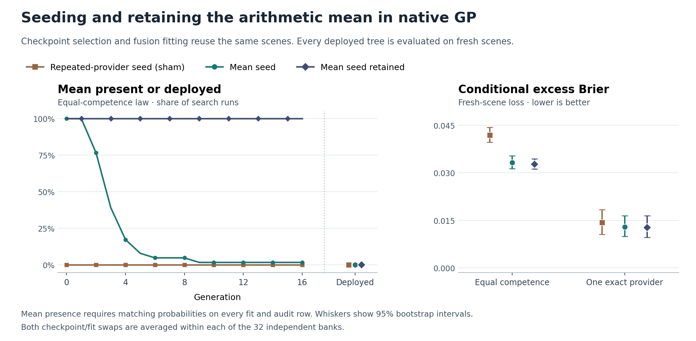

# What happens when OKAPI starts with the arithmetic mean?

Giving native OKAPI the all-provider mean as a starting tree improved the solutions it found. Its choice of which solution to deploy still overfit the development scenes. The clearest example came from a control where one provider returned the true probability. On the reused scenes, the fit criterion chose that provider in **51 of 64** initial populations. By generation 16 it chose it in **6 of 64**, although an equivalent program was still available in **46 of 64**. The two orientations share data within each of 32 independent banks. [Generation results](results/generation-performance.csv) · [Verification](results/verification.json)

## What the search could choose

Eight base models each provide eight correlated checkpoints. Choose one checkpoint per model on 24 development scenes. Fit OKAPI either on those same scenes or on another 24 scenes. Evaluate on 256 fresh scenes. Repeat with the development blocks exchanged, and repeat the whole experiment on 32 independent banks. We average the two orientations within each bank before computing intervals. The unit of replication is the bank.

Each bank has two versions. In the first, all providers are equally competent in the population. Their errors differ, which makes averaging useful. In the second, one randomly positioned provider outputs the true event probability on every row. Everything else, including labels, stays the same. Its identity and the true probabilities are available to the evaluator. The learner receives the frozen predictions and ordinary labels. This control asks whether OKAPI can recognize a genuinely superior base model when it is already present in the initial population.

We compared four actual searches on the same data and search seed. **Stock** starts with one tree per provider. **Sham** adds a ninth tree that takes the arithmetic mean of eight copies of the same provider. **Seeded** gives that tree eight different providers, making it the ordinary ensemble mean. These last two trees have the same shape and node count. **Carry** starts like seeded and restores the mean in the last breeding slot whenever it disappears. A fifth policy, **protected**, runs the exact seeded trajectory, then compares the winner with the mean once more on the fit labels. Ties favor the mean. Every policy can deploy another tree.

Each search lasts 16 generations. The native survivor rule uses rounded fitness and tree size. The final decision uses unrounded fit Brier. The fixed generation budget permits different numbers of proposals and objective evaluations as the paths diverge. The protected policy makes one additional fit comparison after evolution. [Prespecified protocol](protocol.md) · [Native search implementation](native_seed.py) · [Benchmarks](references.py)

## Did the improvements on development scenes transfer?

Here the same scenes served to select base checkpoints and train the fusion rule. The middle columns give audit Brier against sampled labels. The last two columns use the simulator's true event probability to average out label noise. If a model predicts positive probability `p` and the true probability is `q`, that excess loss is `2 × mean((p − q)²)`. Zero means an exact prediction of `q`. Under equal competence the simple mean still has positive excess loss. Lower is better in every column.

| Method | Audit Brier, equal | Audit Brier, perfect provider | Excess, equal | Excess, perfect provider |
| --- | ---: | ---: | ---: | ---: |
| Stock | 0.27383 | 0.24172 | 0.04693 | 0.01432 |
| Sham | 0.26831 | 0.24154 | 0.04195 | 0.01437 |
| Seeded | 0.26038 | 0.23987 | 0.03324 | 0.01290 |
| Protected | 0.26038 | 0.23987 | 0.03324 | 0.01290 |
| Carry | 0.25980 | 0.23975 | 0.03273 | 0.01275 |
| Simple mean | 0.25075 | 0.24595 | 0.02439 | 0.01955 |
| Ranked-prefix Top-N | 0.25934 | 0.23857 | 0.03268 | 0.01151 |
| Probability logistic stacking | 0.26116 | 0.25452 | 0.03429 | 0.02702 |
| Regularized native-pattern OKAPI | 0.26832 | 0.25781 | 0.04166 | 0.03015 |

**Equal providers.** On the prespecified primary comparison, seeding reduced excess loss relative to sham by **0.00870** (32-bank paired 95% interval for the reduction **0.00574–0.01156**). The seeded method did better in 27 of 32 bank means. It still lost to the simple mean by 0.00886 (interval 0.00680–0.01112). Its selected tree scored better than the mean on the fit data in **64/64** orientations, and worse on conditional audit loss in **58/64**. Its trees referenced 4.92 providers on average, compared with 3.30 for sham and eight for averaging. They used 287 versus 257 training objective calls on average under similar proposal counts (305 versus 306).

**One perfect provider.** The fit criterion again preferred the seeded winner over the mean in **64/64** orientations. This time the winner improved conditional audit loss in **50/64**. Its mean advantage over averaging was 0.00665 (interval 0.00303–0.00959). The seeded-versus-sham difference was inconclusive (−0.00147, interval −0.00549 to +0.00251). Top-N selected the perfect provider alone in 29/64 orientations, versus 6/64 for seeded OKAPI selecting an equivalent function. The two methods' average excess losses differed by 0.00140 in favor of Top-N (interval −0.00159 to +0.00476 for OKAPI minus Top-N). [All estimates](results/summary.csv) · [Paired intervals](results/comparisons.csv) · [Exploratory fit-to-audit decision counts](results/paired-mean-decisions.csv)

### Where selection went wrong

Below, each row scores the current winner chosen **using fit labels only** on the positive control. The true provider is in all 64 populations through generation two. Even before any search discards it, the empirical winner starts to move away from it.

| Generation | Perfect provider available, out of 64 | Its prediction chosen, out of 64 | Winner fit Brier | Winner conditional audit excess |
| ---: | ---: | ---: | ---: | ---: |
| 0 | 64 | 51 | 0.23214 | 0.00506 |
| 2 | 64 | 37 | 0.23008 | 0.01028 |
| 4 | 63 | 27 | 0.22853 | 0.01162 |
| 8 | 58 | 13 | 0.22635 | 0.01298 |
| 16 | 46 | 6 | 0.22466 | 0.01290 |

On the equal law, seeded search retained a mean-equivalent tree in only 1/64 final populations. Carry kept it in all 64, requiring an average of 13 reinsertions over 16 generations. Neither policy chose the mean in any final run. The extra terminal comparison also left every seeded decision unchanged across both laws and allocations. Carry brought the hindsight best final survivor's excess down from 0.02960 to 0.02427 under reuse and equal competence. Despite that better final population, deployed excess barely changed (carry minus protected −0.00051, interval −0.00262 to +0.00153). The oracle uses held-out information only to diagnose the frozen population. Selecting it at deployment would require unavailable information.



**Disjoint development scenes.** Selecting checkpoints on one block and training fusion on the other yielded the same direction for the primary comparison (seeded minus sham −0.01032, interval −0.01411 to −0.00720). When a perfect provider existed, the seeded method's excess was 0.00648, versus 0.01290 under reuse, and it selected the perfect prediction in 13/64 orientations, versus 6/64. Fusion saw 24 fit scenes in either case. Disjoint selection consumed twice as many distinct labeled scenes overall. [Raw trajectories](results/trajectories.csv.gz) · [Retention and reappearance](results/retention.csv)

## Regression panel on all 24 standard-v3 scenarios

| Method | Mean test Brier |
| --- | ---: |
| Stock | 0.35379 |
| Sham | 0.34208 |
| Seeded | 0.30807 |
| Protected | 0.30807 |
| Carry | 0.31328 |
| Simple mean | 0.37790 |
| Ranked-prefix Top-N | 0.33992 |
| Probability logistic stacking | 0.24889 |
| Regularized native-pattern OKAPI | 0.22244 |

Seeding reduced test Brier by **0.03401** relative to sham (95% interval 0.02351–0.04471 reduction). It helped on 32 of 48 banks, hurt on 11 and tied on five at tolerance 1e−12. The extra terminal comparison selected the same genotype on all 48. Reserving a breeding slot for the mean changed Brier by +0.00521 relative to that terminal comparison (interval −0.00079 to +0.01115).

The size of the average gain depends on the scenario mix. The two largest reductions were 0.40716 on `environment_shortcut` and 0.26601 on `needle`. The largest reversal was on `parity`, where seeding increased loss by 0.11501. Excluding the 100-model `needle` scenario, as planned because it required a larger tree-size cap, the reduction was 0.02392 (interval 0.01295–0.03485). An exploratory exclusion of both large gains leaves a reduction of 0.00650 over the other 22 scenarios. Each interval conditions on these fixed scenario families and resamples just two independent banks within each family. Data available for each fit and test were 512 rows each; the GP search seed was fixed at zero. [Family results](results/panel-family-means.csv) · [Paired contrasts](results/panel-contrasts.csv) · [Raw scores](results/panel-scores.csv)

## What this suggests for the next experiment

Useful programs can disappear during breeding. They can also survive while a slightly better development score promotes a worse program. The perfect-provider control distinguishes those failures without assuming that the arithmetic mean is optimal. Seeding improved ordinary GP on the suite, yet logistic stacking still beat that seeded GP; the separate regularized native-pattern reference achieved the lowest suite average. This round changed no production OKAPI defaults. Grouped synthetic scenes, deliberately perfect predictions in one control, and one GP seed per bank limit conclusions about transfer on real imagery or about search-seed variance.

A concrete next test is to draw matched 192-row fit sets from a shared, larger bank with independently frozen provider checkpoints. Sample either one row per scene across 192 scenes or eight rows per scene across 24 scenes, holding the GP budget and the fresh audit scenes fixed. Measure how often the fit winner displaces a still-available perfect provider and how much those replacements cost on new scenes. Repeat under equal competence to measure departures from the mean. The one-row-per-scene arm supplies a reference for selection optimism without within-fit scene correlation. This design needs no additional providers at deployment.

## Reproduction

From the root of this FusionBench checkout, use the pinned optional OKAPI dependency (commit `1d7ad2d`). Each worker uses a single numerical thread.

```sh
uv sync --extra okapi
export BACKEND=numpy OKAPI_LOG_LEVEL=ERROR LOGURU_LEVEL=ERROR
export OPENBLAS_NUM_THREADS=1 OMP_NUM_THREADS=1 MKL_NUM_THREADS=1 NUMEXPR_NUM_THREADS=1
study=docs/ensemble-study/seeded-checkpoint
.venv/bin/python "$study/run.py" --workers 3
.venv/bin/python "$study/analyze.py"
.venv/bin/python "$study/transfer.py"
.venv/bin/python "$study/panel.py" --workers 2
.venv/bin/python "$study/plot.py"
.venv/bin/python "$study/verify.py"
```

The paired experiment took **84.75 s** with three CPU workers for 1,024 short GP fits. The 24-scenario panel took **26.12 s** with two workers for 192 further GP fits. Timing covers native training, audit replay and baselines. The main archive has 2,304 method scores, 17,408 generation records and 1,024 per-provider checkpoint decisions. The panel adds 432 method scores and 3,264 generation records. [Bank fingerprints and timing](results/run.json) · [Suite timing](results/panel-summary.json)

A separate implementation replayed one complete A-to-A orientation on both laws. All 18 deployments and 136 generation records matched, with maximum score discrepancy 1.11 × 10⁻¹⁶. Replacing audit labels and the hidden posterior changed diagnostic scores and preserved selected programs and prediction bytes in the tested seeded and protected policies. The verifier also recomputed the primary 32-bank interval, the 24- and 23-family panel intervals and checked the archived grids. [Independent checks](verify.py) · [Recorded outputs](results/verification.json)
