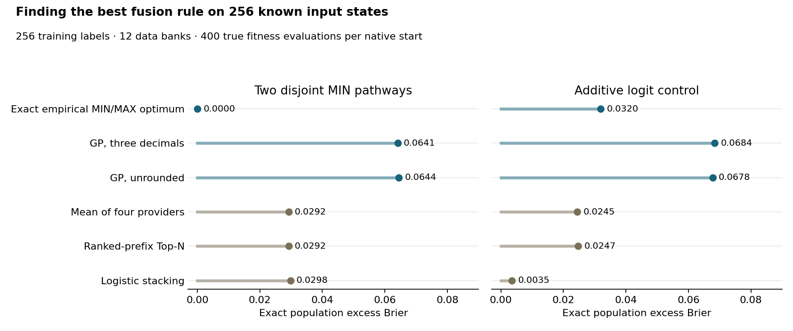

# Fitness precision changes the surviving trees, with little evidence of an IID benefit

Removing the usual three-decimal fitness rounding changed the membership of **134 of 191** observed survivor selections, replayed on identical candidates. After 1,200 training fitness calls, however, native unrounded selection had **0.26786** mean IID full Brier versus **0.26659** for standard three decimals. The paired difference was **+0.00127 [−0.00452, +0.00705]** across six fresh data banks on the fixed 19-family panel. Lower is better. The six-decimal comparison against stock was −0.00040 [−0.00490, +0.00410]. Neither increase in resolution showed a clear average gain. Regularized stacking reached 0.22774. [Preregistered design](protocol.md) · [All fixed-suite contrasts](suite-contrasts.csv) · [Independent survivor replay](survivors-verified.json)

On the four-input challenge, all possible MIN/MAX rules can be enumerated. With 256 labels, the empirical optimum was the true two-pathway rule in **12 of 12** independent banks. The actual native search found it in **0 of 24 starts**, with either three decimals or full precision, after **400 evaluations per start**. In the full-precision arm GP explored about 15 distinct functions out of 166. The limitation in this configuration was finding the right structure. [Exact finite-family results](lattice-means.csv)



## Default cases and native selection

Each GP arm used the same anonymous provider predictions and training labels. Only the precision used by tournaments and survivor selection varied. All winners were archived and chosen using **unrounded** loss. For the main comparison, each tree was selected by fit Brier. Selecting the minimum-validation-Brier tree instead gave +0.00221 [−0.00369, +0.00812] on IID for raw minus three. The corresponding fit-selected difference after 600 calls was +0.00315 [−0.00119, +0.00749]. Across the nine predefined shifts at 1,200 calls it was −0.00014 [−0.00313, +0.00286]. At fit, the difference was +0.00162 [−0.00450, +0.00774]. These samples do not resolve a benefit on either training or test loss from retaining every numerical increment. [Method means and spread](methods.csv.gz) · [All per-scenario paired intervals](paired.csv.gz)

The stock trajectories produced 2,533 complete scoring cohorts. Summing distinct values separately within each cohort gave 178,658 unrounded values, 176,093 at six decimals and 67,081 at three decimals. Replaying complete survivor decisions on the separately preregistered one-start-per-scenario subset changed the selected membership 134 times and only the order 33 further times; 24 lists were identical. Six-decimal and unrounded selection themselves replaced at least one survivor in 18 of 191 cohorts. Pareto comparison includes node count, so fewer ties need not select a subset of the old winning front. The paired replay isolates one survivor decision. Native searches measure the cumulative effect, which also includes later tournaments. These are distinct comparisons. [Per-scenario resolution](cohort-resolution.csv) · [Raw cohorts and full audited candidate lists](cohorts.csv.gz)

On the fixed suite, eight of the 19 primary IID point estimates favored unrounded selection. Only the five-class committee had an individual unadjusted interval entirely on the favorable side. Intervals in the table refer to independent data banks within a case, paired over the same starts, with no correction for 19 comparisons. The first three columns show the all-provider mean, fit-ranked averaging over the best prefix from one through all providers, and regularized logistic stacking. The shift column reports its point estimate where a shifted law was defined.

| Scenario | Mean | Top-N | Stack | Three decimals | Six decimals | Raw | Raw − three, 95% IID interval | Shift Δ |
|---|---:|---:|---:|---:|---:|---:|---:|---:|
| calibrated_suppressor | 0.2797 | 0.2208 | 0.1660 | 0.2209 | 0.2209 | 0.2209 | -0.0001 [-0.0003, +0.0001] | -0.0000 |
| committee | 0.2389 | 0.2450 | 0.0328 | 0.2325 | 0.2204 | 0.2182 | -0.0143 [-0.0504, +0.0217] | — |
| compositional_switch | 0.4019 | 0.3531 | 0.3289 | 0.3294 | 0.3306 | 0.3311 | +0.0017 [-0.0093, +0.0127] | -0.0007 |
| compound | 0.3075 | 0.2511 | 0.1471 | 0.1925 | 0.1919 | 0.1926 | +0.0001 [-0.0110, +0.0111] | — |
| correlated | 0.2910 | 0.2831 | 0.1764 | 0.2470 | 0.2541 | 0.2498 | +0.0028 [-0.0156, +0.0213] | +0.0026 |
| deadweight | 0.3279 | 0.1602 | 0.0595 | 0.1518 | 0.1428 | 0.1425 | -0.0093 [-0.0342, +0.0156] | — |
| gated_experts | 0.3872 | 0.3219 | 0.3489 | 0.3054 | 0.3067 | 0.3049 | -0.0004 [-0.0079, +0.0070] | — |
| hardrescue | 0.4288 | 0.4325 | 0.1015 | 0.0982 | 0.0982 | 0.0982 | -0.0000 [-0.0036, +0.0036] | — |
| hardveto | 0.3090 | 0.3140 | 0.0938 | 0.1471 | 0.1503 | 0.1495 | +0.0024 [-0.0118, +0.0167] | — |
| miscalibration | 0.1894 | 0.1880 | 0.0500 | 0.1656 | 0.1641 | 0.1681 | +0.0025 [-0.0094, +0.0144] | — |
| multiclass_committee | 0.7043 | 0.7063 | 0.7249 | 0.7080 | 0.7035 | 0.7034 | -0.0045 [-0.0082, -0.0009] | — |
| native_close_switch | 0.4953 | 0.4958 | 0.4830 | 0.4722 | 0.4700 | 0.4698 | -0.0024 [-0.0187, +0.0139] | -0.0001 |
| native_switch | 0.4475 | 0.3499 | 0.3101 | 0.3302 | 0.3281 | 0.3294 | -0.0008 [-0.0203, +0.0187] | -0.0032 |
| needle | 0.4870 | 0.1964 | 0.2133 | 0.2330 | 0.2397 | 0.2690 | +0.0359 [-0.0451, +0.1169] | — |
| parity | 0.6647 | 0.6647 | 0.5030 | 0.5327 | 0.5363 | 0.5370 | +0.0043 [-0.0386, +0.0472] | -0.0005 |
| polarity_fault | 0.2238 | 0.1565 | 0.1130 | 0.1475 | 0.1456 | 0.1493 | +0.0018 [-0.0095, +0.0130] | +0.0005 |
| saturated | 0.2001 | 0.2016 | 0.1492 | 0.1813 | 0.1820 | 0.1837 | +0.0024 [-0.0005, +0.0053] | — |
| two_pathways | 0.3067 | 0.3137 | 0.2488 | 0.2958 | 0.2973 | 0.2971 | +0.0012 [-0.0201, +0.0226] | +0.0002 |
| weakest_link | 0.4845 | 0.4968 | 0.0767 | 0.0742 | 0.0750 | 0.0750 | +0.0008 [-0.0015, +0.0031] | -0.0001 |

## Where the finite-family search falls short

Four anonymous provider outputs each take one of four levels. On the 256 input atoms there are exactly 166 different nonconstant MIN/MAX functions. Enumeration computes every integer fit-Brier numerator and the exact conditional population risk. These quantities cover this bounded grammar. In this section all Brier values use the positive class channel; a full two-class Brier would be double. The six-operator canonical suite above uses full-class Brier throughout. [Original bounded grammar](../search-regret/graded.md) · [Search results, ties, regret, true risks and output fingerprints](lattice.csv.gz)

| True law, 256 labels | Exact empirical lattice winner | Standard three-decimal GP | Unrounded GP | All-provider mean | Ranked-prefix Top-N | Logistic stacking |
|---|---:|---:|---:|---:|---:|---:|
| Two-pathway lattice law, excess population Brier | 0.00000 | 0.06409 | 0.06444 | 0.02922 | 0.02922 | 0.02978 |
| Additive logit law, excess population Brier | 0.03196 | 0.06844 | 0.06777 | 0.02447 | 0.02470 | 0.00348 |

On the matched law, unrounded minus three-decimal search increased empirical regret by +0.00052 [−0.00062, +0.00166] and increased exact IID population excess by +0.00036 [−0.00043, +0.00115]. The empirical contribution decomposes into +0.00026 from squared distance to the known q on the same fit inputs and +0.00026 from the label-noise cross product. Neither direction is resolved. At 32 labels the exact empirical rule itself had positive population excess 0.02839. This separates limited statistical information from the search failure at 256 labels, where every unique training winner already matched q. On the additive law, which violates the lattice identity f(t,t,t,t)=t, the best possible population lattice rule has excess 0.02737; the empirical rule incurs a further 0.00459. Exact optimization of this restricted family cannot remove its mismatch. [All budget, sample-size and law contrasts](lattice-paired.csv) · [Exact/inexact sample decompositions](lattice.csv.gz)

The deliberately compressed score 1−2⁻¹²(1−fitness) preserves the ideal score and the ranking in exact arithmetic. After rounding to three decimals it gives one score throughout this challenge. On the matched 256-label case, the compressed three-decimal run increased empirical regret versus ordinary three-decimal selection by +0.00512 [+0.00002, +0.01022]. The corresponding population difference was +0.00197 [−0.00800, +0.01194]. Thus a change of numerical units can affect fit in an extreme case; its size cannot serve as an estimate for natural Brier. Full-precision runs in both units had identical trajectories at all 48 eligible budget checkpoints in this finite test. Because positive-channel fitness in the finite experiment has denominator 400n, six decimals agreed with full precision at all 192 nominal checkpoints. With machine arithmetic, arbitrary strictly increasing transforms need not preserve every representable near-tie in a different problem. [Invariance checks](lattice-controls.json) · [Native selection-precision fixtures](https://github.com/damiankucharski/OKAPI/blob/3eae0e5480cba0471cc5fda71b0c90f35b6a73f2/experiments/selection_precision/README.md)

## Reproduction and verification

The standard panel used 684 real native searches, each to 1,200 scored trees. A separate historical-stock search route reproduced all 228 standard trajectories and 456 checkpoint fingerprints. The independent prediction interpreter reproduced all 10,692 probability vectors bitwise, 53,460 scalar measurements exactly and all 48 aggregate Brier intervals. The survivor verifier independently read the stored raw fitness and sizes and replayed the 191 native candidate-cohort selections. [Case-level runs with trained programs](runs.csv.gz) · [Stock replay](stock-verified.json) · [Prediction and aggregate agreement](predictions-verified.json)

For the finite experiment a second implementation recovered all 166 evaluation vectors on 256 atoms in canonical order, all 1,536 pipeline probability vectors, 30,720 scalar measurements and 924 paired intervals. A separate bare-OKAPI replay on the two prespecified banks matched 112 full native checkpoints and all 224 archived winner choices. The largest scalar discrepancy was 3.33×10⁻¹⁶. [Independent finite oracle and trajectory audit](lattice-verification.json)

Use the indicated OKAPI checkout on PYTHONPATH and one BLAS/OpenMP thread per worker. Native selection precision and its historical default are in [OKAPI 3eae0e5](https://github.com/damiankucharski/OKAPI/commit/3eae0e5480cba0471cc5fda71b0c90f35b6a73f2). The common multiclass probability references use [the corrected Gaussian derivation](../multiclass-oracle/README.md).

```bash
python -m fusionbench.eval.selection_precision --out /tmp/precision --workers 2
python -m fusionbench.eval.precision_lattice --out /tmp/precision --workers 1
python docs/ensemble-study/selection-precision/summarize.py /tmp/precision
python docs/ensemble-study/selection-precision/verify_predictions.py /tmp/precision
python docs/ensemble-study/selection-precision/verify_stock.py /tmp/stock-replay.jsonl
python docs/ensemble-study/selection-precision/verify_stock.py /tmp/stock-replay.jsonl --compare /tmp/precision
python docs/ensemble-study/selection-precision/plot.py /tmp/precision
```

Cawley and Talbot identified optimism from selecting against noisy validation estimates in kernel classifiers. Here exact population calculations and independently sampled labels distinguish fit search from generalization under two specified fusion laws. The results do not establish an effect on real applications or on untested GP grammars. [Cawley and Talbot, Table 8](https://jmlr.org/papers/v11/cawley10a.html) · [Dated source review](../literature/2026-11-21.md) · [Literature index](../literature/README.md)
