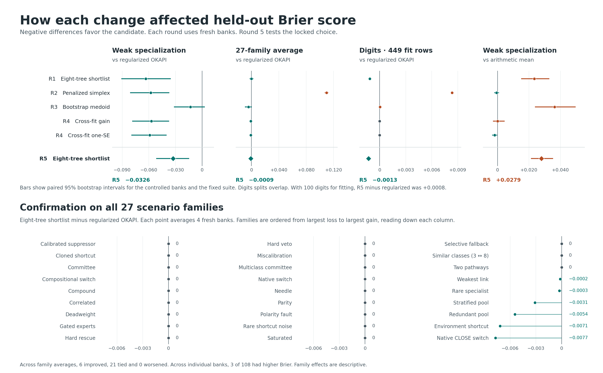

# How many trees should 39 validation labels choose between?

Restricting the choice to eight trees cut about **54% of the gap to simple averaging** in the confirmation experiment. Both versions of OKAPI ran the same evolutionary search. The difference was which trees could compete for the 39 validation labels. The result held on new draws from a fixed population, with the same class and signal-strength proportions in fit and evaluation. Simple averaging still won on all 32 draws.

The intervention also met the prespecified limits for strong specialization, all 27 standard-v5 scenarios and handwritten digits with 449 fusion-training examples. Digits with only 100 fusion examples was a counterexample to uniform improvement. The experiment tests one mechanism that could explain a real-data generalization gap. STARCOP and MedMNIST require separate measurements. [Protocol](protocol.md) · [Independent verification](results/verification.json)



[Download the vector figure](results/stability-five.pdf)

## Five rounds on fresh data

Each number is a change in full-class Brier against the regularized OKAPI fitted in the same round. **Negative values improve the forecast.** Each standard scenario carries equal weight. The last column gives descriptive means over resplits of one real dataset. Open a round's family table for every scenario and method.

| Round and method | Weak specialization | Strong specialization | All 27 | Digits, 449 | Family table |
| --- | ---: | ---: | ---: | ---: | --- |
| 1. Eight trees eligible for validation | −.06325 | −.02859 | −.00002 | −.00115 | [Round 1](results/round1-families.csv) |
| 2. One weighted probability mean with a penalty for unequal weights | −.05784 | −.00576 | +.10983 | +.00836 | [Round 2](results/round2-families.csv) |
| 3. Select one representative of four bootstrap fits | −.01302 | +.00293 | −.00453 | +.00004 | [Round 3](results/round3-families.csv) |
| 4. Use four held-out folds to choose a weighted mean or expressive tree | −.05891 | −.01393 | −.00109 | .00000 | [Round 4](results/round4-families.csv) |
| 5. Confirm the eight-tree rule selected in advance | **−.03264** | **−.02033** | **−.00088** | **−.00128** | [Round 5](results/round5-families.csv) |

**Why restrict validation?** In round 1 the original pipeline let an average of 367 distinct programs compete on the weak task. The validation winner's median rank on the evolution data was 305. On fresh banks in round 5, the original winners scored .41861 on validation and .54245 on the exact population before refitting. Restricting eligibility to the eight best programs on the evolution data changed those scores to .48886 and .51055. The gap fell from .12384 to .02169. The two native logit heads could still compete with the winning GP program. The experiment changes both the number of opportunities to win by chance and which trees are eligible. [Round 1 analysis](r1-report.md) · [Round 5 individual scores](results/round5-scores.csv)

**When does simplicity help?** The weighted probability mean in round 2 stabilized the fit under weak specialization. Used everywhere, it cost .42780 Brier on parity and .41399 on weakest link. In round 3, deploying a representative of four fits gave an inconclusive weak-task improvement and required four native fits. Averaging all four forecasts did better there, at the cost of retaining the four models. [Round 2 and coefficient ablation](r2-report.md) · [Round 3 and averaging control](r3-report.md)

**Can training data tell us which method to use?** In round 4, four-fold validation chose the simple tree on all 16 weak draws and the expressive pipeline on 46 of 54 standard-suite draws. It achieved .48002 on the weak task, versus .48188 for averaging. This is an exploratory result. The screening rule ranked *improvement over each method's own paired baseline*. Against different draw sets those improvements were .06325 for the eight-tree rule and .05891 for the fold-based choice. This sent the eight-tree rule to confirmation. The four rounds do not establish which of those two methods is better head-to-head. [Round 4 and decision counts](r4-report.md) · [Frozen selection](selection.json)

## Round 5 in absolute Brier

| Evaluation | Existing regularized OKAPI | OKAPI, eight trees eligible | Simple average | Ranked Top-N | Logistic stacking | Penalized weighted mean |
| --- | ---: | ---: | ---: | ---: | ---: | ---: |
| Equal competence | .54579 | .51864 | **.48188** | .49982 | .51683 | .48409 |
| Weak specialization | .54245 | .50981 | .48188 | .49691 | .50495 | **.48063** |
| Strong specialization | .45061 | **.43028** | .48188 | .43335 | .43558 | .44338 |
| All 27 scenarios | .25687 | **.25599** | .40042 | .38037 | .28460 | .37030 |
| Digits, 449 | .03068 | .02940 | .05934 | .03307 | **.02588** | .04240 |
| Digits, 100 | .03150 | .03234 | .05934 | .03307 | **.02994** | .04791 |

The eight-tree rule improved on existing OKAPI in 20 of the 32 weak draws. Its paired change was −.03264 (95% interval −.05170 to −.01461). Arithmetic averaging beat it by .02794 (.02136 to .03545). On strong specialization the paired change against existing OKAPI was −.02033 (−.03964 to −.00460). On the 27 fixed families it was −.00088 (−.00178 to −.00002). Six family means improved and 21 tied within 1e−12. Individual suite draws included 12 improvements and three regressions out of 108. The largest family improvements were on native_close_switch (−.00769), environment_shortcut (−.00715) and redundant_pool (−.00542). The environment_shortcut family had worsened in round 1, illustrating the uncertainty of a two-seed family estimate. [Absolute levels](results/round5-levels.csv) · [Paired intervals and counts](results/round5-contrasts.csv) · [Confirmation criteria](results/confirmation.json)

Each controlled variant used eight binary providers, 128 fit rows and known population risk integrated over 512 input patterns. We used 16 fresh draws per variant in rounds 1–4 and 32 in round 5. The 27 standard families had 512 fit and 512 test rows per draw, with two seeds per family in screening and four in confirmation. The digits providers were logistic regression, five-nearest neighbours and random forest, trained on 898 images separate from the 449 fusion and 450 test images. The 100-image variant used the same providers and test images. Repeated digits partitions overlap. The paired intervals resample training banks for the controlled task or seeds within each fixed standard family. They describe sampling at these settings. [Bank construction](banks.py)

## Repeat the experiment

Use this report's FusionBench checkout and the [OKAPI research revision](https://github.com/damiankucharski/OKAPI/commit/d1afe2b2164e67df5c9e157b84d8729a3850f65e). Install their dependencies and expose both source trees on the Python path. Our environment used Python 3.12.14, NumPy 2.3.5, SciPy 1.17.0, scikit-learn 1.8.0, pandas 2.2.3 and threadpoolctl 3.6.0. From the FusionBench repository root, replace the OKAPI checkout path below.

```sh
export PYTHONPATH=".:/path/to/OKAPI"
export BACKEND=numpy OKAPI_LOG_LEVEL=ERROR LOGURU_LEVEL=ERROR
export OPENBLAS_NUM_THREADS=1 MKL_NUM_THREADS=1 OMP_NUM_THREADS=1
study=docs/ensemble-study/stability-five
for round in 1 2 3 4; do python "$study/run.py" --round "$round"; done
python "$study/decision.py" select
python "$study/run.py" --round 5
python "$study/decision.py" confirm
python "$study/verify.py"
python "$study/verify_shortlist_api.py"
python "$study/plot.py"
```

The five runs took 68, 65, 207, 254 and 117 seconds respectively, each with one numerical thread. Screening jobs overlapped. Across 644 bank evaluations we recorded 3,970 method scores. The independent audit reconstructed all 540 paired summaries and reproduced all 1,288 arithmetic-mean and Top-N forecast hashes. A separate replay used the normal fit/predict interface on every confirmation bank. The API reproduced all 220 forecast hashes while evaluating 3,500 GP validation scores across checkpoints, compared with 80,180 for unrestricted validation. The search budget remained 600 discovery evaluations per fit. [Public API and example](../../site/okapi.md#does-the-validation-choice-transfer) · [Replay of all 220 fits](results/round5-shortlist-api-verified.json)

The next comparison would put the eight-tree rule and the fold-based choice on identical fresh banks, including small digits fits. This would measure whether the latter can preserve its near-mean performance on weak signals while retaining nonlinear trees where they help.
