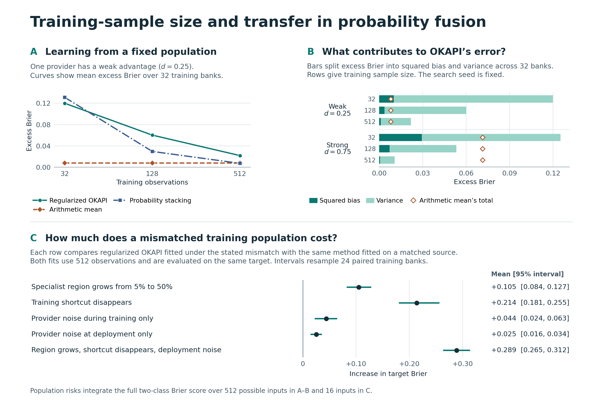

# When regularized OKAPI loses under matched, stratified sampling

**A change of population is unnecessary for a failure.** On the primary `stratified_pool` condition, arithmetic averaging had lower population Brier than regularized OKAPI on all 32 training draws. One provider really carried extra signal. A method that learned to use it could improve on the mean. OKAPI’s predictions averaged over many fits did capture some of that signal. Its predictions varied enough from one fit to the next to erase the gain. [Prespecified questions](protocol.md) · [Verified population losses](results/verification-stratified.json)



[Vector figure](results/transfer-factorial.pdf) · [Both public scenarios](../../site/scenarios.md#same-population-stratified-pool-in-standard-v5)

## The matched case

Each example has eight provider forecasts. The chance of a positive label is a weighted average of their mean (75%) and the first provider’s prediction (25%). Each training draw of 128 contains exactly 32 examples in each combination of class and report amplitude. The target has exactly the same stratum masses, label law, and conditional distribution of provider predictions. We evaluate on all 512 possible input vectors with their exact probabilities. There is no uncertainty from drawing a finite test set. The known Bayes Brier is 0.47395.

| Method | Population Brier | Squared bias contribution | Training-sample variance contribution |
| --- | ---: | ---: | ---: |
| Arithmetic mean | **0.48187** | 0.00793 | 0.00000 |
| Top-N, best fit-ranked prefix | 0.49377 | 0.00223 | 0.01759 |
| Logistic probability stacking | 0.50361 | 0.00079 | 0.02888 |
| Regularized native-pattern OKAPI | 0.53414 | 0.00362 | 0.05657 |

The columns on the right add to each method's excess over Bayes risk, up to rounding. For each input, average the probabilities over the 32 fits. Its squared difference from the true probability gives the bias term; the average squared distance between each fit and that average gives the variance term. Full-class binary Brier multiplies both by two. GP search and internal-split seeds remain fixed in this comparison. The variance column describes how a learned probability changes with the supplied training observations. It includes associated changes in the selected tree and its parameters. On a fresh 16-bank grid crossed with six optimizer seeds, 58.6% of the prediction variance lay between training banks and 41.4% within a bank across seeds, holding the partition seed fixed. The within-bank term includes interactions between the training bank and the seed. Regularized OKAPI again lost to averaging on all 16 bank averages. [All training sizes, methods and mechanisms](results/stratified-decomposition.csv) · [Separate check with six optimizer seeds per training draw](seed-report.md)

The primary risk difference for OKAPI minus mean was **+0.05226** (paired 95% interval +0.03929 to +0.06626). The mean had lower population loss in 32/32 comparisons. OKAPI only achieved lower empirical loss than the mean in 12/32, so false training wins explain just part of the observed deficit. Its mean population-minus-empirical loss was +0.03973. At 512 training observations its loss fell to 0.49588, still above the mean's 0.48187. When the first provider carried a larger fraction of the true probability (75%), OKAPI beat the mean with 128 observations (0.46372 vs 0.48188) and with 512 (0.42117 vs 0.48188). In this stronger condition Top-N was competitive and logistic stacking led at 512 (0.41660). The experiment supplies a failure case with a known mechanism. Its rate across natural tasks cannot be inferred from a grid of synthetic laws. [Paired contrasts](results/stratified-contrasts.csv)

### Why inspect the GP family?

On a further 16 fresh training banks, the method checked an average of 350 distinct evolved programs on 39 internal validation examples. It then used the same 39 examples to compare the winning GP tree with the flat and augmented native heads. GP won that decision in 16/16. Its mean Brier of **0.42380 on those 39 examples became 0.52713 on the exact population**. Always taking the flat head and refitting it, as the method normally does if that family wins, gave 0.50276. Arithmetic averaging gave 0.48188 and beat the refitted flat head in all 16. Repeated selection on a small validation set is a specific hypothesis suggested by this comparison; the experiment has not isolated it as the sole cause. [Family replay on fresh banks](seed-report.md) · [Validation and population scores](results/family-check.json)

## How much protection does a separate validation decision buy?

Reserve a quarter of each label class. Fit a full regularized-OKAPI candidate on the remaining data and score its paired improvement over arithmetic mean on the reserved rows. The cautious rule selects OKAPI only when this gain exceeds one estimated standard error. It then uses the full-data refit. Otherwise it deploys the ordinary mean. The comparison spends an additional OKAPI fit on each bank. It can select a simple estimator without test labels. The margin is a heuristic and the refit can change the model.

At 128 examples and weak specialization the rule selected the mean in **32/32**, closing the entire 0.05226 gap. Accepting *any* positive held-out gain chose OKAPI in three banks and gave 0.49031. With strong specialization the cautious rule chose OKAPI only **6/32** times, giving 0.47970 versus 0.46372 for standard regularized OKAPI. There is a measurable cost to refusing improvements under weak evidence. [Selection, fit and population scores](results/stratified-scores.csv)

On the standard-v5 panel (27 fixed scenarios, two fresh data seeds each), regularized OKAPI scored 0.26778 and the cautious rule 0.26757. Simple averaging scored 0.39920, Top-N 0.37962 and probability stacking 0.29196. Both holdout rules selected OKAPI when the shortcut appeared reliable throughout training and then disappeared in `rare_shortcut_noise`. On the two banks of that family, OKAPI and the rule averaged 0.78162 against 0.47118 for the mean. These two-seed results are a regression check. The training-only decision remains experimental. [Panel, preplanned 26-family subset and 27th family](results/panel-sanity-manifest.json)

**One real dataset provides a counterexample to using this fallback by default.** We trained a logistic model, five-neighbour classifier and random forest on one half of sklearn digits; other, disjoint stratified partitions supplied the fusion-training and test examples. On eight partitions, regularized OKAPI always beat the mean with both 100 and 449 fusion-training rows. With 100, the cautious rule fell back three times and raised Brier from 0.03039 to 0.04048. Logistic stacking achieved the lowest mean Brier at both sizes. These eight overlapping test partitions describe one dataset. STARCOP and MedMNIST predictions were not used here. [Digits experiment](digits-report.md)

## What changes when the populations differ?

The other new scenario, `rare_shortcut_noise`, has a generalist, a regional specialist, an observable routing cue, and a temporary shortcut. Four probabilities can be set independently on fit and test: region prevalence, shortcut activity, provider corruption, and label corruption. The exact observed-label posterior is available for all 16 observable patterns under either split. The following differences compare regularized OKAPI trained under mismatch with the same algorithm trained on data drawn from the target law, evaluated on the same target.

| Change from fit to test | Additional target Brier | 95% paired interval |
| --- | ---: | ---: |
| Specialist region increases from 5% to 50% | +0.10493 | +0.08377 to +0.12717 |
| Shortcut drops from 90% to 50% accuracy | +0.21377 | +0.18146 to +0.25509 |
| 20% independent generalist/specialist vote flips only in training | +0.04409 | +0.02359 to +0.06308 |
| 20% flips only in testing | +0.02543 | +0.01591 to +0.03439 |
| Region increases, shortcut disappears, provider flips only in testing | +0.28883 | +0.26459 to +0.31250 |

These are differences in target loss against matched training. They are distinct from the gap between empirical training and test loss. When only region frequency changes, the oracle probability for every observable input stays fixed. The rare subgroup paid an extra 0.22219 Brier under rare-region training. By contrast, when only the shortcut disappears, even the *exact* source posterior incurs 0.18306 excess Brier on target. On the 16 factorial conditions the simple mean led all eight in which training had the shortcut and the target lacked it. Regularized OKAPI led six of the other eight and Top-N led two. [Full factorial and signed-gap decomposition](main-report.md) · [Independent verification](results/verification-transfer.json)

* **Rare examples and training weight.** Roughly 256 examples from the important region occurred both at 5% of 5,120 rows and at 50% of 512 rows. The larger imbalanced sample gave regularized OKAPI **0.11374** higher target Brier (95% interval +0.10360 to +0.12280). Even retrospectively choosing the best of the three fitted families on target could recover only 0.00218 in the imbalanced condition. [Discovery, refit and subgroup risks](rare-evidence-report.md)
* **Different kinds of noise.** Under a disappearing shortcut, corrupting 20% of *training labels* reduced OKAPI’s reliance on the shortcut and lowered clean-target Brier by 0.11916. Corrupting 20% of the *generalist and specialist reports* raised it by 0.05300. When the shortcut retained its original reliability, corrupting labels made performance worse. The full comparison includes targets where the shortcut retained only part of its reliability. [Direction, noise type and conditional error](noise-report.md)

## Reproduce

Use this FusionBench research checkout and the [OKAPI research revision](https://github.com/damiankucharski/OKAPI/commit/92f0e96d7ba29f047134ffb3640f444fff5adc7a) in the study Python environment. The main estimator is `RegularizedNativePatternOKAPI(seed=0, split_seed=0)`. Earlier studies describe its variance-scaled L2 penalty and selection among flat, augmented and GP candidates. The two new standard scenarios are included in the reproducible reference bank. [Generator API and examples](../../site/scenarios.md#rare-specialist-shortcut-and-noise-in-standard-v5)

```sh
export PYTHONPATH="$PWD:$PWD/../OKAPI"
export OPENBLAS_NUM_THREADS=1 MKL_NUM_THREADS=1 OMP_NUM_THREADS=1 NUMEXPR_NUM_THREADS=1
export BACKEND=numpy OKAPI_LOG_LEVEL=ERROR LOGURU_LEVEL=ERROR
study=docs/ensemble-study/transfer-factorial
python "$study/stratified.py"
python "$study/verify_stratified.py"
python "$study/seeds.py"
python "$study/family-check.py"
python "$study/study.py"
python "$study/verify_transfer.py"
python "$study/rare_evidence.py"
python "$study/noise.py"
python "$study/panel_sanity.py"
python "$study/digits.py"
python "$study/plot.py"
```

An immediate research question is whether resampling the training examples can identify unstable corrections *within* OKAPI and preserve useful corrections, without having to discard the full tree each time a separate validation comparison is inconclusive.
