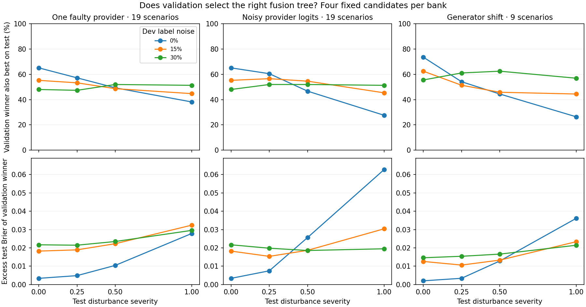

# When does the tree selected on validation still win on test?

With clean development labels, the tree selected on validation was also best on an independent, identically distributed test in **65.1%** of banks. At the strongest test-time logit noise this fell to **27.6%**, on exactly the same 19 scenarios, development banks and four candidate trees. The corresponding cost of choosing by validation rose from **0.00338 to 0.06271** full-class Brier. This comparison holds the programs fixed before refitting, so it measures a change in which tree generalizes.

The experiment uses the new configurable FusionBench transfer grid. The grid can also evaluate any registered fusion method on paired clean and disturbed data. [Public CLI, presets and contributing a scenario](../../transfer-benchmark.md) · [Benchmark card](benchmark-card.md) · [Frozen protocol](protocol.md)

## Can mild validation disturbances select a more robust native tree?

We compared the previous single-tree OKAPI with a version that tried mild perturbations of validation inputs, considered attenuating the coefficients of evolved subtrees, and chose a single candidate that retained strong validation fitness across environments. Both had exactly the same training labels, GP archive and validation partition. In 128 of 456 fits, the new policy selected a different candidate name. Both policies use one native tree at inference. We also evaluated unweighted mean, ranked-prefix Top-N, logistic stacking on probabilities and logistic stacking on logits.

| Mean full-class Brier (lower is better) | Previous OKAPI | New selector | Probability LR | Logit LR | Top-N | Mean |
|---|---:|---:|---:|---:|---:|---:|
| Six generic disturbances, all three source noise levels, 19 scenarios | **0.30376** | 0.30487 | 0.32793 | 0.33731 | 0.37353 | 0.39511 |
| Clean labels and clean test inputs, 19 scenarios | **0.18662** | 0.18969 | 0.21745 | 0.22075 | 0.33277 | 0.37796 |
| Strongest original generator shift, clean source labels, 9 scenarios | 0.32033 | 0.32222 | **0.30458** | 0.31590 | 0.36451 | 0.38564 |

The new selector missed both prespecified criteria. Its primary paired difference against previous OKAPI was **+0.00112**, with 95% CI **−0.00026 to +0.00249**. On clean source and test the difference was **+0.00307**, with CI **+0.00075 to +0.00539**, crossing the +0.005 noninferiority margin. Nine additional objective evaluations per fit bought no demonstrated robustness improvement. The previous selector remains the reference for the next round. The first and last rows weight different test populations. They illustrate why the coverage and severity of a benchmark must accompany an overall score. [All contrasts](contrasts.csv) · [Scores by condition](conditions.csv)

## Diagnosing the validation-to-test gap

For each fit we retained four candidates at the end of discovery: a flat native logit head, a head with evolved subtrees, a GP tree, and the same augmented head with halved subtree coefficients. We evaluated each on the 192 development validation rows and every independent test condition. A hit means the best validation candidate is within 1e−12 of the lowest test Brier among these four. Excess Brier is the test loss of the validation winner minus that lowest loss. The retrospective comparison measures selection error relative to the available programs. It does not establish the globally best tree. The main method results above come from the separately refitted deployment trees.

| Independent test, clean source labels | Families | Hit rate | Excess Brier |
|---|---:|---:|---:|
| Clean inputs | 19 | 65.1% | 0.00338 |
| One provider replaced on every row | 19 | 38.2% | 0.02787 |
| Strongest noise on provider logits | 19 | 27.6% | 0.06271 |
| Full scenario-specific change | 9 | 26.4% | 0.03615 |



The public benchmark can ask the same question across any registered methods. As a separate diagnostic, we let a fresh 192-row validation sample choose between simple mean, Top-N and the two logistic stackers. With clean source labels the chosen method was also best on test in **115/152** clean banks (75.7%), **86/152** banks with a fully disrupted provider (56.6%) and **64/152** banks at maximum logit noise (42.1%). These are the same 152 banks in each condition. Ties within 1e−12 of the best test score count as hits. Their candidate pool and validation sample differ from the four-tree diagnostic, so the two rows of experiments do not rank the selectors against each other. [Validation scores](reference-validation.csv.gz) · [Per-condition selections and losses](reference-selection.csv.gz) · [Input hashes and environment](reference-manifest.json.gz)

A separate effect appears even with unchanged test inputs. Flipping development labels with probability .30 dropped the clean-test hit rate from 65.1% to 48.0% and increased excess Brier to 0.02169. As an exploratory comparison, .15 source label noise worsened the previous OKAPI's clean-test Brier from 0.18662 to 0.23117, but improved its Brier at the strongest logit noise from 0.37694 to 0.34217. This tradeoff merits a test of whether controlling excessive confidence can recover some of the latter gain while preserving clean-test quality. Label corruption and conditional changes in the test generator pose different problems.

## Reproduction and scope

We froze the [design](https://github.com/damiankucharski/fusionbench/blob/804b7d4/docs/ensemble-study/transfer-grid/protocol.md) and the [numeric runner](https://github.com/damiankucharski/fusionbench/tree/604ca93) before scoring the 152 fresh banks. Each of the 19 scenarios contributes eight independent draws. The three noise levels share rows, and the test conditions share fitted models. The 95% intervals pair methods within each bank and use the eight replicate averages over the fixed suite. Data and search randomness vary jointly. This experiment covers synthetic mechanisms with perturbations specified by the designers.

Training and evaluation took 129.1 seconds elapsed with four CPU workers. Across all fits, native training accumulated 422.9 worker-seconds and 2,336,710 objective evaluations. The verifier checked the 38,400 rows for completeness and checked all 456 selection decisions and the published group statistics. Independent tree inference on a stratified sample covering every scenario and noise level replayed 684 validation scores and 3,840 test scores from 57 saved fits. The research run archives per-fit [costs and validation scores](costs.csv), [all deployed scores](results.csv.gz), [candidate diagnostics](diagnostics.csv.gz) and [sampled trees](sample_trees.jsonl.gz).

From this FusionBench research checkout, install `python -m pip install '.[okapi]'` to obtain the pinned OKAPI implementation. To replay the archive and optionally rerun the full training procedure:

```sh
export OPENBLAS_NUM_THREADS=1 MKL_NUM_THREADS=1 OMP_NUM_THREADS=1
python docs/ensemble-study/transfer-grid/verify.py
# Retrain on CPU and regenerate the tables and plot
python docs/ensemble-study/transfer-grid/run.py --workers 4
python docs/ensemble-study/transfer-grid/analyze.py
python docs/ensemble-study/transfer-grid/verify.py
```

The [run manifest](run-manifest.json) records package versions, compute settings, source revisions and hashes of the research outputs. An independently installed wheel reproduced all 15,360 Brier scores for the four inexpensive baselines on the full standard grid. Its largest absolute discrepancy was 1.11 × 10⁻¹⁶.

For a method-independent smoke test of the public benchmark, run `fusionbench transfer-grid --preset smoke --out results/smoke`. The public runner also saves its resolved YAML configuration, package versions and hashes for generated inputs and labels.
