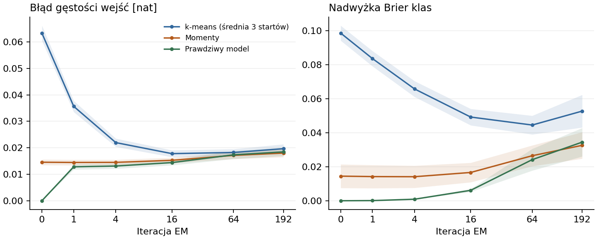

# Czy lepsze dopasowanie mieszaniny daje lepszy podział na klasy?

Przy słabym sygnale wybór startu oraz iteracji EM na osobnych 1024 nieetykietowanych przykładach obniżył nadwyżkę Brier z **0,07120 do 0,01731**. Poprawa na 12 niezależnych bankach wyniosła **0,05389 [0,01695; 0,09083]**. Tańsza inicjalizacja z momentów bez kolejnych iteracji osiągnęła jeszcze niższą średnią **0,01447**. Nawet start z dokładnych, prawdziwych parametrów po 192 iteracjach EM pogorszył wynik z zera do 0,03448. Na skończonej próbie dalsza poprawa treningowej wiarygodności może pogarszać posterior klasy mimo poprawnej rodziny modelu i najlepszego możliwego punktu początkowego.



Wykres pokazuje średnie i jeden błąd standardowy ze sparowanych banków przy 1024 przykładach i 40% nominalnej separacji klas. Skala pozioma to log(1 + numer iteracji). Trzy starty k-means uśredniono najpierw wewnątrz każdego banku. „Prawdziwy model” jest uprzywilejowaną diagnozą zachowania EM.

## Co faktycznie pomogło

Każdy kandydat ma dwie wielowymiarowe składowe Gaussa ze wspólną macierzą kowariancji. Jego posterior to pojedyncza sigmoida na sześciu surowych pomiarach. Uczące się warianty widziały wyłącznie wejścia docelowe i znały orientację przeciętnego sygnału. Dane testowe służyły do pomiaru nadwyżki Brier jako E[(p−q)²] dla prawdziwego posterioru q.

| Selekcja / inicjalizacja | Słaby sygnał, 1024 | Słaby sygnał, 4096 | Silny sygnał i zależna para, 1024 |
|---|---:|---:|---:|
| Trzy starty k-means, treningowa wiarygodność i próg przyrostu 0,001 | 0,07120 | 0,03854 | 0,00075 |
| Cztery starty, 192 iteracje i wybór na treningu | 0,05340 | 0,00516 | 0,00074 |
| Cztery starty × sześć iteracji, wybór przez wiarygodność na odłożonych wejściach | 0,01731 | 0,00441 | 0,00050 |
| Inicjalizacja z momentów, jeden krok M tworzący parametry | 0,01447 | 0,00273 | 0,00055 |
| Inicjalizacja z momentów + 192 dalsze iteracje | 0,03259 | 0,00510 | 0,00074 |
| Start w prawdziwym modelu + 192 iteracje | 0,03448 | 0,00515 | 0,00074 |
| Retrospektywne minimum dokładnego Brier w tej samej siatce modeli i na tej samej próbie testowej | 0,01030 | 0,00137 | 0,00041 |

Główny kontrast zmienia budżet, kandydatów oraz kryterium. Dodatkowa analiza tej samej siatki oddziela część efektów. Zmiana wyłącznie zbioru oceniającego z treningu na osobną walidację obniżyła stratę o 0,03609 [0,01040; 0,06178], porównując te same cztery starty i te same sześć punktów na każdej trajektorii. Rozszerzenie tej samej walidacyjnej selekcji trzech trajektorii k-means o start momentowy dało dalsze 0,01593 [0,00325; 0,02861]. Walidacja wybrała jego trajektorię w ośmiu z dwunastu banków. Są to analizy wtórne. Większy bank treningowy 4096 istotnie ograniczył średnie straty, ale momentowy start nadal wyglądał dobrze bez długiej optymalizacji.

## Ile o etykietach mówi gęstość wejść

W słabym sygnale, na 1024 przykładach, treningowa log-wiarygodność trajektorii startującej z prawdy poprawiła się od −8,48418 do −8,46725 nata na rekord. Jednocześnie populacyjny błąd gęstości wejść oszacowany na odłożonych przykładach wzrósł z 0 do 0,01846 nata, a warunkowy KL klas wzrósł z 0 do **0,11399**. W modelu momentowym Brier był najmniejszy przy pomiarze po czterech iteracjach (0,01413) i osiągnął 0,03259 w iteracji 192. To pokazuje koszt uczenia się szczegółów skończonej próbki. Żaden z tych pomiarów nie rozstrzyga, czy algorytm znalazł globalne maksimum.

Jeszcze mocniejsza kontrola zeruje separację średnich. Daje dokładnie ten sam rozkład X przy dowolnym priorze, a prawdziwa klasa dodatnia ma w tej próbie częstość 0,75. Przy 1024 obserwacjach walidacja nieetykietowanej gęstości dała nadwyżkę Brier 0,16809. Stała 0,5 ma tu stratę 0,0625, zaś stała 0,75 znająca prior osiąga 0. W tej sytuacji dodatkowe dane o samym X nie rozwiązują problemu. Implementacja zachowuje dokładnie równe średnie przy identycznych odpowiedzialnościach EM. Kontrola jednostkowa powtarza 192 kroki ze startu populacyjnego na wszystkich dwunastu seedach potwierdzenia.

## Odtworzenie

Progi treningowe i siatka zostały opublikowane przed obliczeniem. Implementacja wykonuje 192 aktualizacje każdego startu, aby zapisać porównywalne trajektorie. Standardowy komparator używa stanu z pierwszego kroku o przyroście ≤0,001; średnio zatrzymałby się po 5,58 przejściach w głównym warunku. Metoda walidacyjna wykorzystuje wszystkie cztery starty, po sześć stanów i dodatkowych 1024 nieetykietowanych rekordów. Komparator prawdy oraz ocena retrospektywna wymagają danych generatora. Modelowi z trenowalnymi parametrami nie udostępniamy etykiet celu.

Końcowe uruchomienie, łącznie z wykresem, trwało 25.94 s na CPU. Cztery wykonania oraz powtórzenia po kontroli numerycznej równości komponentów i dodaniu analiz wtórnych zajęły razem 106.44 s czasu obliczeń.

Plik trajectories.csv zawiera wszystkie opublikowane punkty, selections.csv wszystkie decyzje, a means.csv średnie z banków. Różnice logarytmicznych gęstości są estymatami Monte Carlo i mogą być lokalnie ujemne. Następny test wykorzysta małą, jawnie policzoną liczbę etykiet celu do rozstrzygnięcia między modelami o zbliżonej wiarygodności na samych wejściach.

```bash
PYTHONPATH="$PWD/fusionbench:$PWD/okapi" OPENBLAS_NUM_THREADS=1 OMP_NUM_THREADS=1 \
python -m fusionbench.eval.weak_mixtures --out weak-results
```

[Protokół sprzed obliczeń](https://github.com/damiankucharski/fusionbench/blob/1bf5327/docs/ensemble-study/weak-mixtures/protocol.md)
